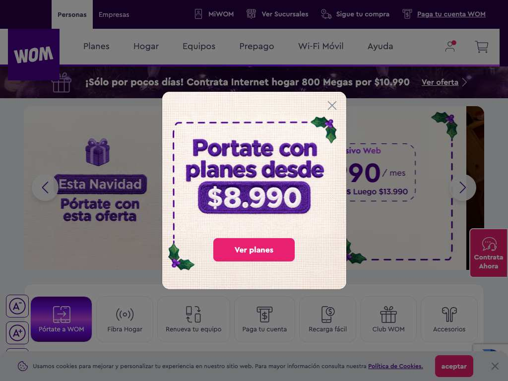
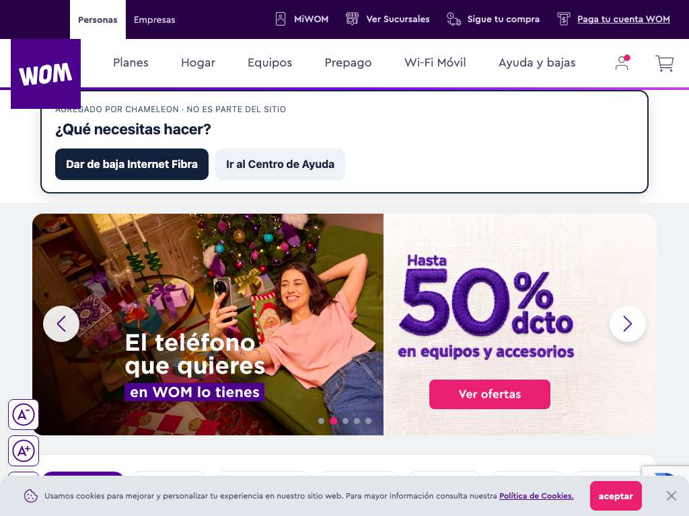
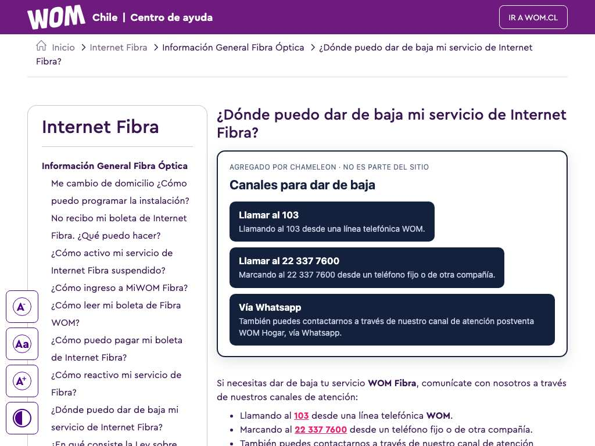
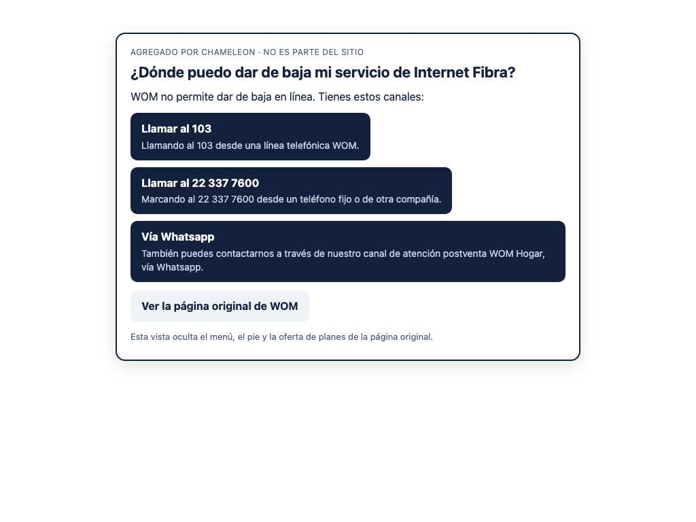
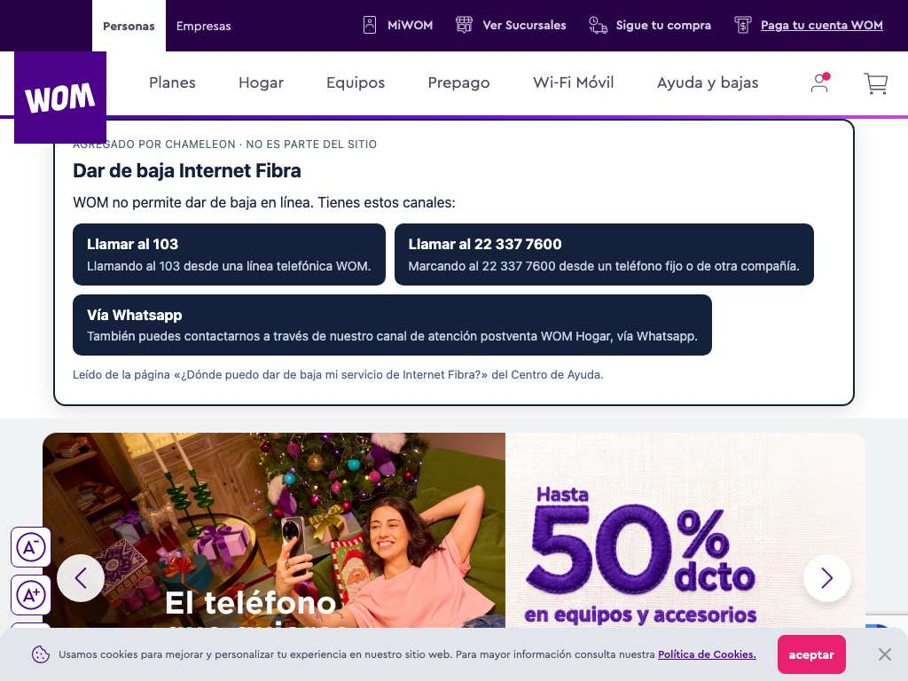
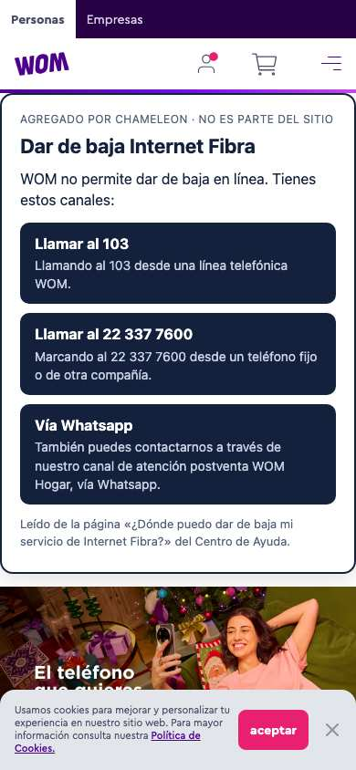
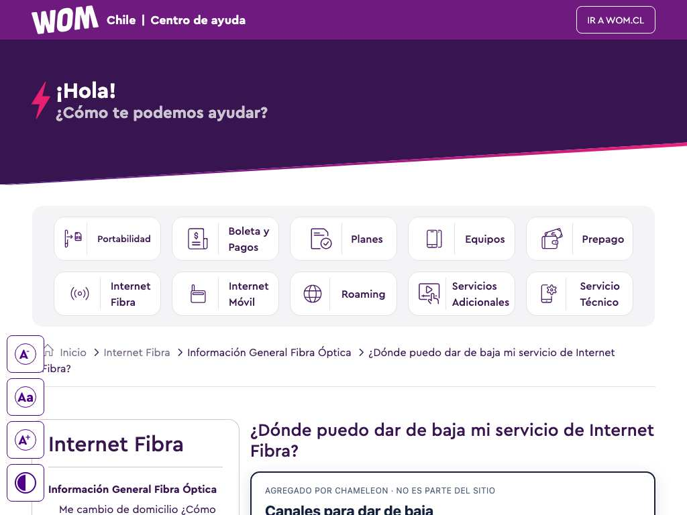

# Spike: ¿hasta qué nivel de cambio se puede modificar wom.cl sin romperlo? (2026-11-21)

Se usó la rama `docs/limpia-referencias-prototipo` (commit `e942ddc`), en un Mac con Chromium 156 sin ventana manejado
por Playwright 1.65. Se consultó [niveles de cambio](../docs/agents/niveles-de-cambio.md), que es el documento que
este spike pone a prueba, y los recorridos de atajo-explorer sobre wom.cl del 2026-11-21 (tres perfiles, los tres
lograron la tarea en 11 a 13 pasos y 41 a 50 segundos).

**Quién hizo de optimizador.** Claude, a mano. Leyó esos recorridos y sus capturas, escribió los parches como datos y
miró las capturas del resultado. No hay un agente optimizador construido. El script es
[2026-11-21-alcance-cambios-wom.py](2026-11-21-alcance-cambios-wom.py); los parches están en él, por nivel y por página, en `NIVELES`.

**La regla para decidir no se escribió antes de medir.** Es un spike de alcance, exploratorio: la pregunta era hasta
dónde se llega, no si se pasa un umbral.

## Respuesta corta

**En wom.cl se llegó hasta el nivel 5 sin romper la página.** Para la tarea «Encuentra cómo dar de baja tu servicio de
Internet Fibra», una ruta escrita a mano necesita 7 acciones en el sitio original, 4 con parches de datos y orden
(niveles 1 y 2), 1 con un componente de atajos (nivel 3) y 0 con una pieza que trae la respuesta a la portada
(nivel 5). La vista alternativa (nivel 4) no ahorra ninguna acción respecto del nivel 3 y es la que más contenido
esconde: 45 enlaces.

**El documento de niveles se sostiene en lo principal:** el nivel 3 es el mejor equilibrio. Pero el spike encontró
siete cosas que el documento no dice o dice mal, y dos de ellas son fallos silenciosos: un cambio que el programa da
por aplicado y que en la pantalla no ocurrió.

**Lo que no quedó demostrado.** Que esto ayude a un agente o a una persona: las rutas son guiones fijos, no intentos.
Que funcione en un sitio con React: wom.cl usa jQuery y Bootstrap, el caso fácil. Que funcione desde la extensión, que
corre en Firefox y en un script de contenido; aquí se usó Chromium y el código corrió en la página.

## Evidencia

Todo sale de una corrida del 2026-11-21 a las 05:17, guardada en
[resultados.json](2026-11-21-alcance-cambios-wom/resultados.json). Fueron tres corridas en total, unas 60 cargas de
página; las dos primeras sirvieron para corregir los parches y se cuentan más abajo. Cada número es de **una** ejecución,
no de una tanda.

### Qué se cambió en cada nivel

| Nivel | Portada | Categoría «Internet Fibra» | Artículo de la baja |
|---|---|---|---|
| 1 · Parche de datos | Cerrar el popup; ocultar la huincha de oferta y el botón flotante «Contrata Ahora»; renombrar «Ayuda» a «Ayuda y bajas» | Ocultar el saludo con buscador y la rejilla de categorías | Ocultar lo mismo, y el párrafo «Recuerda que siempre tenemos los mejores planes…» |
| 2 · Reordenar y resaltar | Resaltar «Ayuda y bajas» | Pulsar «VER MÁS», subir la pregunta de la baja al primer lugar y resaltarla | — |
| 3 · Componentes | Pieza de atajos con «Dar de baja Internet Fibra» | (igual que el 2) | Pieza con un botón por canal: «Llamar al 103», «Llamar al 22 337 7600», «Vía Whatsapp» |
| 4 · Vista alternativa | (igual que el 3) | (igual que el 2) | Se oculta toda la página y queda una sola tarjeta con los tres canales y «Ver la página original de WOM» |
| 5 · Entre páginas | Pieza que lee el artículo de la baja y muestra los tres canales en la portada | — | — |

El aviso de cookies no se tocó en ningún nivel: es un consentimiento, un elemento protegido.

### Acciones hasta ver los dos teléfonos de la baja

Una ruta escrita a mano por nivel, desde la portada, en una sesión nueva. Cuenta clics y scrolls. Demostrado, sobre una
ejecución por fila.

| Nivel | Pantalla | Acciones | Cuáles |
|---|---|---|---|
| Original | 1024×768 | **7** | Cerrar popup, «Ayuda», «Ir al Centro de Ayuda», «Internet Fibra», scroll, la pregunta, scroll |
| 1 y 2 | 1024×768 | **4** | «Ayuda y bajas», «Ir al Centro de Ayuda», «Internet Fibra», la pregunta |
| 3 | 1024×768 | **1** | «Dar de baja Internet Fibra» |
| 4 | 1024×768 | **1** | «Dar de baja Internet Fibra» |
| 5 | 1024×768 | **0** | Los canales ya están en la portada |
| 4 | 390×844 | **1** | Igual |
| 5 | 390×844 | **0** | Igual |

Como referencia, los tres agentes de atajo-explorer usaron de 11 a 13 pasos en el sitio original, porque buscaron en
vez de ir directo. Los dos números no se comparan: uno es un guion y el otro son intentos.

| Original | Nivel 3, portada | Nivel 3, artículo |
|---|---|---|
|  |  |  |

| Nivel 4, artículo | Nivel 5, portada | Nivel 5, celular |
|---|---|---|
|  |  |  |

### Si los cambios aguantan

Nueve parches probados uno por uno. Demostrado:

- **Los 9 se aplicaron completos** en escritorio, y los 9 seguían en pie tras 3 segundos, un scroll y un cambio de
  tamaño de la ventana.
- **Deshacer devolvió la página original en 7 de 9.** Los dos que no, llevan un cambio que pulsa algo (cerrar el popup,
  abrir «VER MÁS»): eso no se deshace.
- **«Ver la página original» funciona** en la vista de nivel 4: la muestra, vuelve a la vista, y al quitar el parche la
  página queda igual que antes.
- **El acoplamiento funciona:** pulsar «Vía Whatsapp» en la pieza pulsó el enlace original, que abrió
  `api.whatsapp.com/send/?phone=56937400691…` (la petición se cortó antes de salir). Los enlaces `tel:` no se probaron.
- **El sitio no pone trabas:** no envía política de seguridad de contenido, no exige *Trusted Types* y no usa React.

### Los siete hallazgos

**1. Un «ocultar» puede reportar éxito y no ocultar nada.** La primera versión ocultaba con una regla CSS
(`[data-mt-oculto]{display:none!important}`). Dos elementos siguieron a la vista: la huincha de oferta y la cabecera
del Centro de Ayuda. El sitio usa clases de Bootstrap (`.d-block`, `.d-flex`) que también llevan `!important` y ganan.
El aplicador dijo «aplicado» las dos veces; se supo por la captura. Con el estilo en línea ya no ocurre: 0 elementos
ocultos siguen visibles. La regla de la extensión es más específica y debería ganar, pero no se probó.

**2. Ocultar un popup no es cerrarlo.** Ocultar el popup de la portada y su fondo deja la página sin scroll, porque
Bootstrap bloquea el `body` mientras cree que el popup está abierto. Hay que pulsar su «X». Demostrado.

**3. Una lista mal acotada pasa todas las comprobaciones.** El primer localizador de los canales
(`#titulo-entrada ul > li`) encontró 11 elementos en vez de 3: sumó los ocho temas del formulario de valoración. La
pieza se dibujó con 11 botones y el aplicador dijo «aplicado». De nuevo, se supo por la captura. Demostrado.

**4. «Entero o nada» choca con lo que aparece a veces.** El popup sale una vez por sesión. Un parche que exige
cerrarlo falla en la segunda visita, y con la regla del documento no se aplicaría nada. Hubo que marcar ese cambio como
opcional. En celular pasó algo parecido: «Ayuda» aparece dos veces, el localizador encontró 2 y el renombre falló en
las dos rutas de celular. Demostrado.

**5. Rol y nombre alcanzan para lo que se pulsa o se lee, no para los contenedores.** De los 9 controles y textos, 8 se
encontraron por rol y nombre y 1 necesitó `css` para desempatar («VER MÁS» aparece cinco veces). Los 11 contenedores
(la cabecera, el pie, el buscador, la rejilla, la lista de canales) se encontraron solo por `css`: no tienen rol ni
nombre. Demostrado, en este sitio.

**6. El inventario hace falta, y por texto se equivoca.** Sirvió: mostró que el nivel 1 de la portada esconde dos
canales de contacto («¿Te llamamos?» y «Quiero chatear») que venían dentro del botón «Contrata Ahora», y que la vista
de nivel 4 esconde 45 enlaces, entre ellos los controles de accesibilidad del sitio (tamaño de letra y contraste). Pero
contó «Ayuda» como perdido cuando solo se había renombrado. Demostrado.

**7. La regla «la pieza nunca envía una petición» impide el cambio que más ahorra.** El nivel 5 de este spike pide el
artículo de la baja al mismo sitio, sin credenciales, y lee de él los tres canales. Funcionó a la primera y deja la
tarea en 0 acciones. El atajo del nivel 3 tiene el mismo roce en chico: navega a una dirección que la portada no
enlaza, que el optimizador conoce por los recorridos. Demostrado que se puede; no demostrado que convenga.

### Lo que el documento no menciona y el spike necesitó

| Hizo falta | Para qué | En el documento |
|---|---|---|
| `press`: pulsar un elemento al aplicar | Cerrar el popup, abrir «VER MÁS» | No está. No se puede deshacer. |
| `optional` en un cambio | El popup que sale a veces | No está. Contradice «entero o nada». |
| Leer una lista (`each`) | Un botón por canal | `reads` solo lee un elemento. La plantilla `vista` de la extensión ya lee listas (`items`). |
| Navegar a una dirección (`go`) | El atajo de la portada | Las acciones solo permiten pulsar lo que hay en la página. |
| Leer de otra página (`from`) | Nivel 5 | Prohibido por la sección 3. |
| Texto propio del optimizador | «WOM no permite dar de baja en línea» | Es una inferencia de Claude; la página no lo dice así. El documento pide que la pieza no parezca del sitio, pero no dice qué puede afirmar. |

### Suposiciones

- **Supuesto:** que menos acciones en un guion es menos dificultad para una persona. No se midió.
- **Supuesto:** que el costo de generar estos parches es bajo. No se midió ni tiempo ni tokens. Sí se vio que hicieron
  falta tres corridas y mirar las capturas para dejarlos bien.
- **Supuesto:** que los parches duran. Se probaron el mismo día en que se escribieron.

## Qué decidimos

Es una propuesta para el equipo; nadie más la revisó.

1. **El nivel 3 es el objetivo, como dice el documento.** En esta tarea da casi todo el ahorro (de 7 acciones a 1) y no
   esconde nada que no se haya decidido esconder. El nivel 4 no aporta acciones y esconde 45 enlaces: solo vale para
   páginas donde el problema es el ruido, no el camino.
2. **Ningún cambio se da por aplicado sin comprobar el resultado.** Después de aplicar, el motor comprueba que lo
   ocultado no se ve, que la página sigue teniendo scroll y que una lista tiene la cantidad esperada (el parche la
   declara). Y el optimizador mira una captura antes de proponer. Dos de los siete hallazgos solo se vieron así.
3. **Ocultar se hace con estilo en línea e `!important`**, o con una regla más específica que las del sitio, probada.
4. **El formato de parche suma cuatro cosas:** `press`, `optional`, lectura de listas y la cantidad esperada. El
   documento de niveles y [formas de datos](../docs/formas-de-datos.md) se corrigen con esto.
5. **«Entero o nada» pasa a ser por grupo de cambios**, no por parche: lo opcional puede faltar; lo demás, no.
6. **Los controles de accesibilidad y los canales de contacto del sitio entran a la lista de elementos protegidos.**
7. **El inventario compara elementos, no textos.**

Queda sin resolver, y lo decide el equipo:

- **¿Una pieza puede leer otra página del mismo sitio?** Es lo que más ahorra y rompe una regla. Una salida intermedia:
  permitirlo solo para leer, sin credenciales, y solo de direcciones que aparecen en los recorridos.
- **¿Qué puede afirmar una pieza con palabras propias?** «WOM no permite dar de baja en línea» ayuda, y es de Claude.
- **¿Se ocultan las ofertas?** Aquí se ocultó la oferta que WOM pone antes de los canales de baja. Mejora la tarea y es
  una decisión sobre contenido ajeno.

Lo que sigue, si se quiere cerrar lo no demostrado: repetir con la plantilla `vista` de la extensión en Firefox, probar
un sitio con React (los spikes 1 y 2 del documento de niveles) y medir las cinco variantes con agentes en vez de
guiones.
