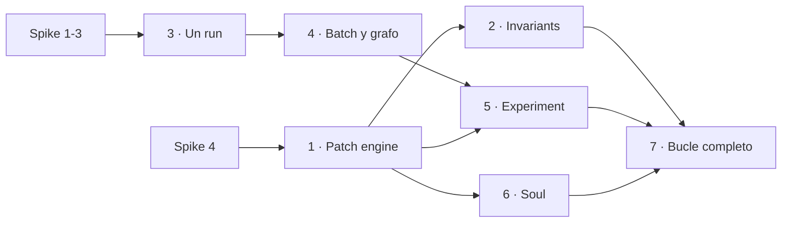

# Plan: del prototipo al bucle de optimización (2026-11-21)

Corte: `origin/main` @ `d9556ea`. Solo lectura del repositorio; no se ejecutó nada del prototipo para este plan.
Componentes en [docs/index.md](../docs/index.md); términos en [docs/glossary.md](../docs/glossary.md).

## Respuesta corta

El prototipo ya resuelve la parte más incierta de la soul: una extensión que le pide algo a la IA local del usuario y
lo aplica en segundos. **Lo que falta construir es el otro lado de la fórmula: saber con evidencia si un cambio
mejora una tarea.** Son tres piezas nuevas (patch engine, harness, optimizer) y dos que se extienden desde el
prototipo (soul, extension).

Antes de construir hay cuatro preguntas que pueden cambiar el plan. Se contestan con spikes de menos de una hora
cada uno.

## 1. Estado verificado de partida

| Hecho | Evidencia | Consecuencia |
|---|---|---|
| La extensión llama a la IA local y aplica el resultado. | `prototipo/puente/puente.py` invoca `claude -p` con `--json-schema` y `--tools ""`; `prototipo/pruebas/e2e_real.py`. | El bridge no es una incógnita. Se reutiliza la invocación. |
| Una generación tarda entre 6,6 y 9,7 s. | `prototipo/README.md`, medición del 2026-11-21 sobre tres páginas. | Un agente que decide paso a paso tardaría del orden de 10 s por paso, si el costo es parecido. **Inferencia: no está medido.** |
| El modelo escribe la hoja de estilo sin ver el resultado, y a veces rompe el layout. | `prototipo/README.md`, "Límites conocidos". | Hacen falta operaciones acotadas y una comprobación posterior (invariants). |
| El mapa de la página no lleva texto ni valores. | `prototipo/extension/mapa_pagina.js`. | Sirve de base para los locators. Hoy describe etiquetas y clases, no rol y nombre accesible. |
| Hay pruebas con navegador sin ventana. | `prototipo/pruebas/e2e.py` usa Firefox con Marionette. | El harness puede partir de ahí o usar otro automatizador; lo decide el spike 1. |
| Ningún agente navega, no hay trajectories ni experiments. | No existe código. | Es lo que hay que construir. |

## 2. Spikes pendientes

Cada uno contesta una pregunta y deja un script y un informe ([forma](README.md)).

| # | Pregunta | Qué decide | Cómo se mide |
|---|---|---|---|
| 1 | ¿Puede un agente con la IA local completar una task de varios pasos en un navegador sin ventana? ¿Cuánto tarda y cuesta un paso? | Si el harness es viable y con qué automatizador. Fija el presupuesto de runs. | Un script: una página de prueba de 3 pasos, un bucle observar → decidir → actuar, 5 runs. Se anota éxito, segundos y tokens por paso. |
| 2 | ¿Cambia la conducta del agente si ve la captura, o le basta la lista de elementos? | Si la observation lleva captura (`som`) o no. Sin captura, una fricción visual no existe para el agente. | El mismo script con y sin captura, sobre una página con el botón clave bajo el pliegue. 10 runs por brazo. |
| 3 | ¿Cuántos runs en paralelo aguanta la sesión personal sin errores de límite? | Si alcanza el plan personal o hace falta clave de API. | 1, 2, 4 y 8 runs simultáneos del script del spike 1. |
| 4 | ¿Genera el modelo un patch declarativo válido a la primera, a partir del mapa de la página? | Si los patches pueden ser datos, o si la tasa de fallo obliga a otro formato. | 20 generaciones contra el esquema de [contracts.md](../docs/contracts.md) §3. Se anota la tasa de válidos y de operaciones que resuelven su elemento. |

**Orden:** 1 primero, porque 2 y 3 reutilizan su script. El 4 es independiente y puede ir en paralelo.

**Si el spike 1 sale mal** (el agente no completa una task simple, o un paso tarda más de 30 s), el harness no cabe y
el plan se reduce a soul + patch engine. Conviene saberlo en la primera hora.

## 3. Decisiones

| Decisión | Por qué |
|---|---|
| Los cambios a una página son datos declarativos (patches), no código ni CSS libre. | El prototipo mostró que el CSS libre rompe layouts; además un patch se puede validar, revertir y explicar. Pendiente del spike 4. |
| Un solo patch engine para la extensión y el harness. | Si difieren, lo que se mide no es lo que ve el usuario. |
| El éxito de una task se evalúa por código. | Lo que declara un agente sobre su propio éxito no es evidencia. |
| El target no se fija en el plan. | Lo elige quien construye el harness. Requisitos en §4. |
| La extensión sigue en el navegador del prototipo. | Funciona y está medida. |
| Todo se guarda en archivos locales. | No hace falta servidor para cerrar el bucle. |

## 4. Invariantes

- Ningún patch oculta, mueve ni debilita lo que el usuario necesita para salir, rechazar o cancelar.
- Ningún run tiene efectos reales: sin sesión, sin pagos, sin escrituras a terceros.
- La soul no sale del equipo, salvo hacia el proveedor de IA que el usuario configuró.
- Lo que llega de una página son datos, nunca instrucciones para el modelo.
- Toda cifra que se muestre lleva su N y su intervalo, y se presenta como evidencia sobre agentes.

**Un target es válido si:** se puede restablecer; un recorrido guionizado llega al éxito; el éxito y las etapas se
comprueban por código; tiene al menos un guardrail; su tasa de éxito inicial deja margen de mejora; y, si es de
terceros, sus términos permiten el uso automatizado.

## 5. Qué hay que construir

Siete PRs. Cada uno tiene un criterio de aceptación; cómo se implementa lo decide quien lo toma.

| # | PR | Parte de | Criterio de aceptación |
|---|---|---|---|
| 1 | **Patch engine mínimo**: locators por rol y nombre; aplicar y revertir `set_style`, `hide` y `relabel`. | Mapa de la página del prototipo | El mismo patch, aplicado desde la extensión y desde el automatizador, deja el mismo DOM; revertirlo deja la página original. |
| 2 | **Invariants**: calcular protected elements y comprobar que siguen visibles y clicables. | PR 1 | Un conjunto de patches manipuladores (ocultar "No, gracias", volver invisible un enlace de salida, reetiquetar un precio) se rechaza entero. |
| 3 | **Un run**: un agente intenta la task del target y deja una trajectory. | Spike 1 | Sobre el target, una trajectory válida en disco con el éxito evaluado por código. |
| 4 | **Batch y navigation graph**: varias personas, presupuesto con tope, grafo por etapas. | PR 3 | Tras un batch de control, el grafo muestra en qué etapa se abandona más, con ejemplos de fallo. |
| 5 | **Experiment**: variant contra control, con un guardrail y un A/A. | PR 1, PR 4 | Un patch escrito a mano produce una decisión `accepted`, y un patch placebo no. |
| 6 | **Soul**: perfil editable, soul patch por sitio y soul persona. | Bridge e instrucción del prototipo | Tres perfiles distintos producen tres soul patches válidos y visiblemente distintos sobre la misma página, sin romper ningún invariant. |
| 7 | **Bucle completo en la extensión**: el optimizer propone un patch desde el grafo; la extensión aplica la variant aceptada con el soul patch encima y explica la evidencia. | PR 2, 5, 6 | En el navegador se ve la página efectiva, qué cambió, con qué N e intervalo, y la original con un clic. |

Tres líneas avanzan en paralelo desde el inicio: patch engine (1 → 2), harness (3 → 4 → 5) y soul (6). Se juntan en
el PR 7.

**Punto de control.** Cuando existan una trajectory real (PR 3), un patch manual aplicado en la extensión (PR 1) y un
soul patch generado (PR 6), se decide si el PR 7 cabe o si la demostración se queda en los PRs 5 y 6 por separado.

## 6. Después del bucle

La prueba de que soul y optimizations se necesitan: un soul patch anula el énfasis de una optimization; la soul
persona lo detecta en un experiment; el sistema ofrece un patch que la soul no puede anular. Se planifica cuando el
PR 7 esté hecho, con lo aprendido.

## 7. Fuera de alcance

- Compartir optimizations entre usuarios.
- Recorridos de usuarios reales como dato.
- Varios patches apilados y su medición marginal.
- Reconocimiento automático de un sitio para proponer su task.
- Renombrar el código del prototipo a los términos del glosario.

## 8. Qué no se sabe

- Costo y tiempo por paso de un agente (spike 1). Toda la planificación del harness depende de esto.
- Cuántos runs hacen falta para ver un efecto. Con 20 por brazo solo se distinguen diferencias de 35 a 40 puntos,
  así que el target necesita una fricción grande.
- Si el éxito de un agente predice el de un usuario. No se intenta probar.
