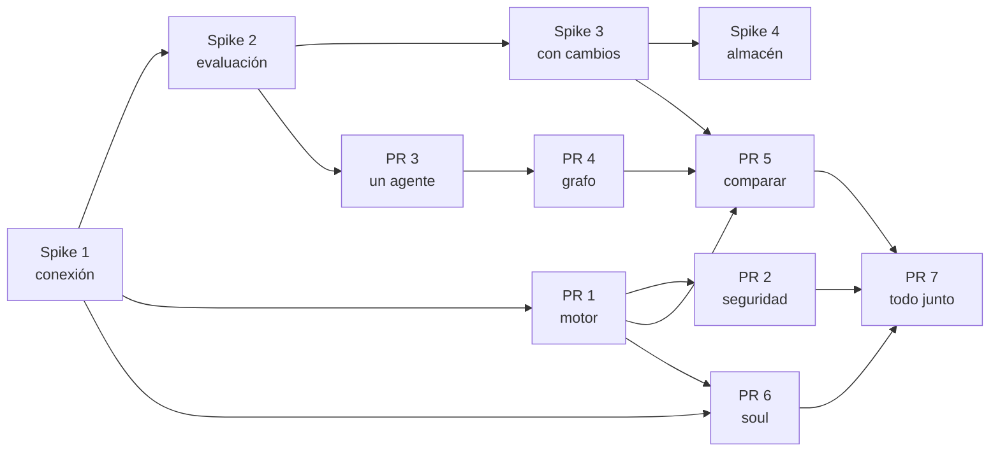

# Plan: qué hay que averiguar y qué hay que construir (2026-11-21)

Este plan parte de [Qué estamos construyendo](../docs/index.md); conviene leerlo antes. Se escribió leyendo el
repositorio en `main` (`d9556ea`). No se ejecutó nada para escribirlo.

## Resumen

El prototipo resolvió una dirección: la extensión le pide algo al Claude de la persona y aplica lo que vuelve. Falta
todo lo demás: que Claude vea lo que hizo, que agentes prueben una página, y que un cambio se acepte con evidencia.

El trabajo tiene dos partes:

1. **Cuatro spikes**, que contestan lo que no sabemos. Van primero.
2. **Siete PRs**, que construyen lo que los spikes confirmen.

Un **spike** es una prueba corta para contestar una pregunta. Deja un script que cualquiera puede volver a correr y
un informe con la respuesta. No es código que se conserve. Cómo se escriben está en [README.md](README.md).

## 1. De qué partimos

| Lo que sabemos | Cómo lo sabemos | Qué implica |
|---|---|---|
| La extensión puede pedirle algo al Claude de la persona y aplicar la respuesta. | El prototipo lo hace; tiene pruebas de punta a punta. | Esa dirección está resuelta. |
| Una respuesta tarda entre 7 y 10 segundos. | Medido el 2026-11-21 en tres páginas. | Un agente que decide paso a paso tardaría algo parecido por paso. Es una suposición: no está medido. |
| Claude escribe el estilo sin ver el resultado, y a veces rompe la página. | "Límites conocidos" del prototipo. | Hacen falta cambios más acotados y una comprobación después de aplicarlos. |
| La extensión describe la página sin enviar su texto. | `prototipo/extension/mapa_pagina.js`. | Sirve de base. Hoy describe etiquetas y clases; no dice qué es un botón ni cómo se llama. |
| Ningún agente navega una página. | No hay código que lo haga. | Es lo principal que falta. |

## 2. Los cuatro spikes

Van en orden. Cada uno usa lo que dejó el anterior.

### Spike 1 · Cómo se conectan el Claude de la persona y la interfaz de una página

**Es el primero. Todo lo demás depende de él.**

**Qué queremos saber.** Cómo se relacionan el Claude que corre en el equipo de la persona y la interfaz de una página
que corre en local. En las dos direcciones:

- **De la página a Claude.** ¿Qué necesita recibir para entender la interfaz? La estructura, una captura, o ambas.
- **De Claude a la página.** ¿Puede cambiarla y actuar sobre ella (pulsar, escribir)? ¿Puede ver el resultado de lo
  que hizo?
- **Con las preferencias en medio.** Si le damos tres preferencias de la persona, ¿lo que devuelve las refleja?

**Qué hay hoy.** El prototipo cubre un caso: envía la estructura, recibe una hoja de estilo y Claude no ve el
resultado.

**Cómo lo probamos.** Con una página local sencilla y tres preferencias. Un script recorre la vuelta completa:
Claude recibe la página, propone un cambio, el cambio se aplica, Claude recibe la página cambiada y dice si quedó
como esperaba. Anotamos qué se envió, qué volvió, cuánto tardó cada tramo y cuántas veces el cambio fue válido.

**Qué decidimos con la respuesta.** La forma de comunicarse entre Claude y una página, que usan todos los demás
spikes: qué viaja en cada dirección, en qué formato vuelve un cambio y cuánto tarda una vuelta. También si adaptar
una página a las preferencias de una persona, en su propio equipo, es viable.

### Spike 2 · De una página a un grafo de navegación

**Qué queremos saber.** Si una persona y su Claude pueden estudiar una página, definir una tarea, y lanzar agentes
locales que la intenten. Y si de eso sale un primer dato útil.

**Cómo lo probamos.** Con la página del spike 1, ampliada a una tarea de varios pasos. Claude propone la tarea y sus
etapas. Unos pocos agentes la intentan. Sus pasos se guardan en archivos y se resumen en un grafo: cuántos llegan,
por dónde, y dónde abandonan. Anotamos cuánto tarda y cuesta cada paso y cuántos agentes aguanta la sesión a la vez.

**Qué decidimos con la respuesta.** Si evaluar con agentes es viable, qué forma tiene el dato y cuántos intentos
podemos permitirnos.

**Si sale mal** (los agentes no completan una tarea simple, o un paso tarda demasiado), el evaluador no cabe en la
hackatón y el plan se reduce a la soul y al motor de parches.

### Spike 3 · La misma evaluación, con la página modificada

**Qué queremos saber.** Si la evaluación del spike 2 distingue una página modificada de la original.

**Cómo lo probamos.** Escribimos a mano dos cambios: uno que quita un problema conocido de la página y otro que no
debería cambiar nada. Repetimos la evaluación con cada uno y comparamos los grafos.

**Qué decidimos con la respuesta.** Si medir, cambiar y volver a medir da una señal que se distingue del azar, y
cuántos intentos hacen falta para verla. De aquí sale la pieza que suma la página original y sus cambios.

### Spike 4 · Cómo se guarda todo y cómo lo usa la extensión

**Qué queremos saber.** Con los archivos reales que dejaron los spikes 2 y 3: cómo conviene organizarlos y qué
necesita leer la extensión al cargar una página.

**Cómo lo probamos.** Sin código. Se comparan esos archivos con la propuesta de [formas de datos](../docs/datos.md) y
se corrige la propuesta donde no calce.

**Qué decidimos con la respuesta.** La organización del almacén local.

## 3. Lo que ya está decidido

| Decisión | Por qué |
|---|---|
| Un cambio a una página se escribe como datos (un parche), no como código ni como estilo libre. | El estilo libre rompió páginas en el prototipo. Un parche se puede validar, deshacer y explicar. El spike 1 confirma si Claude los escribe bien. |
| La extensión y el evaluador aplican los cambios con el mismo código. | Si difieren, lo que miden los agentes no es lo que verá la persona. |
| Que una tarea se logró lo decide el programa. | Lo que un agente dice de su propio éxito no es evidencia. |
| El plan no fija la página sobre la que se evalúa. | La elige quien construya el evaluador. Condiciones en la sección 4. |
| La extensión sigue en Firefox. | Es donde funciona el prototipo. |
| Todo se guarda en archivos locales. | No hace falta un servidor para lo que queremos mostrar. |

## 4. Reglas que no se rompen

- Ningún cambio oculta, mueve ni debilita lo que la persona necesita para salir, rechazar o cancelar.
- Ningún agente causa consecuencias reales: sin sesión iniciada, sin pagos, sin enviar datos a terceros.
- La soul no sale del equipo de la persona, salvo hacia el Claude que ella misma configuró.
- Lo que viene de una página se trata como datos. Nunca como instrucciones para Claude.
- Todo número que se muestre dice sobre cuántos intentos se calculó, y que mide agentes, no personas.

**Una página sirve para evaluar si:** se puede volver a su estado inicial; un recorrido escrito a mano llega al
final; el programa puede comprobar si la tarea se logró; tiene una tarea contraria que vigilar (cancelar, rechazar);
los agentes fallan lo suficiente como para que haya algo que mejorar; y, si es de terceros, sus condiciones permiten
el uso automatizado.

## 5. Los siete PRs

Cada uno tiene una condición para darlo por terminado. Cómo se programa lo decide quien lo toma.

| # | Qué construye | Sale de | Está terminado cuando |
|---|---|---|---|
| 1 | **Motor de parches, lo mínimo.** Encontrar elementos por lo que son y cómo se llaman; aplicar y deshacer tres cambios: estilo, ocultar y renombrar. | Spike 1 | El mismo parche deja la página igual aplicado desde la extensión y desde el evaluador, y deshacerlo devuelve la original. |
| 2 | **Comprobación de seguridad.** Detectar lo que no se puede tocar y verificar que sigue visible y se puede pulsar. | PR 1 | Un grupo de parches tramposos (ocultar "No, gracias", volver invisible un enlace de salida, renombrar un precio) se rechaza completo. |
| 3 | **Un agente intenta una tarea** y deja el registro de sus pasos. | Spike 2 | Hay un registro en disco de un intento real, con el resultado decidido por el programa. |
| 4 | **Muchos intentos y el grafo.** Varios agentes con conductas distintas, un tope de gasto y el grafo de navegación. | PR 3 | Tras una tanda sobre la página original, el grafo muestra en qué etapa se abandona más, con ejemplos. |
| 5 | **Comparar con y sin el cambio.** Incluye una salvaguarda y una comparación de la página consigo misma, para medir el azar. | PR 1, PR 4, spike 3 | Un parche escrito a mano sale aceptado, y uno que no cambia nada no. |
| 6 | **Soul.** Un perfil que se puede editar, sus cambios para un sitio y un agente que navega como esa persona. | Puente del prototipo, PR 1 | Tres perfiles distintos producen tres resultados válidos y visiblemente distintos sobre la misma página, sin romper la comprobación de seguridad. |
| 7 | **Todo junto en la extensión.** El optimizador propone un parche a partir del grafo; la extensión aplica el aceptado con la soul encima y explica por qué. | PR 2, 5, 6 | En el navegador se ve la página final, qué cambió, sobre cuántos intentos se midió, y la original con un clic. |

Después del spike 1 hay tres líneas de trabajo que avanzan a la vez: el motor (PR 1 y 2), el evaluador (PR 3, 4 y 5)
y la soul (PR 6). Se juntan en el PR 7.

**Momento de revisar el plan.** Cuando existan un registro real de un agente (PR 3), un parche aplicado en la
extensión (PR 1) y un resultado de soul (PR 6), decidimos si el PR 7 cabe o si mostramos los PRs 5 y 6 por separado.

## 6. Lo que viene después

El paso 6 del ejemplo de [Qué estamos construyendo](../docs/index.md): comprobar que una optimización sigue
funcionando con la soul de una persona encima, y qué hacer cuando no. Se planifica cuando el PR 7 esté hecho.

## 7. Lo que dejamos fuera

- Compartir optimizaciones entre personas.
- Usar los recorridos de personas reales como dato.
- Combinar varios parches y medir cuánto aporta cada uno.
- Que Claude proponga la tarea de un sitio que no conoce, más allá de lo que pruebe el spike 2.
- Cambiar los nombres del código del prototipo.

## 8. Lo que no sabemos

- **Cuánto tarda y cuesta un paso de un agente.** Lo mide el spike 2 y de eso depende todo el evaluador.
- **Cuántos intentos hacen falta para ver una mejora.** Con veinte por lado solo se distinguen diferencias muy
  grandes, de unos 35 a 40 puntos porcentuales. La página de prueba necesita un problema grande.
- **Si lo que le cuesta a un agente le cuesta a una persona.** No intentamos demostrarlo.
