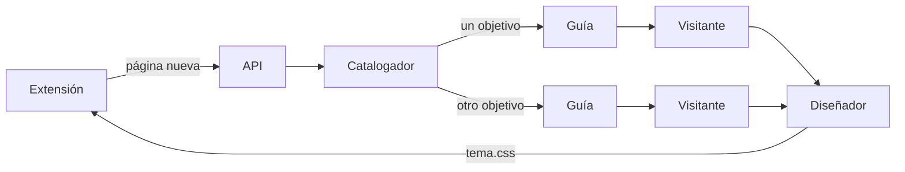

# Chameleon


**Los sitios web están hechos para el promedio. Chameleon los adapta para que cualquiera logre lo que vino a hacer.**

Una extensión de navegador aplica un tema sobre cada página, sin tocar el sitio original. El tema sale de agentes de
IA que recorren el sitio como lo haría una persona y encuentran dónde se pierde.

[chameleonmode.app](https://chameleonmode.app) · Platanus Hack 26: Santiago ft. Buk · Track 🔗 Multiplayer

## Cómo funciona

Cuando alguien visita una página que Chameleon aún no conoce, la API pide una **revisión**:



1. El **Catalogador** lee la página y elige qué viene a hacer la gente en ella.
2. Por cada objetivo, en paralelo, la **Guía** encuentra y verifica el camino con el DOM, y el **Visitante**, un
   usuario sintético que solo ve capturas, intenta recorrerlo.
3. El **Diseñador** escribe el tema con lo que aprendieron, y la extensión lo aplica para todos los que visitan esa
   página.

Cada paso queda en S3 y el estado de la revisión en DynamoDB, así que el [backoffice](backoffice/README.md) muestra
a los agentes trabajando mientras avanzan.

| Pieza | Qué es |
|---|---|
| [`extension/`](extension/README.md) | Extensión de Firefox y Chrome que aplica el tema de cada página |
| `backend/` | API de revisiones: dispara la revisión de una página y entrega su tema |
| [`backoffice/`](backoffice/README.md) | Visor de las revisiones y de los recorridos de los agentes |
| [`agents/app/conductor/`](agents/app/conductor/README.md) | Conductor: corre una revisión completa, etapa por etapa |
| [`agents/app/cataloger/`](agents/app/cataloger/README.md) | Catalogador: cataloga los objetivos de un sitio, clasificados |
| [`agents/app/guide/`](agents/app/guide/README.md) | Guía: encuentra y verifica la ruta de un objetivo, con el DOM y capturas |
| [`agents/app/visitor/`](agents/app/visitor/README.md) | Visitante: usuarios sintéticos que intentan un objetivo viendo solo capturas |
| [`agents/app/web_designer/`](agents/app/web_designer/README.md) | Diseñador: escribe el tema de la página |
| [`agents/app/summary/`](agents/app/summary/README.md) | Resumen de un sitio: la ruta de la Guía contra los intentos del Visitante |
| [`agents/app/runtime/`](agents/app/runtime/README.md) | Entrada de los agentes en AWS AgentCore |
| [`agents/shared/`](agents/shared/README.md) | Lo que comparten los agentes: almacén, navegador, Claude, nodos, DOM y catálogo |
| [`infra/`](infra/README.md) | Terraform y AgentCore: API, almacén, tabla, backoffice y runtime |

## Equipo

- Jorge Eduardo León Reyes ([@jorvan758](https://github.com/jorvan758))
- Brayan Moreno Avendaño ([@brayanmoreno](https://github.com/brayanmoreno))
- Rodrigo Elicer Krause ([@rodrigoelicer](https://github.com/rodrigoelicer))
- Ariel Ignacio Madariaga González ([@arielm-unholster](https://github.com/arielm-unholster))

## Desarrollo local

Requisitos: [`just`](https://github.com/casey/just) (`brew install just`), Node.js 22 o más reciente con npm, Firefox
(la extensión también corre en Chrome 148 o superior: `npm run dev:chrome`, ver [extension/README.md](extension/README.md))
y, para los pasos 4, 5, 6, 8 y 9, [Claude Code](https://claude.com/claude-code) con la sesión iniciada. Probado en macOS. Desde un
clon nuevo, en este orden:

```bash
just local setup                      # 1. once, after cloning: checks requirements, installs dependencies
just local up                         # 2. backend, backoffice (http://localhost:4848/backoffice/) and a separate Firefox with the extension, in the background
just local up sesion                  #    same, with a copy of your Firefox profile (made the first time)
just local down                       #    stops them (just local logs follows their logs)
just local test                       # 3. before pushing: every test that does not call Claude
just local catalog <url>              # 4. cataloger: goal catalog of a site (calls Claude)
just local guide <host>/<goal>        # 5. guide: reference route of a task in agents/tasks/ (calls Claude)
just local visit <url> "<task>"       # 6. visitor: synthetic users try a task on a site (calls Claude)
just local visit-tasks [wom|sii|dt]   #    visitor on the tasks in agents/tasks/ (calls Claude)
just local backoffice                 # 7. viewer of the visitor runs
just local revision <url>             # 8. the whole pipeline on one page: catalog, guide and visitor per goal, and tema.css (calls Claude)
just local site <url> [goals]         # 9. per site, without tema.css: catalog, guide and visitor per goal, and a summary (calls Claude)
just local summary <url>              #    rewrites that summary from the files on disk
```

Cada pull request a `main` corre las mismas pruebas en GitHub Actions ([`pruebas.yml`](.github/workflows/pruebas.yml)):
`npm run check` y `pytest` en cada proyecto de Python bajo `agents/` que tenga `tests/`, sin llamar a Claude ni a AWS.
El check **Todas las pruebas** tiene que pasar para mergear.

Los despliegues y las versiones de la extensión corren como GitHub Actions en el repo personal
[brayanmoreno/hackathon-grupo36](https://github.com/brayanmoreno/hackathon-grupo36), una copia de `main` de este
(ver [infra/README.md](infra/README.md)). Necesitan [`gh`](https://cli.github.com) con la sesión iniciada:

```bash
just sync                             # copies main to the personal repo now and follows the deploy, if any
just publish v0.3.0                   # signs that version of the extension and publishes it as a release
```

Corre `just local` para ver esta lista. Funciona desde cualquier carpeta del repo; los comandos están en
[`local/justfile`](local/justfile).

## En AWS

Los agentes corren en AgentCore, con Claude en Bedrock (`export AWS_PROFILE=<perfil>`). `just aws revision <url>`
revisa una página completa, igual que `just local revision <url>`, y muestra su avance; `just aws seed` siembra las
páginas de la demo. Todo se despliega solo al mergear a `main`: ver [el runtime](agents/app/runtime/README.md) y
[la infraestructura](infra/README.md).
