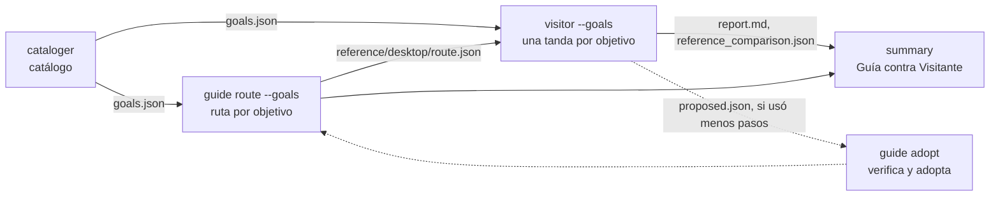
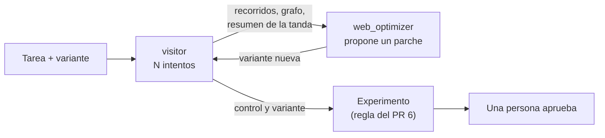

# Arquitectura de los agentes: directorios y AgentCore

**Qué es este documento.** Dónde va el código de los agentes en el repositorio, cómo se organiza como proyecto de
AgentCore y qué se pasan los agentes. Es para quien vaya a construirlos. Sale de la sección 5 del
[diseño del Visitante](evaluador.md), que allí se llama evaluador.

## Distribución de directorios

**Cada agente es una carpeta de `agents/app/` con un solo trabajo, y su despliegue en AgentCore vive en `infra/`.**
Se sigue la estructura que genera la CLI de AgentCore (`agentcore create`): una carpeta por agente dentro de `app/` y
una carpeta de configuración, `agentcore/`. Esa configuración está en `infra/agentcore/`, junto al resto de la
infraestructura; `infra/` es el proyecto de la CLI y apunta al código de `agents/app/`. El mismo código corre como
script en tu computador y en AgentCore.

```
agents/
  app/
    cataloger/                ← CATALOGA: recorre el sitio leyendo el DOM y clasifica sus objetivos
      main.py  cataloger/  tests/
    guide/                    ← GUÍA: encuentra y verifica la ruta de referencia de un objetivo, con DOM y capturas
      main.py  guide/  tests/
    visitor/                  ← VISITA: usuarios sintéticos que intentan un objetivo viendo solo capturas
      main.py  agentcore_app.py  visitor/  tests/
    summary/                  ← RESUME: compara, por objetivo, la ruta de la Guía con los intentos del Visitante
      main.py  summary/  tests/
  shared/                     ← lo que usan dos o más: almacén, navegador, Claude Code, nodos, DOM y catálogo
  tasks/                      ← tareas escritas a mano
  .runs/                      ← salidas de los agentes (fuera de git)
```

Cada carpeta de `app/` es un proyecto de uv que se corre con `uv run main.py` y depende de `agents/shared/` como
dependencia de ruta editable. Ningún agente importa la carpeta de otro: se comunican solo por archivos.

**Los agentes:**

| | `cataloger` (Catalogador) | `guide` (Guía) | `visitor` (Visitante) |
|---|---|---|---|
| **Qué hace** | Cataloga los objetivos de un sitio y los clasifica. | Encuentra la ruta de referencia de un objetivo, con sus pasos mínimos. | Intenta un objetivo con varios perfiles y mide cuántos lo logran. |
| **Qué ve** | El DOM de cada página. | El DOM de la página y capturas. | Solo capturas de lo visible. |
| **Qué puede hacer** | Recorrer enlaces del mismo sitio, sin enviar formularios. | Clic, escribir, elegir, teclas, atrás y scroll sobre elementos a la vista; no puede ir a una URL ni seguir un enlace a otro host. | Las nueve acciones de la sección 3 del [diseño](evaluador.md). |
| **Qué entrega** | `goals.json`: los objetivos clasificados. | `route.json`: la ruta verificada y la cita que la respalda. | Recorridos, árbol de rutas, comparación con la referencia y reporte. |
| **Quién decide** | Reglas sin modelo sobre lo que propone el modelo. | La repetición: la ruta vale si llega a la misma página y la cita está en ella. | El juez, no el agente. |

**La expectativa que ordena el producto:** cada objetivo pasa por separado por la Guía y por el Visitante, y la Guía,
que tiene herramientas web, debe lograrlo al menos igual de bien.

**Detalles:**

- **Nombres con guion bajo o una palabra.** Python no puede importar una carpeta con guion, y el nombre de un runtime
  de AgentCore tampoco lo acepta (patrón `[a-zA-Z][a-zA-Z0-9_]{0,47}`).
- **El runtime desplegado se llama `web_evaluator_image`.** Es una imagen: `infra/agentcore/agentcore.json` la
  construye con `agents/app/visitor/Dockerfile` y `agents/` como contexto, para que entre `agents/shared/`.
- **El Optimizador** se propone como `web_optimizer`.

## Flujo por sitio

**Cada objetivo evaluable de un sitio pasa por la Guía y por el Visitante, y un resumen los compara.** Se comunican
por archivos en `agents/.runs/`. El Catalogador decide en el catálogo qué objetivos se evalúan (`exclusion`) y con qué
tarea (`instruction`); la Guía y el Visitante solo lo leen. `just local site <url> <N>` corre todo.



La ruta de referencia es la más corta verificada entre las exploradas. Por eso la Guía busca una más corta después
de la primera, y un intento que usa menos pasos queda propuesto hasta que `adopt` lo verifica repitiéndolo. La
prominencia y la complejidad que salen de la ruta las calcula el resumen.

## Del Visitante al Optimizador

**Lo que deja el Visitante es lo que lee el Optimizador.** El Optimizador ya está en [la propuesta](../index.md)
(sección 3): lee el grafo de navegación, propone parches y le pide al Visitante que los mida. Los dos agentes forman
un ciclo:



**Cómo se invocaría el Visitante sobre una variante (propuesta):**

```
uv run main.py --task <id> --variant <id | control> --n <intentos> --profiles <ids> --model <id>
```

**Lo que entrega**, por tarea y variante, en `agents/.runs/`:

| Qué | Para qué le sirve al optimizador | Forma |
|---|---|---|
| Los recorridos, con la captura de cada paso | Ver qué tenía en pantalla un agente cuando se perdió | Formas de datos, sección 6, con los cambios de la sección 3 del [diseño](evaluador.md) |
| El grafo de navegación | Saber en qué etapa se abandona más | Formas de datos, sección 7 |
| El resumen de la tanda | Intentos, logrados, errores de puntería, costo y tiempo. Es lo que compara el experimento | Lo calcula el Visitante; el experimento es formas de datos, sección 8 |

**Reglas del contrato:**

- **Se comunican por archivos, no por llamadas.** En local, el Optimizador lee `agents/.runs/` y lanza el Visitante
  sobre la variante nueva. En AgentCore, el Optimizador invocaría al Visitante desplegado; es una propuesta, sin
  probar.
- **Una variante se identifica con su `id`** ([formas de datos](../formas-de-datos.md), sección 4), que sale de sus
  parches.
- **Las etapas salen de la tarea, no de los elementos.** Así el grafo de la variante se compara con el del control
  aunque un parche renombre u oculte un botón.
- **El Optimizador no decide solo.** Aplica la regla de aceptación del experimento (PR 6); no la inventa. Y una persona
  aprueba antes de que el parche quede activo.
- **Las reglas de la sección 2 del [diseño](evaluador.md) solo valen para el Visitante.** El Optimizador sí lee el DOM, porque para
  escribir un parche necesita localizar elementos. Lo que no puede hacer es medir su propio parche: eso lo hace
  siempre el Visitante.

**Sobre el nombre.** Se planteó "web refinator". "Refinator" no existe en inglés ("refiner" sí), y el glosario ya
llama Optimizador a esta pieza. Se propone `web_optimizer` para no tener dos nombres para lo mismo.

## Almacén

**Las salidas de los agentes tienen un solo árbol por sitio, igual en `agents/.runs/` y en S3.** Lo define el paquete
[`agents/shared/`](../../agents/shared/README.md) (`shared.store`): las claves, los ids de corrida, el manifiesto y
los backends local y S3.

```
<host>/
  cataloger/<run>/                       manifest.json outline.json goals.json goals.md
  guide/<goal>/<viewport>/<run>/         manifest.json route.json route.md step_00.png …
  visitor/<goal>/<run>/                  manifest.json criteria.json route_tree.json comparison.json report.md
      <profile>/                         run.json step_00.png … video.webm
  summary/<run>/                         manifest.json summary.json summary.md
```

`<run>` es el instante UTC de inicio y la última corrida es la última clave. Cada `manifest.json` dice qué es la
carpeta y de qué corridas viene.
