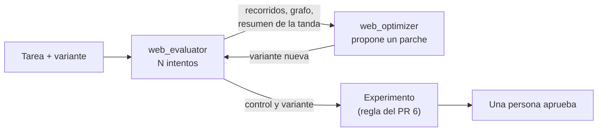

# Arquitectura de los agentes: directorios y AgentCore

**Qué es este documento.** Dónde va el código de los agentes en el repositorio, cómo se organiza como proyecto de
AgentCore y qué se pasan el evaluador y el optimizador. Es para quien vaya a construirlos. Sale de la sección 5 del
[evaluador](evaluador.md); el diseño del agente que mide está allí.

## Distribución de directorios

**Cada agente es una carpeta de `agents/app/` con sus herramientas, y su despliegue en AgentCore vive en `infra/`.**
Se sigue la estructura que genera la CLI de AgentCore (`agentcore create`): una carpeta por agente dentro de `app/` y
una carpeta de configuración, `agentcore/`. Esa configuración está en `infra/agentcore/`, junto al resto de la
infraestructura; `infra/` es el proyecto de la CLI y apunta al código de `agents/app/`. El mismo código corre de dos
formas: como script en tu computador y, cuando haga falta escalar, en AgentCore. Seguir esa estructura desde el
comienzo evita mover código al pasar de una a otra.

Así se ubica en el repositorio:

```
platanus-hack-26-cl-team-36/
  backend/  extension/                   ← lo que ya existe: la extensión y su servidor
  docs/  .specs/  .spikes/                ← documentación y pruebas cortas
  infra/agentcore/                        ← configuración de despliegue en AgentCore (ver infra/README.md)
  agents/                                 ← NUEVO: el código de los agentes
    app/
      web_evaluator/                      ← MIDE: agentes que usan la página solo con capturas
        main.py                           ← punto de entrada (script local hoy, AgentCore después)
        harness.py                        ← el ciclo: captura → Claude → acción → captura
        model/load.py                     ← qué Claude se usa
        tools/                            ← SOLO las nueve acciones que el agente puede pedir
        judge.py                          ← fuera de tools/ a propósito: lee la URL y el DOM
        profiles/                         ← un perfil de agente por archivo
      web_mapper/                         ← MAPEA: lee el DOM, cataloga los objetivos y sus rutas de referencia
        main.py                           ← punto de entrada: route y goals
        mapper/                           ← vista del DOM, exploración, verificación, esquema y catálogo
      web_optimizer/                      ← PROPONE: lee lo que deja el evaluador y escribe un parche
        main.py                           ← punto de entrada
        model/load.py                     ← qué Claude se usa
        tools/                            ← leer recorridos y grafo, leer el DOM, escribir un parche
    tasks/                                ← las tareas, compartidas por los dos agentes
    .runs/                                ← recorridos, capturas y resúmenes (fuera de git)
```

**Los agentes:**

| | `web_evaluator` | `web_mapper` | `web_optimizer` |
|---|---|---|---|
| **Qué hace** | Intenta una tarea N veces y mide cuántas veces se logra. | Cataloga los objetivos de un sitio y encuentra la ruta de referencia de cada uno, con sus pasos mínimos. | Lee dónde se pierden los agentes y propone un parche. |
| **Qué ve** | Solo capturas de lo visible. | El DOM de la página y capturas. | Recorridos, grafo y el DOM de la página. |
| **Qué puede hacer** | Las nueve acciones de la sección 3 del [evaluador](evaluador.md). | Clic, escribir, elegir, teclas y atrás sobre elementos a la vista; no puede ir a una URL. | Leer archivos de `.runs/` y escribir un parche. |
| **Qué entrega** | Recorridos, grafo y resumen de la tanda. | `goals.json`: los objetivos clasificados. `route.json`: la ruta verificada y la cita que la respalda. | Una variante nueva para que el evaluador la mida. |
| **Quién decide** | El juez, no el agente. | La repetición: la ruta vale si llega a la misma página y la cita está en ella. | La regla del experimento (PR 6) y una persona. |

**`tools/` contiene solo lo que el agente puede pedir.** El juez queda fuera de esa carpeta a propósito. Así las
reglas 2 y 3 de la sección 2 del [evaluador](evaluador.md) se ven en la estructura: si algo está en `tools/`, el agente lo puede usar, y nada que lea
la URL o el DOM puede estar ahí.

**Detalles:**

- **`web_evaluator`, con guion bajo.** Python no puede importar una carpeta con guion, y el nombre de un runtime de
  AgentCore tampoco lo acepta (patrón `[a-zA-Z][a-zA-Z0-9_]{0,47}`).
- **En el avance 1 no existe `infra/agentcore/`.** `main.py` se corre como un script de Python, pero conviene
  escribirlo desde ya cumpliendo el contrato HTTP que espera AgentCore Runtime, para que el avance 5 sea desplegar y
  no reescribir. La CLI acepta código fuera de su proyecto: `infra/agentcore/agentcore.json` apunta a
  `../agents/app/web_evaluator`.
- **La plantilla de AgentCore usa Strands, pero no es obligatorio.** AgentCore Runtime acepta cualquier código. Lo que
  importa es que el ciclo cumpla las tres reglas de la sección 2 del [evaluador](evaluador.md).

En el glosario siguen siendo "Evaluador" y "Optimizador"; en el código se proponen `web_evaluator` y `web_optimizer`.
Se decide junto con la pregunta "¿Qué nombres se usan?" del plan (sección 6).

## Del evaluador al optimizador

**Lo que deja el evaluador es lo que lee el optimizador.** El optimizador ya está en [la propuesta](../index.md)
(sección 3): lee el grafo de navegación, propone parches y le pide al evaluador que los mida. Los dos agentes forman
un ciclo:



**Cómo se invoca el evaluador:**

```
python agents/app/web_evaluator/main.py --task <id> --variant <id | control> --n <intentos> \
    --profile <id> --viewport <ancho>x<alto> --model <id>
```

**Lo que entrega**, por tarea y variante, en `agents/.runs/`:

| Qué | Para qué le sirve al optimizador | Forma |
|---|---|---|
| Los recorridos, con la captura de cada paso | Ver qué tenía en pantalla un agente cuando se perdió | Formas de datos, sección 6, con los cambios de la sección 3 del [evaluador](evaluador.md) |
| El grafo de navegación | Saber en qué etapa se abandona más | Formas de datos, sección 7 |
| El resumen de la tanda | Intentos, logrados, errores de puntería, costo y tiempo. Es lo que compara el experimento | Lo calcula el evaluador; el experimento es formas de datos, sección 8 |

**Reglas del contrato:**

- **Se comunican por archivos, no por llamadas.** En local, el optimizador lee `agents/.runs/` y lanza el evaluador
  sobre la variante nueva. En AgentCore, el optimizador invocaría al evaluador desplegado; es una propuesta, sin
  probar.
- **Una variante se identifica con su `id`** ([formas de datos](../formas-de-datos.md), sección 4), que sale de sus
  parches.
- **Las etapas salen de la tarea, no de los elementos.** Así el grafo de la variante se compara con el del control
  aunque un parche renombre u oculte un botón.
- **El optimizador no decide solo.** Aplica la regla de aceptación del experimento (PR 6); no la inventa. Y una persona
  aprueba antes de que el parche quede activo.
- **Las reglas de la sección 2 del [evaluador](evaluador.md) solo valen para él.** El optimizador sí lee el DOM, porque para escribir un parche
  necesita localizar elementos. Lo que no puede hacer es medir su propio parche: eso lo hace siempre el evaluador.

**Sobre el nombre.** Se planteó "web refinator". "Refinator" no existe en inglés ("refiner" sí), y el glosario ya
llama Optimizador a esta pieza. Se propone `web_optimizer` para no tener dos nombres para lo mismo.

## Almacén

**Las salidas de los agentes tienen un solo árbol por sitio, igual en `agents/.runs/` y en S3.** Lo define el paquete
[`agents/shared/`](../../agents/shared/README.md) (`shared.store`): las claves, los ids de corrida, el manifiesto y
los backends local y S3.

```
<host>/
  cataloger/<run>/                       manifest.json outline.json goals.json goals.md
  guide/<goal>/<viewport>/<run>/         manifest.json route.json route.md step_00.png …
  visitor/<goal>/<run>/                  manifest.json criteria.json route_tree.json comparison.json report.md
      <profile>/                         run.json step_00.png … video.webm
  summary/<run>/                         manifest.json summary.json summary.md
```

`<run>` es el instante UTC de inicio y la última corrida es la última clave. Cada `manifest.json` dice qué es la
carpeta y de qué corridas viene.
