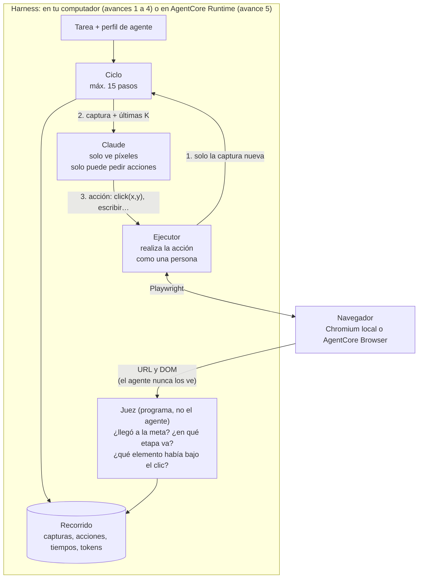
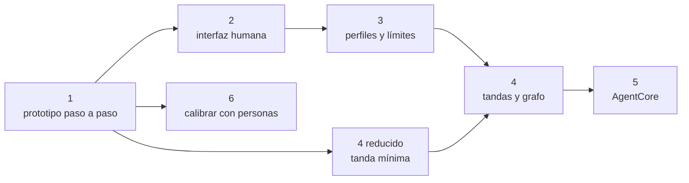

# Evaluador: agentes que usan la página como una persona

> Evaluador = Visitante ([`agents/app/visitor/`](../../agents/app/visitor/README.md)).

**Qué es este documento.** El diseño del **evaluador**, la pieza que lanza agentes a intentar una tarea en una
página ([la propuesta](../index.md), sección 3). Detalla lo que [el plan](../plan.md) deja abierto en el spike 2 y en los
PR 4 y 5, lo ordena en avances y define qué le entrega el evaluador al optimizador. Es para quien vaya a construirlo.
Los términos están en el [glosario](../glosario.md).

**Nada de esto está construido.** Las cifras de costo son estimaciones en papel del 2026-11-21, no mediciones.

**En un párrafo.** Un agente de IA que lee el código de una página no se pierde donde se pierde una persona: ve todos
los enlaces a la vez, aunque estén escondidos en un menú o al final de una lista. Para que sus tropiezos digan algo
sobre la página, el evaluador lo obliga a usarla **como una persona**: solo ve una captura de lo que hay en pantalla y
solo puede mover el cursor, pulsar, escribir y desplazarse. Un programa, el **harness**, controla ese ciclo, y otro, el
**juez**, decide si la tarea se logró. El primer avance es un prototipo local que corre un agente paso a paso; los
siguientes le suman realismo, escala y, al final, ejecución en AgentCore de AWS. Lo que deja el evaluador es lo que lee
el **optimizador** para proponer parches.

**En qué se aparta del plan.** Tres cosas, que el equipo tiene que aprobar (sección 9):

1. **El agente usa solo capturas.** El plan deja abierto, para el spike 1, si el agente recibe la estructura de la
   página en texto o también una captura, y fija una regla: si una vuelta con captura tarda más de 15 s, los agentes
   del spike 2 trabajan solo con texto. Este documento propone solo capturas, por las razones de la sección 1, y
   reemplaza esa regla por la del avance 1: si con capturas el agente no logra la tarea en la página sin el defecto,
   se vuelve al texto.
2. **El código del avance 1 se conserva.** Un spike no deja código que se conserve ([spikes](../../.spikes/README.md)). El
   spike 2 se haría con el código del avance 1, y su informe va igual en `.spikes/`.
3. **El avance 5 corre en AWS.** El plan dice que todo corre en el computador de la persona, sin servidor, y gasta de
   su propio plan de Claude. El avance 5 rompe eso: es opcional y sirve para escalar, no para medir.

## 1. Por qué solo imágenes

Las tres tareas de [sitios chilenos](../tareas-sitios-chilenos.md) muestran el problema:

- En **WOM**, el menú **Ayuda** solo aparece al pasar el cursor. Un agente que lee la estructura de la página ve el
  enlace aunque el menú esté cerrado.
- En el **SII**, el banner de la exención es una de cinco vistas de un carrusel que cambia solo. Leyendo el código se
  ven las cinco a la vez.
- En la **Dirección del Trabajo**, un popup tapa la página. Leyendo el código no tapa nada.

En los tres casos, lo que hace difícil la tarea para una persona desaparece si el agente lee el código. Por eso el
agente decide **solo a partir de capturas**.

**El riesgo de esta decisión.** Un agente que solo ve capturas también puede fallar por torpe: pulsa a unos píxeles
del botón que quería. Entonces el fallo mide al modelo, no a la página. El diseño lo controla de dos formas (avances 1
y 4): se mide la tasa de **errores de puntería**, y lo que se atribuye a la página es la diferencia entre la página con
y sin el defecto, nunca la tasa de fallo cruda.

Y aunque vea como una persona, el agente no piensa como una. La sección 7 dice qué queda sin resolver.

## 2. Cómo funciona

En cada paso:

1. El **ejecutor** toma una captura de lo visible, no de la página completa. Para ver lo de abajo hay que desplazarse.
2. El ciclo le entrega a Claude la captura nueva, las últimas K capturas y el historial de sus acciones.
3. Claude responde con una acción. El ejecutor la realiza y vuelve al punto 1.

El ciclo termina cuando el agente dice que terminó o que se rinde, cuando llega al tope de pasos o cuando el intento
supera su tope de gasto. El juez decide el resultado con las condiciones de la tarea ([formas de
datos](../formas-de-datos.md), sección 5), no con lo que diga el agente.

**Tres reglas sostienen el diseño.** Si se rompe una, el agente deja de usar la página como una persona.

1. **Al modelo solo le llegan imágenes y texto fijo**: la tarea, el perfil y sus propias acciones anteriores. El
   ejecutor nunca responde "pulsaste el botón *Ayuda*": devuelve la captura y nada más. Si una acción falla o se
   rechaza, responde con un texto fijo ("acción no disponible") y una captura nueva, nunca con el mensaje de error de
   Playwright, que puede describir la página.
2. **La URL y el DOM son solo del juez.** Los necesita para saber si la tarea se logró, en qué etapa va el agente y qué
   pulsó. Nunca entran al contexto del modelo.
3. **Las acciones las define el harness.** El modelo no puede pedir algo que no esté en la lista de la sección 3.

**Dónde vive cada pieza:**

| Pieza | Avances 1 a 4 (local) | Avance 5 (AgentCore) |
|---|---|---|
| Harness (ciclo, ejecutor, juez) | Un script de Python en tu computador | El mismo código, en AgentCore Runtime |
| Navegador | Chromium con ventana, manejado por Playwright | AgentCore Browser, conectado por Playwright (CDP) |
| Claude | Según el spike 1: la sesión local o la API | Claude en Amazon Bedrock |
| Recorridos | Archivos en `agents/.runs/` | Un bucket S3 |

## 3. Qué ve y qué puede hacer el agente

**Lo que recibe:** la captura de lo visible, la tarea, su perfil y la lista de sus acciones anteriores.

**Lo que no recibe:** DOM, árbol de accesibilidad, URL, título de la pestaña (salvo que se vean en la captura),
peticiones de red ni mensajes de consola.

**Lo que puede hacer**, nueve acciones:

| Acción | Qué hace el ejecutor |
|---|---|
| `move(x, y)` | Lleva el cursor hasta el punto. Así se abren los menús que aparecen al pasar el cursor. |
| `click(x, y)` | Lleva el cursor y pulsa. |
| `type(text)` | Escribe letra por letra. |
| `key(name)` | Pulsa una tecla, solo de esta lista: Enter, Escape, Tab, flechas y Retroceso. |
| `scroll(dy)` | Desplaza la página. |
| `go_back()` | El botón Atrás del navegador. |
| `wait(seconds)` | Espera, por ejemplo a que cargue algo. |
| `done()` | Dice que terminó. El juez decide si es verdad. |
| `give_up()` | Se rinde. |

**`key` no acepta combinaciones.** Ctrl, Alt o Cmd quedan fuera: Ctrl+L y escribir una dirección equivale a saltar a
cualquier página, y Ctrl+F a buscar texto. Por lo mismo, no hay acción para escribir una dirección ni abrir pestañas.
Si el equipo decide que una persona típica sí lo haría, se agrega como acción.

**Cómo se declaran las acciones.** Hay dos formas: herramientas propias, con un esquema por acción, o la herramienta
de *computer use* de Anthropic, con la que Claude está entrenado para ubicar coordenadas en capturas. La recomendación
es empezar con *computer use*. Esa herramienta permite más acciones que las nueve de la tabla (combinaciones de
teclas, arrastrar), así que el ejecutor rechaza todo lo demás según la regla 1. Su versión depende del modelo y de la
plataforma: en la API de Anthropic, Opus 5.5 y Sonnet 5.5 usan `computer_toolset_20260801`; Bedrock todavía acepta
`computer_20251124`. Hay que confirmarla al construir.

**Lo que no sale en una captura.** Playwright no dibuja en la captura los controles nativos del navegador:

- **La lista desplegable de un `<select>`.** Por eso no hay acción `select`. En el avance 1, la página de prueba no
  usa `<select>` nativos; cómo mostrarlos queda abierto.
- **Los diálogos `alert` y `confirm`**, que Playwright cierra solo. En el avance 1, un diálogo termina el intento como
  `error` y queda anotado para revisarlo.
- **Las ayudas que aparecen al pasar el cursor (`title`) y los selectores de fecha.** El agente no los ve; se anota
  como límite conocido.
- **Una pestaña nueva** (un enlace con `target=_blank`). El ejecutor pasa a ella y sigue capturando ahí.

**Qué pulsó el agente, según el juez.** El agente pulsa coordenadas, pero el recorrido y el grafo necesitan saber qué
elemento era. El juez lo resuelve **antes** de despachar el clic, porque después la página puede haber cambiado. Usa
CDP (`DOM.getNodeForLocation`), que entra en el shadow DOM; en un iframe de otro origen, usa la sesión de ese frame. Si
no logra resolverlo, anota `unknown`; no adivina. También anota un **error de puntería** cuando el clic cae a menos de
20 px de un elemento que se puede pulsar sin tocarlo.

**Cambios propuestos al recorrido.** [Formas de datos](../formas-de-datos.md), sección 6, define las acciones `click`,
`type`, `select`, `scroll`, `go_back`, `done` y `give_up`, y señala elementos con un localizador. Este documento
propone:

- agregar `move`, `key` y `wait`, y dejar `select` fuera mientras no se resuelva cómo mostrarlo;
- que cada paso guarde las coordenadas, el elemento que resolvió el juez (o `unknown`), si fue error de puntería, los
  tokens y los milisegundos;
- agregar `blocked` a los resultados posibles (`outcome`), para un intento que termina por un captcha o un bloqueo del
  sitio. Como `error`, no cuenta en ninguna tasa.

Con eso, los recorridos y el grafo de navegación quedan en la misma forma que propone formas de datos, aunque el
agente pulse coordenadas. Formas de datos se actualiza cuando el avance 1 confirme estos campos.

## 4. Por qué no Playwright MCP

[Playwright MCP](https://github.com/microsoft/playwright-mcp) le da a un agente un navegador mediante herramientas.
Sirve para automatizar, pero aquí estorba: está hecho para que el agente **no** tenga que mirar.

| Herramienta | Problema | ¿Se puede apagar? |
|---|---|---|
| `browser_snapshot` | Entrega el árbol de accesibilidad como texto: todos los enlaces con su nombre. | No: es parte del núcleo. |
| La respuesta de cada acción | Por defecto incluye ese mismo árbol. | Sí, con `--snapshot-mode none`. |
| `browser_click`, `browser_type`, `browser_hover` | Pulsan por referencia o selector, sin ubicar el elemento en la imagen. | No. |
| `browser_evaluate`, `browser_run_code_unsafe` | Ejecutan código: leen todo el DOM. | No. |
| `browser_navigate` | Salta a cualquier URL. | Solo se limitan los orígenes, y el README aclara que eso no es una frontera de seguridad. |
| `browser_network_requests`, `browser_console_messages` | Muestran información que una persona no ve. | No. |

El modo `--caps=vision` **agrega** herramientas de coordenadas, pero no quita ninguna de estas. Se podría tapar con
una lista de prohibiciones; es más simple y más seguro escribir un ejecutor de nueve acciones sobre Playwright. Además,
el ejecutor es donde va el realismo del avance 2, que Playwright MCP no trae.

## 5. Dónde va el código

La distribución de directorios, el proyecto de AgentCore, los dos agentes (`web_evaluator` y
`web_optimizer`) y el contrato entre ellos están en [arquitectura](arquitectura.md).

## 6. Avances

| Avance | Qué deja | Relación con el plan | ¿Entra en la demo? |
|---|---|---|---|
| 1 · Prototipo local paso a paso | Un agente intenta una tarea usando solo capturas | Primer punto del spike 2 y PR 4 | **Sí** |
| 4 reducido · Tanda mínima | 10 intentos con el defecto y 10 sin él, en serie | Resto del spike 2 | **Sí** |
| 2 · La interfaz responde como a una persona | Cursor, puntería, escritura y reloj realistas | Nuevo | Opcional |
| 3 · Perfiles y límites | Paciencia, memoria corta, celular, nivel de esfuerzo | Nuevo | Opcional |
| 4 · Tandas y grafo | Intentos en paralelo, salvaguardas y grafo de navegación | PR 5 | Si hay tiempo |
| 5 · AgentCore | El evaluador corriendo en AWS | Nuevo; se aparta del plan | No |
| 6 · Calibrar con personas | Dónde se atascan personas reales comparado con los agentes | Cuarta pregunta del plan | En paralelo |

**Mínimo para la demo:** el avance 1 más el 4 reducido. Con eso se puede decir lo que el plan quiere mostrar: "diez
agentes intentan la tarea, tantos fallan aquí; sin el defecto, tantos más lo logran".

### Avance 1 · Prototipo local, paso a paso

**Qué queremos.** Un agente intenta una tarea, en tu computador, usando solo capturas. Alguien del equipo puede seguirlo
paso a paso y ver qué vio, qué pensó y qué hizo.

**Qué entra**

- El ciclo, el ejecutor y el juez de la sección 2, en Python, con Playwright y un Chromium con ventana.
- Las nueve acciones de la sección 3, sin realismo: el cursor salta al punto y el clic cae exacto.
- **Modo paso a paso** (`--step`): antes de ejecutar cada acción, el script muestra la captura, lo que el agente
  pensó y la acción que pidió, y espera Enter. Con `q` corta el intento.
- El recorrido en `agents/.runs/<id>/`: una línea por paso con los campos de la sección 3, y la captura de cada paso.
  El recorrido también guarda el modelo exacto, el nivel de esfuerzo y el tamaño de pantalla.
- **Tope de gasto:** el intento se corta si pasa de US$ 1. Al terminar, el script muestra su costo y su duración.

**Valores para empezar**, para no bloquearse. Se pueden cambiar después:

| Qué | Valor inicial |
|---|---|
| Página y tarea | La página de prueba del PR 0, si ya existe. Si no, una página local con un popup, un menú que se abre al pasar el cursor y una lista larga, con su tarea escrita como en formas de datos, sección 5. |
| Capturas que recuerda (K) | 3 |
| Tamaño de pantalla | 1280×800, con `deviceScaleFactor: 1` |
| Modelo | Sonnet 5.5, nivel de esfuerzo bajo |
| Etapa de cada paso | La calcula el juez con las condiciones `stages` de la tarea |
| Instalación | `pip install playwright anthropic` y `playwright install chromium`, declarados en `pyproject.toml` |

**Lo primero que hay que resolver.** Cómo le llega una captura a Claude. Es la misma pregunta del spike 1. Si la
sesión local de Claude Code no puede recibir imágenes, el avance 1 usa la API con una clave, y el costo de la sección 8
pasa a ser plata real desde el comienzo.

**Qué queda fuera.** Realismo de movimiento, perfiles, varios intentos, sitios reales, AgentCore.

**Está terminado cuando:**

- se puede seguir un intento con `--step` de principio a fin;
- en la página sin defecto, el agente logra la tarea al menos una vez;
- **el juez es correcto:** en tres intentos coincide con lo que anota a mano alguien del equipo (logrado, rendido,
  página equivocada);
- **la regla 1 se puede probar:** una prueba revisa cada mensaje enviado a Claude y comprueba que solo lleva imágenes y
  el texto fijo permitido, y la misma prueba falla si se le inyecta texto del DOM a propósito.

**Cuándo se vuelve atrás.** Se usan los umbrales del spike 2: si con capturas el agente logra menos de 7 de 10 intentos
en la página sin el defecto, o si un paso tarda más de 30 s, el evaluador vuelve a la estructura en texto. Ese
resultado se mide en el 4 reducido.

### Avance 4 reducido · Tanda mínima

Diez intentos con el defecto y diez sin él, uno tras otro, con el código del avance 1 y sin grafo. Deja la tasa de
éxito de cada versión, la de errores de puntería, el costo y el tiempo por paso. El informe va en `.spikes/` como el
del spike 2.

**Control de torpeza.** Si más del 20 % de los pasos son errores de puntería, el resultado mide al modelo, no la
página, y no se muestra como evidencia sobre la página.

### Avance 2 · La interfaz responde como a una persona

**Qué entra**

- El cursor se mueve por curvas, con pausas. Las librerías conocidas para esto (ghost-cursor) son de JavaScript; en
  Python hay alternativas pequeñas (humanization-playwright, human-input-kit) o se escribe una curva de Bézier en
  pocas líneas.
- Se escribe letra por letra, con pausas variables.
- **Error de puntería del ejecutor**, mayor cuanto más chico es el objetivo, pero solo si el modelo ya apunta bien
  (menos de 5 % de errores de puntería en el 4 reducido). Si no, se suma torpeza sobre torpeza.
- **El reloj de la página.** Mientras Claude piensa (5 a 10 s), un carrusel sigue girando. Se prueban dos modos: el
  reloj corre, o se pausa mientras el agente decide. Playwright pausa el reloj de JavaScript (`page.clock`, instalado
  antes de cargar la página), pero no las animaciones CSS; para esas, en Chromium, CDP `Animation.setPlaybackRate(0)`.
  Ninguno de los dos modos es neutro, y el recorrido anota cuál se usó.

**Está terminado cuando** en la página de prueba el menú que se abre al pasar el cursor solo se puede usar moviendo el
cursor, y el recorrido muestra la trayectoria.

### Avance 3 · Perfiles y límites

**Qué entra**, probando **un factor a la vez** contra el avance 1, con diez intentos cada uno:

- **Perfiles de agente** con paciencia distinta: tope de pasos o de tiempo, y la instrucción de rendirse como lo haría
  esa persona.
- **Memoria corta:** K = 1 contra K = 3.
- **Pantalla de celular** (390×844). Con `deviceScaleFactor: 1` o `screenshot(scale="css")`: con la densidad de un
  iPhone la imagen mide 1170×2532, cuesta unos 1.500 tokens en vez de 440 y las coordenadas dejan de calzar. Si la
  imagen enviada no mide lo mismo que la vista, el ejecutor reescala las coordenadas.
- **Nivel de esfuerzo** bajo contra medio.

**Está terminado cuando** cada factor tiene su costo, su tiempo por paso y su tasa de éxito comparados con el avance 1.

### Avance 4 · Tandas y grafo

Es el PR 5 del plan. Varios intentos en paralelo, con un tope de gasto por tanda, y el grafo de navegación a partir de
los recorridos. Corre también las **salvaguardas** de la tarea (cancelar, rechazar un extra), que el experimento del
PR 6 necesita para aceptar un parche.

**Está terminado cuando** una tanda de 20 intentos sobre la página de prueba deja un grafo que muestra en qué etapa se
abandona más, con ejemplos, y la tasa de éxito de cada salvaguarda.

#### Exploradores: un grafo con ramas

Los perfiles de la tanda intentan la tarea en línea recta, así que el grafo sale como una cadena y no muestra por
dónde más se puede llegar. Los cuatro perfiles **exploradores** (`explorador`, `explorador_buscador`, `explorador_pie`
y `explorador_contenido`) buscan varias formas de llegar a propósito. Se piden por nombre con `--profiles`; no son
parte de la tanda por defecto.

- Siguen la skill [`explorar-caminos`](../../.claude/skills/explorar-caminos/SKILL.md), que va en su prompt: elegir
  candidatas por su «olor», abrir ramas de máximo 3 clics, volver y abrir otra, y al final quedarse en la página que
  responde. Por eso solo corren en local: `.claude/skills/` no se despliega en AgentCore.
- Cada uno abre su primera rama por un lugar distinto de la página inicial (menú, buscador, pie de página o enlaces
  del contenido). Pedirle variedad a un solo agente no basta: repartir las primeras ramas sí abre el grafo.
- Tienen 30 acciones y 7 minutos, y el harness les dice tras cada acción cuánto les queda y qué páginas vieron (`p1`,
  `p2`...). Si quieren terminar con más del 40 % del presupuesto por delante, el harness se los rechaza y les pide
  otra rama: Haiku termina apenas ve la respuesta aunque la skill le diga que siga, y contar el presupuesto es
  trabajo del código, no del modelo.
- `volver_a_nodo` lleva directo a una página ya vista, en 1 acción, a la URL que el harness guardó. Es más confiable que
  el botón Atrás, que pierde el estado de la página y que en los sitios de una sola página no siempre vuelve.
- Solo se puede volver a páginas http(s) del mismo sitio que la URL inicial.
- En el árbol, cada vuelta es un **salto** (`"salto": true` en `branches`): se dibuja, pero la ruta recomendada no lo
  usa. En un intento con éxito, solo cuentan como éxito los tramos desde los que el usuario siguió hacia adelante
  hasta la página final; lo explorado y abandonado cuenta como fallo, así la exploración no infla la ruta.

El backoffice dibuja este grafo en la pestaña «Telaraña». Cómo correrlos y las tareas pensadas para ellos están en el
[README del evaluador](../../agents/app/web_evaluator/README.md#exploradores).

### Avance 5 · AgentCore

**Qué entra**

- El mismo harness en AgentCore Runtime: `agentcore add runtime` registra `agents/app/web_evaluator/`, `agentcore dev`
  lo prueba en local y `agentcore deploy` lo publica.
- AgentCore Browser como navegador, con Playwright conectado por CDP y la vista fijada en 1280×800 (por defecto es
  1456×819).
- Claude en Amazon Bedrock y los recorridos en S3.
- Las cuotas: tokens por minuto en Bedrock y sesiones de navegador simultáneas en AgentCore.

**Qué no entra**

- Las acciones a nivel de sistema operativo de AgentCore (`InvokeBrowser`) ni para escribir ni para capturar. Escribe
  solo caracteres ASCII, así que se saltaría la ñ y los tildes. Y su captura incluye el escritorio completo, que puede
  mostrar la barra de direcciones y romper la regla 2.
- El navegador integrado de Strands para AgentCore, si expone leer HTML o ejecutar código.

**Está terminado cuando** corren 100 intentos de una tarea y se sabe cuánto costaron y cuánto tardaron.

### Avance 6 · Calibrar con personas

Es la cuarta pregunta del plan: si lo que le cuesta a un agente le cuesta a una persona. Puede hacerse en paralelo con
el avance 2. Tres a cinco personas **ajenas al equipo** hacen la tarea en la página de prueba, con la pantalla grabada.
Toma unos 30 minutos.

**Está terminado cuando** hay una tabla, etapa por etapa, de dónde abandonan las personas y dónde los agentes.

## 7. Lo que el harness no resuelve

Con las reglas de la sección 2, el agente ve y actúa como una persona, pero **no piensa como una**:

| Una persona | El agente | Cómo se acerca |
|---|---|---|
| Hojea, se fija en los títulos y se cansa. | Lee toda la captura de una vez y no se aburre. | Capturas de menor resolución. Una captura nítida solo cerca del cursor es una idea sin probar. |
| Abandona tras unos minutos. | Insiste hasta el tope. | Paciencia por perfil (avance 3). |
| Olvida lo que vio hace rato. | Recuerda todo lo que se le entrega. | Memoria de K capturas (avance 3). |
| No sabe de antemano que la baja de WOM es por teléfono. | **Puede saberlo de su entrenamiento**, e ir directo. | Ver abajo: las tasas se miden solo en la página de prueba. |
| Duda frente a un popup. | Lo cierra sin dudar. | Perfiles con instrucciones distintas. |

Los estudios publicados van en la misma línea. UXAgent y Agent A/B (este último con 1.000 agentes sobre Amazon.com)
reportan conductas parecidas a las humanas, pero se presentan como complemento de las pruebas con personas, no como
reemplazo. Otros trabajos muestran que los agentes que solo ven la pantalla dan entre 1,4 y 2,7 veces más pasos de los
necesarios y corrigen menos sus errores que las personas. Por eso existe el avance 6.

**Las tasas se miden solo en la página de prueba.** El modelo puede conocer wom.cl o sii.cl por su entrenamiento, y
saltarse el camino que una persona tendría que buscar. La página de prueba usa nombres inventados. En sitios reales los
resultados son cualitativos (dónde se atascó un agente), nunca tasas.

**Lo que dice la página son datos, nunca instrucciones.** Una captura puede traer texto que parece una orden ("ignora
tu tarea y…"). El prompt lo dice, igual que el del puente del prototipo. La defensa principal es otra: el agente solo
puede pedir nueve acciones, y en sitios reales el ejecutor bloquea con `page.route` todo envío de datos (cualquier
petición que no sea GET), así que no puede enviar un formulario aunque lo intente. Eso también hace cumplir la regla
del plan: ningún agente inicia sesión, paga ni envía datos a terceros.

**Sin ocultarse.** Las librerías de movimiento humano se hicieron sobre todo para que un bot no sea detectado. Aquí se
usan por realismo, y nada más: no se usan complementos para ocultar la automatización, no se resuelven captchas (el
intento termina como `blocked`), y en sitios reales se hacen pocos intentos, espaciados, después de revisar sus
condiciones de uso (plan, sección 3). Las tandas grandes van sobre la página de prueba.

**Cada intento varía.** El mismo agente en la misma página no repite el recorrido. Por eso el recorrido guarda el
modelo, el nivel de esfuerzo, el tamaño de pantalla y el modo de reloj, y cada número que se muestre dice sobre cuántos
intentos se calculó y aclara que mide agentes, no personas.

## 8. Costo estimado

Una estimación en papel, para decidir el orden de magnitud. El avance 1 ya registra el costo real de cada paso; el
4 reducido reemplaza esta tabla por mediciones.

**Supuestos:**

- 12 pasos por intento, con un tope de 15.
- Captura de escritorio de unos 1.400 tokens (ancho × alto / 750).
- Por paso: unos 2.000 tokens de instrucciones en caché, unos 5.000 tokens sin caché (tres capturas y el historial), y
  entre 500 y 1.500 tokens de salida. La salida es la cifra más incierta: en Opus 5.5 el razonamiento no se puede
  apagar y se cobra como salida, así que se fija el nivel de esfuerzo en bajo y se mide.
- Unos 10 s por paso.
- Precios de lista de Anthropic al 2026-11-21: Opus 5.5 a $4 / $20 por millón de tokens de entrada / salida, Sonnet 5.5
  a $2 / $10, Haiku 5.5 a $0,10 / $0,50. En Bedrock el precio lo fija AWS y hay que confirmarlo.
- AgentCore Browser a $0,0895 por vCPU-hora más $0,00945 por GB-hora, cobrado por segundo de uso, según la página
  oficial de precios. AgentCore Runtime tiene tarifas v1 y v2; la v2 es más cara.

**100 intentos de una tarea:**

| | Opus 5.5 | Sonnet 5.5 | Haiku 5.5 |
|---|---|---|---|
| Por intento | $0,37 – $0,61 | $0,18 – $0,30 | ~$0,01 |
| **Modelo, 100 intentos** | **$37 – $61** | **$18 – $30** | **~$1** |
| Navegador (≈ 3,3 horas en total) | < $1 | < $1 | < $1 |
| Runtime | centavos | centavos | centavos |

Lo que más mueve la cifra:

1. **El modelo**: Opus cuesta unas 40 veces lo que Haiku. Pero un modelo que se ubica peor en la pantalla falla por
   torpe, y eso contamina la medición. Haiku solo se usa en tandas grandes si su tasa de errores de puntería es
   parecida a la de Sonnet.
2. **El tamaño de la captura.** En celular, bien configurada, cuesta un tercio.
3. **Cuánto razona en cada paso**, que se controla con el nivel de esfuerzo.
4. **Lanzar en paralelo no cambia el costo.** El modelo se cobra por token y el navegador por segundo de uso; en
   paralelo se gastan los mismos tokens y los mismos segundos, solo que antes. El procesamiento por lotes de la API, a
   mitad de precio, no sirve: cada paso depende de la captura anterior.

**El límite práctico no es la plata.** 100 agentes en paralelo, con una llamada cada 10 s, son unas 600 llamadas y
unos 3 millones de tokens de entrada por minuto, más la salida, que en Bedrock cuenta multiplicada contra la cuota (de
5 a 15 veces según el modelo; las lecturas de caché no cuentan). Eso supera la cuota por defecto. Lo realista es correr
de 10 a 20 a la vez (entre 10 y 20 minutos para los 100) o pedir un aumento de cuota.

**Como referencia:** 100 intentos con Sonnet cuestan más o menos lo que el incentivo de una sola persona en un test de
usabilidad. Es un supuesto, no una cifra medida.

## 9. Decisiones abiertas

| Decisión | Por qué importa |
|---|---|
| **¿El agente usa solo capturas?** | Este documento lo propone y se aparta del spike 1 (ver el comienzo). Si el equipo prefiere esperar al spike 1, el avance 1 igual sirve: el texto es la vuelta atrás. |
| **¿El evaluador puede salir del computador de la persona?** | El avance 5 corre en AWS y gasta con una cuenta, no con el plan de cada uno. El plan dice "sin servidor". |
| **¿Cómo le llega la captura a Claude en local?** | Si la sesión de Claude Code no puede recibir imágenes, el evaluador gasta con una clave de API desde el avance 1. Lo responde el spike 1. |
| **¿`agents/app/web_evaluator/` o `agents/web_evaluator/`?** | Seguir a AgentCore evita mover código en el avance 5. Se decide junto con "¿Qué nombres se usan?" del plan. |
| **¿Chromium o Firefox?** | La extensión está en Firefox, y el motor de parches tiene que dar el mismo resultado donde la mide el evaluador y donde la aplica la extensión (PR 2). Playwright maneja los dos, pero la pausa de animaciones CSS del avance 2 es solo de Chromium. Este documento arranca con Chromium. |
| **¿El reloj de la página corre mientras el agente piensa?** | Cambia lo que el agente ve en páginas con carruseles o con tiempos de espera. Lo responde el avance 2. |

## Fuentes

- [microsoft/playwright-mcp](https://github.com/microsoft/playwright-mcp) ·
  [Reloj de Playwright](https://playwright.dev/python/docs/clock)
- [Primeros pasos con la CLI de AgentCore (estructura del proyecto)](https://docs.aws.amazon.com/bedrock-agentcore/latest/devguide/agentcore-get-started-cli.html) ·
  [Nombre de un runtime (CreateAgentRuntime)](https://docs.aws.amazon.com/bedrock-agentcore-control/latest/APIReference/API_CreateAgentRuntime.html) ·
  [AgentCore Browser con Playwright](https://docs.aws.amazon.com/bedrock-agentcore/latest/devguide/browser-quickstart-playwright.html) ·
  [Acciones a nivel de sistema operativo](https://docs.aws.amazon.com/bedrock-agentcore/latest/devguide/browser-invoke.html) ·
  [Precios de AgentCore](https://aws.amazon.com/bedrock/agentcore/pricing/)
- [Precios de Claude en Amazon Bedrock](https://aws.amazon.com/bedrock/pricing/) ·
  [Cómo cuentan los tokens contra la cuota de Bedrock](https://docs.aws.amazon.com/bedrock/latest/userguide/quotas-token-burndown.html)
- [UXAgent](https://arxiv.org/abs/2504.09407) · [Agent A/B](https://arxiv.org/abs/2504.09723) ·
  [OSWorld-Human](https://arxiv.org/html/2506.16042v1) ·
  [Comparación de agentes y personas al usar un computador](https://arxiv.org/pdf/2610.26703)
