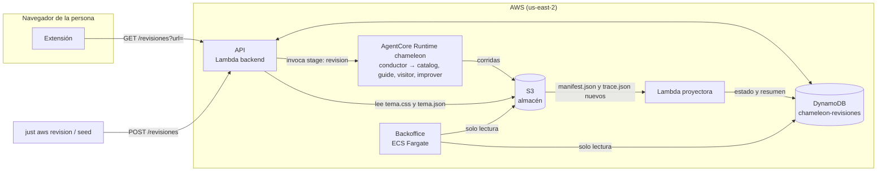
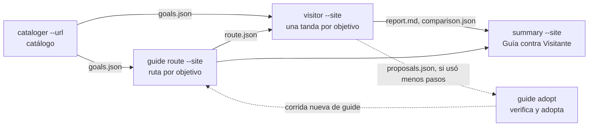

# Arquitectura

Cómo se conectan las piezas de Chameleon, qué pasa en una revisión y dónde queda cada dato. Es para quien va a
programar; conviene haber leído [el índice](index.md). Los términos están en el [glosario](glosario.md).

## Vista general



Hay dos lugares donde vive el estado, y nada más:

- **El almacén** (S3): todo lo que escriben los agentes, una carpeta por corrida. Es la fuente de verdad.
- **La tabla de revisiones** (DynamoDB): qué revisión tiene cada página y cómo va. Es una proyección del almacén, que
  mantiene la proyectora, para que la API responda sin listar el bucket.

## El ciclo de una revisión

1. **Se pide.** `POST /revisiones` con la URL de la página. Lo hacen `just aws revision <url>`, `just aws seed` y el
   workflow `Sembrar revisiones`; la extensión no. La API normaliza la URL, anota la revisión como `queued` e invoca
   el runtime con `{"stage": "revision", ...}`. Si la página ya tiene una revisión, responde con esa; pide otra solo
   si la anterior falló, lleva más de una hora en curso sin novedades, o terminó y viene `force`. Con demasiadas revisiones en curso
   responde 429.
2. **El conductor la corre.** Lanza cada etapa como otra invocación del mismo runtime, en una sesión nueva, y espera
   su `manifest.json` en el almacén:
   - `catalog`: el Catalogador, una vez.
   - `guide` y luego `visitor`, por cada objetivo evaluable (6 por defecto, varios a la vez). Una Guía que falla o
     no verifica su ruta deja ese objetivo sin Visitante, sin hacer fallar la revisión. En una revisión la Guía se
     queda con la primera ruta que verifica, sin buscar una más corta.
   - `improver`: el Diseñador, con el objetivo que peor resultó como tarea. Parte 45 s después del primer Visitante
     exitoso, con lo que haya; si ninguno lo logra, espera a todos.
3. **La proyectora sigue el avance.** Cada `manifest.json` o `trace.json` nuevo en el bucket la dispara: actualiza
   el estado de cada etapa y el resumen de la revisión en la tabla. Los eventos de S3 llegan repetidos y
   desordenados, así que un estado solo avanza.
4. **Termina.** La revisión queda `done` si el Diseñador dejó un tema, y `failed` si falló el catálogo, no hubo
   objetivos evaluables o falló el Diseñador. Para la extensión está `done` apenas existe el `tema.css`, aunque el
   conductor siga con los demás objetivos.
5. **La extensión la consulta.** En cada página pide `GET /revisiones?url=…`. Con la revisión `done`, la API devuelve
   el `tema.css` (y el `tema.json`, si existe) leídos del almacén; la extensión sanea el CSS y lo inyecta. Con la
   revisión en curso, vuelve a preguntar cada 3 s, alargando la espera hasta 15 s, por 10 min como máximo. Sin revisión, o si falló, no toca la página.

| Estado de una revisión | Qué significa |
|---|---|
| `queued` | Anotada; el conductor todavía no parte. |
| `running` | El conductor partió. |
| `done` | Hay tema. |
| `failed` | No hay tema ni lo habrá, salvo que se pida otra. |

Cada etapa de una revisión está `pending`, `running`, `succeeded`, `failed` o `skipped` (el Visitante de un objetivo
cuya Guía falló).

## Los agentes

Cada agente es una carpeta de `agents/app/` con un solo trabajo: un proyecto de uv que se corre con
`uv run main.py`. **Ningún agente importa la carpeta de otro: se comunican solo por corridas del almacén.** Lo que
usan dos o más está en [`agents/shared/`](../agents/shared/README.md).

```
agents/
  app/
    cataloger/      CATALOGA: recorre el sitio leyendo el DOM y clasifica sus objetivos
    guide/          GUÍA: encuentra y verifica la ruta de referencia de un objetivo, con DOM y capturas
    visitor/        VISITA: usuarios sintéticos que intentan un objetivo viendo solo capturas
    web_designer/   DISEÑA: escribe el tema (etapa improver)
    conductor/      corre las etapas de una revisión
    summary/        resume un sitio: la ruta de la Guía contra los intentos del Visitante
    runtime/        la entrada del runtime chameleon en AgentCore
  shared/           almacén, navegador, Claude, nodos, DOM, catálogo y etapas
  tasks/<host>/<goal>.json    tareas escritas a mano: cada una es un objetivo de su host
  .runs/            el almacén en disco (fuera de git)
```

| | Catalogador | Guía | Visitante | Diseñador |
|---|---|---|---|---|
| **Qué hace** | Cataloga los objetivos de un sitio y los clasifica. | Encuentra la ruta de referencia de un objetivo. | Intenta un objetivo con cada perfil y mide cuántos lo logran. | Escribe el tema de la página. |
| **Qué ve** | El DOM de cada página. | El DOM y capturas. | Solo capturas de lo visible. | La página real y lo que midieron en esa revisión el Catalogador, la Guía y el Visitante. |
| **Qué puede hacer** | Recorrer enlaces del mismo sitio, sin enviar formularios. | Clic, escribir, elegir, teclas, atrás y scroll sobre lo que está a la vista; no puede ir a una URL ni salir del sitio. | Lo que haría una persona con mouse y teclado: clic en un punto de la captura, escribir, teclas y scroll. | Nada en la página: elige una dirección de arte y el código compone el CSS, que se sanea como lo haría la extensión. |
| **Qué entrega** | `goals.json` | `route.json` y la cita que la respalda | Recorridos, árbol de rutas, comparación con la ruta y reporte | `tema.css` y `tema.json`, con las vistas que agrega a la página |
| **Quién decide** | Reglas sin modelo sobre lo que propone el modelo. | La repetición: la ruta vale si al repetirla llega a la misma página y la cita está en ella. | El programa: el intento lo logró si pasó por la página final de la ruta de la Guía. | El código: sanea el CSS y valida el `tema.json` con las mismas reglas que la extensión. |

**Por qué el Visitante solo ve capturas.** Un agente que lee el código de una página no se pierde donde se pierde una
persona: ve todos los enlaces a la vez, aunque estén escondidos en un menú o al final de la página. Para que sus
tropiezos digan algo sobre la página, el Visitante la usa como una persona. La Guía sí lee el DOM: su trabajo es
encontrar el camino más corto, y debe lograr el objetivo al menos igual de bien. La distancia entre los dos es lo
que se mide ([métricas](objetivos-y-metricas.md#métricas-un-intento-contra-la-ruta-de-referencia)).

### Por sitio, sin tema

Además de la revisión de una página, `just local site <url>` recorre un sitio entero y lo resume, sin Diseñador. Al
repetirlo salta lo que ya tiene corrida.



La ruta de referencia es la más corta verificada entre las exploradas, no la mínima del sitio. Por eso un intento
que logra el objetivo con menos pasos queda como propuesta, hasta que `guide adopt` la verifica repitiéndola.

## El almacén

Las salidas de los agentes tienen un solo árbol por sitio, igual en `agents/.runs/` y en S3. Lo define
[`shared.store`](../agents/shared/README.md#sharedstore): ningún agente arma una ruta a mano.

```
<host>/
  cataloger/<run>/                  manifest.json outline.json goals.json goals.md
  guide/<goal>/<viewport>/<run>/    manifest.json route.json route.md trace.json step_00.png …
  visitor/<goal>/<run>/             manifest.json criteria.json route_tree.json comparison.json proposals.json report.md
      <profile>/                    run.json trace.json step_00.png … video.webm
  summary/<run>/                    manifest.json summary.json summary.md
  improver/<run>/                   manifest.json tema.css tema.json atajos.json diagnostico.json informe.json mejora.json vistas/
  conductor/<run>/                  manifest.json conductor.json
```

- `<run>` es el instante UTC de inicio: la última corrida es la última clave, sin punteros `latest`.
- Una corrida termina `succeeded` o `failed` y nunca se sobrescribe.
- Cada `manifest.json` dice qué es la carpeta y, en `inputs`, de qué corridas viene: una ruta nombra el catálogo de
  su objetivo; una tanda, las rutas con que se comparó.
- Las corridas de una revisión llevan `revision` en el manifiesto; así la proyectora sabe a cuál pertenecen.
- La Guía y el Visitante suben `trace.json` y la captura de cada paso mientras trabajan: de ahí sale el avance
  en vivo del backoffice.

## En tu computador y en AWS

El mismo código corre en los dos lados; cambian cuatro cosas, todas por variables de entorno.

| | En tu computador | En AWS |
|---|---|---|
| **Modelo** (`AGENTS_ENGINE`) | `claude-code`: tu Claude Code, con tu sesión. | `bedrock`: Claude en Bedrock, un modelo rápido, uno fuerte y uno para la Guía. |
| **Navegador** (`AGENTS_BROWSER`) | `local`: Chromium con Playwright. | `agentcore`: AgentCore Browser. |
| **Almacén** (`AGENTS_STORE`) | `agents/.runs/` | `s3://chameleon-almacen-<cuenta>/` |
| **Etapas** (`CONDUCTOR_INVOKER`) | `local`: cada etapa es un proceso. | `agentcore`: cada etapa es una invocación del runtime. |

`just local revision <url>` corre una revisión completa en tu computador y deja el `tema.css` en `local/.state/`.
No pasa por la API ni por la tabla: el backend local no tiene revisiones, y por eso la extensión de desarrollo
consulta por defecto la API desplegada.

## La extensión

La extensión no trae temas empaquetados: todo lo específico de un sitio llega como datos. El CSS del tema cuelga de
la clase `mi-tema` en `<html>`, así que apagar el interruptor es quitar esa clase. Lo que el CSS no alcanza lo hacen las
**features**, código de la extensión que el `tema.json` activa y configura. De la API solo se acepta la feature
`vista`, con tres componentes: `atajo` (un formulario corto que lleva directo a un resultado), `lanzador` (accesos a
las tareas más buscadas) y `buscador` (una paleta para saltar a cualquier tarea del sitio). El CSS y el `tema.json` que llegan de la API se sanean antes de usarlos: nada que cargue recursos o ejecute
código, y los enlaces solo al mismo sitio. El detalle está en [extension/README.md](../extension/README.md).

## Despliegue

Este repo es público y de la organización, así que los despliegues corren en un repo personal privado que copia
`main`: Terraform crea la API, el almacén, la tabla y el backoffice, y la CLI de AgentCore despliega el runtime. Un
merge a `main` llega a AWS solo. Los pasos y la operación están en [infra/README.md](../infra/README.md).
