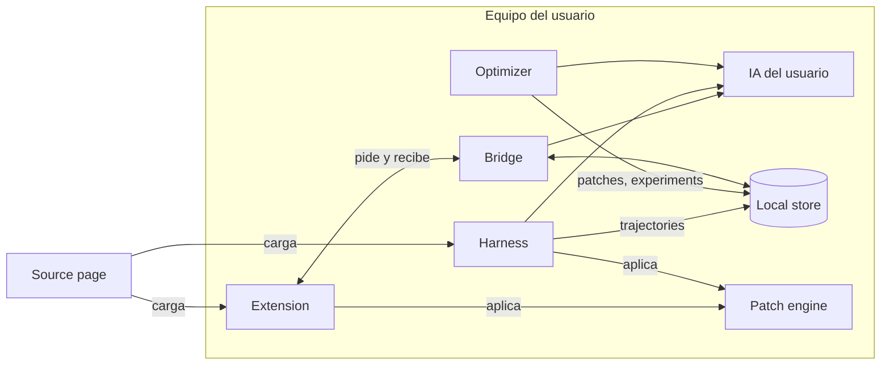

# A dónde apunta esto

```
página efectiva = source page + optimizations + soul
```

Un usuario, con la IA que corre en su propio equipo, hace que un sitio web le funcione mejor. El sitio no se toca:
todo se aplica encima, en el navegador.

- Las **optimizations** hacen que una tarea se complete mejor para cualquiera. Se aceptan con evidencia: agentes
  navegan el sitio con y sin el cambio, y se compara.
- La **soul** es el perfil de preferencias de un usuario. Ajusta la página a esa persona y no sale de su equipo.

Van juntas porque una optimization es un promedio de la población y puede fallarle a un usuario concreto. La soul
convierte "funciona para la población" en "funciona para ti", y permite comprobarlo sin tráfico real.

Esta página describe los componentes y su estado. Los términos están en [glossary.md](glossary.md) y las formas de
datos en [contracts.md](contracts.md). Lo fechado (planes, mediciones, experimentos) no va aquí: va en
[`.spikes/`](../.spikes/README.md).

Cada componente lleva dos estados separados:

- **Entrega:** `existente`, `parcial` o `no construido`.
- **Certeza:** `verificado`, `decidido`, `propuesto` o `hipótesis`.

## Límite del sistema



Nada sale del equipo del usuario salvo lo que se envía a su proveedor de IA. No hay servidor propio.

## Componentes

### Patch engine

**Qué pregunta responde:** ¿cómo se cambia una página ajena de forma segura y reversible?

Aplica una lista declarativa de operaciones (cambiar estilo, ocultar, reetiquetar, mover) sobre elementos
identificados por su rol y su nombre accesible. No ejecuta código generado. Comprueba invariants: lo que el usuario
necesita para salir, rechazar o avanzar sigue visible y clicable. Es un único módulo que usan la extensión y el
harness, para que lo que se mide sea lo que ve el usuario.

**Entrega:** `parcial` — el prototipo aplica una hoja de estilo saneada y arma un mapa de la página sin texto. No hay
operaciones declarativas, locators ni invariants. · **Certeza:** `propuesto`

### Harness

**Qué pregunta responde:** ¿dónde se pierde alguien que intenta completar una tarea en este sitio?

Lanza agentes que intentan una task en un target, cada uno con una persona distinta. Cada agente ve una captura de
la página con los elementos visibles numerados y elige una acción. El éxito se evalúa por código. De las trajectories
sale un navigation graph: etapas, transiciones y dónde se abandona. Un experiment compara una variant contra el
control y contra guardrails, y da una decisión con su intervalo.

El target no está fijado: lo elige quien construye el harness, y debe poder restablecerse, no tener efectos reales y
permitir comprobar el éxito por código.

**Entrega:** `no construido` — el prototipo tiene pruebas con un navegador sin ventana, pero ningún agente navega.
· **Certeza:** `hipótesis` — falta medir costo y tiempo por paso.

### Optimizer

**Qué pregunta responde:** ¿qué cambio mejora la tarea, y cómo se sabe que no manipula?

Lee el navigation graph, propone patches con una hipótesis comprobable y decide con un experiment cuál se acepta. Un
patch que sube el éxito pero empeora un guardrail (por ejemplo, rechazar un extra) se rechaza. Un usuario aprueba
antes de que un patch quede activo.

**Entrega:** `no construido` · **Certeza:** `propuesto`

### Soul

**Qué pregunta responde:** ¿cómo quiere ver y usar la web esta persona?

Un archivo legible y editable con las preferencias del usuario. De él sale un soul patch por sitio, limitado a
presentación, que se aplica encima de las optimizations. También define una soul persona: un agente del harness que
navega como ese usuario, para comprobar que una optimization le sirve a él.

**Entrega:** `parcial` — el prototipo guarda una instrucción global y genera una hoja de estilo por sitio. No hay
perfil estructurado, ni soul patch declarativo, ni soul persona. · **Certeza:** `propuesto`

### Bridge

**Qué pregunta responde:** ¿cómo usa una extensión la IA que corre en el equipo del usuario?

Un proceso local que recibe peticiones de la extensión, llama a la IA con la sesión del usuario y devuelve una
respuesta validada contra un esquema. No acepta peticiones de páginas web.

**Entrega:** `existente` — `prototipo/puente/puente.py` llama a `claude -p` sin herramientas y con salida
estructurada; mide entre 7 y 10 s por generación. Falta el pairing token. · **Certeza:** `verificado` (2026-11-21,
pruebas de punta a punta del prototipo)

### Extension

**Qué pregunta responde:** ¿qué ve el usuario, y por qué se ve así?

Aplica la variant activa y el soul patch al navegar, desde una copia local. Explica qué cambió, con qué evidencia, y
deja ver la página original con un clic.

**Entrega:** `parcial` — el prototipo aplica una hoja de estilo en caché y permite ver el original. No aplica
variants ni explica evidencia. · **Certeza:** `decidido` para el navegador (el del prototipo).

### Local store

**Qué pregunta responde:** ¿dónde vive lo aprendido de un sitio?

Archivos locales: tasks, patches, variants, trajectories, navigation graphs y experiments por host, y la soul aparte.
Los patches y las variants son inmutables y se identifican por su contenido. Lo de un host se puede exportar; la soul
nunca.

**Entrega:** `no construido` · **Certeza:** `propuesto`

## Lo que no es

- No prueba que mejore la usabilidad para personas. Los agentes dan fricciones candidatas.
- No actúa sobre sitios con sesión iniciada, pagos o efectos reales.
- No comparte optimizations entre usuarios. Es el paso siguiente natural y hoy no está diseñado.

## Material de apoyo

- [Investigación previa](investigacion-ui-adaptativa.md): estado del arte de las interfaces adaptativas.
- [Referencias](referencias.md): modelos y herramientas que podrían sumarse.
