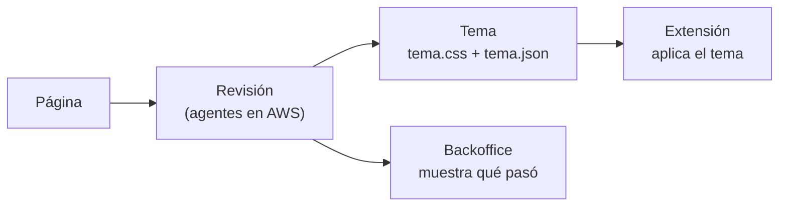

# Chameleon

Chameleon es una extensión de navegador que cambia el diseño de un sitio web sin tocar el original: aplica un **tema**
encima de la página. El tema de cada página lo generan agentes de IA que primero estudian el sitio: descubren qué
viene a hacer la gente, encuentran el camino más corto para lograrlo y lanzan usuarios sintéticos que lo intentan
viendo solo la pantalla, como una persona. Con lo que aprenden de dónde se pierden, escriben el tema.

Está publicado en <https://chameleonmode.app>. Somos el equipo 36 de Platanus Hack 26, track Multiplayer.

## Cómo funciona

1. **Se pide la revisión de una página.** La API la anota y lanza a los agentes.
2. **El Catalogador** lee la página y cataloga los objetivos que ofrece a un visitante («dar de baja la fibra»,
   «consultar la tarifa del sábado»), clasificados.
3. **La Guía** encuentra, para cada objetivo, la ruta de referencia: un camino que lo logra, verificado repitiéndolo.
4. **El Visitante** lanza usuarios sintéticos que intentan el mismo objetivo viendo solo capturas de pantalla. Sus
   recorridos se comparan con la ruta de la Guía: dónde se desvían es donde la página confunde.
5. **El Diseñador** escribe el tema con esa evidencia: una hoja CSS y accesos directos a las tareas del sitio.
6. **La extensión** consulta la revisión de cada página que visitas y, si hay un tema listo, lo aplica. Un
   interruptor vuelve a la página original.

El [backoffice](https://chameleonmode.app/backoffice/) muestra cada revisión: qué objetivos encontró, por dónde fue
cada usuario sintético y qué tema quedó.

## Las piezas

| Pieza | Qué es | Dónde corre |
|---|---|---|
| [`extension/`](../extension/README.md) | Extensión de Firefox y Chrome que aplica el tema de cada página. | El navegador de la persona |
| `backend/` | La API: dice qué tema corresponde a cada página y lanza las revisiones. | AWS Lambda, `api.chameleonmode.app` |
| [`agents/app/cataloger/`](../agents/app/cataloger/README.md) | Catalogador: los objetivos de un sitio, clasificados. | AgentCore, o tu computador |
| [`agents/app/guide/`](../agents/app/guide/README.md) | Guía: la ruta de referencia de un objetivo. | AgentCore, o tu computador |
| [`agents/app/visitor/`](../agents/app/visitor/README.md) | Visitante: usuarios sintéticos que intentan un objetivo viendo solo capturas. | AgentCore, o tu computador |
| [`agents/app/web_designer/`](../agents/app/web_designer/README.md) | Diseñador: escribe el tema. Su etapa se llama `improver`. | AgentCore, o tu computador |
| [`agents/app/conductor/`](../agents/app/conductor/README.md) | Conductor: corre las etapas de una revisión en orden. | AgentCore, o tu computador |
| [`agents/app/summary/`](../agents/app/summary/README.md) | Resumen de un sitio: la Guía contra el Visitante, por objetivo. No llama a Claude. | Tu computador |
| [`agents/app/runtime/`](../agents/app/runtime/README.md) | La entrada del runtime `chameleon` de AgentCore. | AgentCore |
| [`agents/shared/`](../agents/shared/README.md) | Lo que usan dos o más agentes: almacén, navegador, Claude, catálogo. | — |
| [`backoffice/`](../backoffice/README.md) | Visor de solo lectura de las revisiones y las corridas de los agentes. | ECS Fargate, `chameleonmode.app/backoffice/` |
| [`infra/`](../infra/README.md) | Terraform (API, almacén, tabla, backoffice) y el proyecto de AgentCore. | — |

## Lo que no hace

- **La extensión no pide revisiones.** Solo consulta las que existen; una página sin revisión queda tal cual. Las
  revisiones se piden con `just aws revision <url>` o `just aws seed`.
- **Los agentes no inician sesión ni completan trámites.** Un objetivo que termina en un pago o un envío se recorre
  hasta el paso anterior, y el navegador cancela el envío de formularios POST o con contraseña. Los que piden
  cuenta, datos personales o un captcha quedan fuera.
- **No demuestra que una página sea más usable para personas.** Los usuarios sintéticos señalan dónde una página
  confunde; no reemplazan una prueba con usuarios.

## La documentación

| Documento | Qué responde |
|---|---|
| [Arquitectura](arquitectura.md) | Cómo se conectan las piezas, el ciclo de una revisión y dónde queda cada dato. |
| [Objetivos y métricas](objetivos-y-metricas.md) | Cómo se clasifica un objetivo y cómo se compara un intento con la ruta de referencia. |
| [Glosario](glosario.md) | Los términos del proyecto y su nombre en el código. |
| [Marca](marca/README.md) | El logo, los colores y sus reglas. |
| [README de la raíz](../README.md) | Cómo levantar todo en tu computador. |
| [Infraestructura](../infra/README.md) | Cómo llega un cambio a AWS y cómo se opera. |

El detalle de cada pieza (opciones, archivos que escribe, pruebas) está en su propio README, enlazado en la tabla de
arriba.

**Sobre el idioma.** Los documentos van en español. En el código, los agentes y sus datos usan nombres en inglés
(`goal`, `route`, `run`); la extensión, el backend y el backoffice, en español. El glosario dice cuál corresponde a
cada término.
