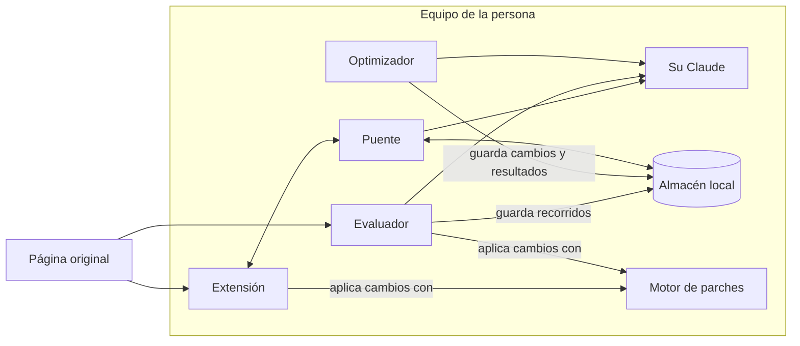

# Qué estamos construyendo y a dónde va

Este documento es el punto de entrada. Explica de dónde venimos, cuál es la idea, qué piezas tiene y en qué estado
está cada una. No hace falta haber leído nada antes.

**Orden de lectura sugerido**

1. Este documento.
2. [El plan](../.spikes/2026-11-21-plan.md): qué hay que averiguar y qué hay que construir.
3. [Glosario](glosario.md): los términos, por si alguno no queda claro.
4. [Formas de datos](datos.md): solo cuando se vaya a programar.

## 1. De dónde venimos

Somos el equipo 36 de la hackatón, en el track Multiplayer. La idea de partida fue una extensión de navegador que
usa el Claude de cada persona para adaptar cualquier página web a su gusto.

**Lo que ya funciona.** El [prototipo](../prototipo/README.md) hace esto: la persona escribe cómo quiere ver las
páginas ("modo oscuro, texto más grande"); la extensión le envía a su Claude la estructura de la página; Claude
devuelve una hoja de estilo; la extensión la aplica. Tarda entre 7 y 10 segundos y la segunda visita sale de la
caché.

**Lo que aprendimos con él.**

- Claude escribe el estilo sin ver el resultado. A veces rompe la página: en las pruebas dejó un panel sin oscurecer
  y unas tarjetas demasiado estrechas.
- No tenemos cómo saber si un cambio ayuda o estorba. Solo sabemos si a la persona le gusta.

**Lo que ya propuso el equipo.** [specs/MVP.md](../specs/MVP.md) añade dos ideas: registrar los recorridos de las
personas, y validar un cambio con agentes de IA que hacen una tarea en el sitio. Este documento toma esa segunda idea
y la pone en el centro.

## 2. La idea

```
página que ve la persona = página original + optimizaciones + soul
```

- **Página original:** el sitio tal como lo sirve su dueño. No se toca; todo se aplica encima, en el navegador.
- **Optimizaciones:** cambios que hacen que una tarea se complete mejor para cualquiera. No se aceptan por gusto,
  sino con evidencia.
- **Soul:** el perfil de preferencias de una persona. Ajusta la página a ella y nunca sale de su equipo.

### Un ejemplo

Un formulario de inscripción tiene tres pasos. En el segundo hay dos botones que dicen "Continuar": uno avanza y el
otro vuelve al inicio.

1. **Se mide.** Veinte agentes de IA intentan inscribirse, cada uno con una conducta distinta (uno impaciente, uno
   que lee todo…). Solo seis lo logran. El registro de sus pasos muestra que la mayoría se pierde en el segundo paso.
2. **Se propone un cambio.** Renombrar el botón que avanza a "Siguiente paso" y darle más peso visual.
3. **Se vuelve a medir.** Con el cambio, quince de veinte lo logran. Además se comprueba que sigue siendo igual de
   fácil cancelar la inscripción: un cambio que mejora el número a costa de atrapar a la gente se rechaza.
4. **Se acepta.** Eso es una optimización: sirve a cualquiera que quiera inscribirse.
5. **Entra la soul.** Ana prefiere colores apagados y texto grande. Su soul ajusta la página a eso, encima de la
   optimización.
6. **Se comprueba para Ana.** Los colores apagados de Ana le quitan el peso visual al botón. Un agente que navega
   "como Ana" lo detecta, y el sistema conserva para ella el cambio de nombre, que su soul no altera.

**Por qué las dos cosas van juntas.** Una optimización es un promedio: funciona para la mayoría y puede fallarle a
una persona concreta. La soul la ajusta a esa persona, y permite comprobarlo sin esperar a tener usuarios reales.

**Qué tiene de multiplayer.** Una optimización aceptada sirve a todos los que usan ese sitio. Compartirlas entre
personas es el paso siguiente; hoy todo corre en el equipo de cada una.

## 3. Las piezas

Todo corre en el equipo de la persona. No hay servidor propio.



| Pieza | Qué hace | Estado hoy |
|---|---|---|
| **Puente** | Conecta la extensión con el Claude de la persona. | Funciona en el prototipo. |
| **Extensión** | Aplica los cambios al navegar y explica por qué la página se ve así. | El prototipo aplica una hoja de estilo; no explica nada. |
| **Soul** | Guarda las preferencias de la persona y las convierte en cambios para cada sitio. | El prototipo guarda una sola instrucción. |
| **Motor de parches** | Aplica cambios a una página de forma segura y reversible. | No existe. El prototipo aplica estilo libre. |
| **Evaluador** | Lanza agentes que intentan una tarea y registra dónde se pierden. | No existe. |
| **Optimizador** | Propone cambios a partir de lo que encontró el evaluador y decide cuál se acepta. | No existe. |
| **Almacén local** | Guarda en archivos lo aprendido de cada sitio. | No existe. |

### Puente

Un programa pequeño en el equipo de la persona. Recibe peticiones de la extensión, se las pasa a su Claude y devuelve
la respuesta. Existe porque una extensión no puede hablar con Claude directamente usando la sesión de la persona.

Ya funciona: `prototipo/puente/puente.py`. Le falta comprobar que quien lo llama es la extensión y no una página web
cualquiera.

### Extensión

Lo que la persona instala y ve. Al cargar una página aplica los cambios guardados para ese sitio. Debe poder
responder "¿por qué esta página se ve así?" y mostrar la original con un clic.

### Soul

Un archivo que la persona puede leer, corregir y borrar, con sus preferencias. De él sale, para cada sitio, un
conjunto de cambios de presentación. También sirve para crear un agente que navega "como esa persona".

La llamamos soul porque es lo que hace que la página sea de esa persona. No es la personalidad de un agente.

### Motor de parches

Un **parche** es una lista de cambios escritos como datos, no como código: "renombra este botón", "oculta este
bloque", "cambia este color". El motor los aplica, los puede deshacer y comprueba después que nada importante se
rompió: que los botones para salir, cancelar o rechazar siguen ahí y se pueden pulsar.

Lo usan tanto la extensión como el evaluador. Así, lo que miden los agentes es exactamente lo que verá la persona.

Reemplaza la hoja de estilo libre del prototipo, que es la que a veces rompía la página.

### Evaluador

Lanza agentes de IA que intentan una **tarea** en una página: inscribirse, encontrar un dato, completar un trámite.
Cada agente ve la página como una captura con los elementos numerados y elige qué hacer. Que lo haya logrado lo
decide el programa, no el agente.

De todos los intentos sale un **grafo de navegación**: por qué etapas pasan, por dónde siguen y dónde abandonan.

La página sobre la que se evalúa no está fijada. La elige quien construya esta pieza.

### Optimizador

Lee el grafo de navegación, propone parches y pide al evaluador que los mida. Acepta un parche solo si mejora la
tarea y no empeora una **salvaguarda**: una tarea contraria que debe seguir siendo igual de fácil, como cancelar o
rechazar un extra. Una persona aprueba antes de que el cambio quede activo.

### Almacén local

Archivos en el equipo de la persona con las tareas, los parches, los recorridos de los agentes y los resultados de
cada sitio. La soul se guarda aparte y nunca se exporta.

## 4. Lo que esto no es

- No demuestra que una página sea más usable para personas. Los agentes señalan problemas candidatos; no reemplazan
  una prueba con usuarios.
- No actúa en sitios con sesión iniciada, pagos o consecuencias reales.
- No comparte nada entre personas todavía.

## 5. Qué sigue

Antes de construir hay que averiguar cuatro cosas, empezando por cómo se conectan el Claude de la persona y la
interfaz de una página. Está en [el plan](../.spikes/2026-11-21-plan.md).

Material de apoyo: [investigación previa](investigacion-ui-adaptativa.md) sobre interfaces adaptativas y
[referencias](referencias.md) de herramientas que podrían sumarse.
