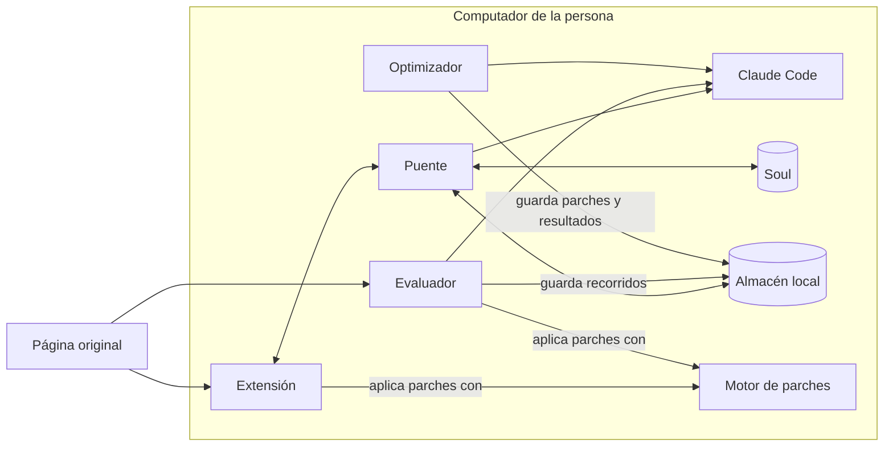

# Páginas web que se adaptan a cada persona, con cambios que se prueban antes de aplicarse

**Qué es este documento.** El punto de entrada del proyecto, para cualquiera del equipo o del jurado. No hace falta
haber leído nada antes. Es una **propuesta en revisión**: cambia el rumbo respecto de [.specs/MVP.md](../.specs/MVP.md),
y la sección 1 dice en qué.

**En un párrafo.** Una extensión de navegador mejora cualquier página web sin tocar el sitio original. Hace dos
cosas. Primero **optimiza**: agentes de IA intentan una tarea en la página, se registra dónde se pierden, se propone
un cambio acotado y se acepta solo si más agentes logran la tarea y sigue siendo igual de fácil cancelar o rechazar.
Después **personaliza**: la *soul*, un archivo con las preferencias de la persona que nunca sale de su computador,
ajusta la página encima de esas optimizaciones. Hoy funciona un prototipo que adapta el estilo de una página; la
evaluación con agentes está planificada y aún no construida.

El producto todavía no tiene nombre. Somos el equipo 36 de la hackatón, categoría Multiplayer.

**Orden de lectura**

1. Este documento: de dónde venimos, la idea y las piezas.
2. [El plan](plan.md): qué hay que averiguar y qué hay que construir.
3. [Glosario](glosario.md): para consultar un término.
4. [Formas de datos](formas-de-datos.md): solo al programar.

**Sobre el idioma.** Los documentos van en español. El código y los datos usan nombres en inglés; el glosario dice
cuál corresponde a cada término. En el texto solo se dejan en inglés *soul*, *spike*, *PR* y *script*.

## 1. De dónde venimos

### Lo que ya funciona

El prototipo es una extensión de Firefox. La persona escribe cómo quiere ver las páginas ("modo oscuro, texto más
grande"). La extensión envía la estructura de la página a Claude, Claude devuelve una hoja de estilo y la extensión la
aplica. El panel muestra una explicación de lo que cambió y permite ver la página original.

El prototipo se retiró del repositorio en la PR #13 y queda en el historial de git. La extensión actual del proyecto
es [Chameleon](../extension/README.md), que aplica temas por sitio con su servidor en `backend/`.

"Claude" aquí es Claude Code, instalado en el computador de la persona y con su sesión iniciada. La extensión no
puede hablar con él directamente; lo hace a través de un programa pequeño que llamamos **puente**.

Una adaptación tardó 6,6, 8,7 y 9,7 segundos en las tres páginas medidas el 2026-11-21. La segunda visita a un sitio
sale de la caché.

### Lo que aprendimos

- **Claude escribe el estilo sin ver el resultado.** Según las notas del prototipo, dejó un panel sin oscurecer y
  unas tarjetas demasiado estrechas.
- **No sabemos si un cambio ayuda o estorba.** Solo sabemos si a la persona le gusta.

### Qué cambia respecto de `.specs/MVP.md`

Ese documento propone más que el prototipo: un servidor central donde las personas comparten y valoran sus
adaptaciones, un recomendador, el registro de cómo navega cada persona, y una validación con agentes de IA.

Esta propuesta **toma la validación con agentes y la pone en el centro**, y **deja fuera, por ahora, el servidor
central, las valoraciones y el recomendador**. La razón: hoy no podemos decir si una adaptación es buena, y compartir
adaptaciones sin saberlo reparte el problema. Primero hay que poder medir.

La consecuencia hay que decirla: **con esta propuesta, nada se comparte entre personas todavía.** Lo que una persona
mide queda en su computador. Lo multiplayer pasa a ser el paso siguiente: compartir optimizaciones que ya traen su
evidencia. Si el equipo necesita mostrar algo compartido en la hackatón, hay que decidirlo ahora; está en la lista de
decisiones del [plan](plan.md).

## 2. La idea

```
página que ve la persona = página original + optimizaciones + soul
```

- **Página original:** el sitio tal como lo sirve su dueño. No se toca; todo se aplica encima, en el navegador.
- **Optimizaciones:** cambios que hacen que una tarea se complete mejor para cualquiera. Solo se aceptan si una
  medición muestra que mejoran la tarea.
- **Soul:** las preferencias de una persona. Ajusta la página a ella y nunca sale de su computador.

### Un ejemplo

Un formulario de inscripción tiene tres etapas. En la segunda hay dos botones que dicen "Continuar": uno avanza y el
otro vuelve al inicio.

1. **Se mide.** La persona pide evaluar el formulario. En su computador, veinte agentes de IA intentan inscribirse,
   cada uno con una conducta distinta (uno impaciente, uno que lee todo). Solo seis lo logran. Sus recorridos
   muestran que la mayoría se pierde en la segunda etapa.
2. **Se propone un parche.** Renombrar el botón que avanza a "Siguiente paso" y darle más peso visual.
3. **Se vuelve a medir.** Con el parche, quince de veinte lo logran. Además se comprueba una salvaguarda: cancelar la
   inscripción sigue siendo igual de fácil. Un parche que mejora el número a costa de atrapar a la gente se rechaza.
4. **Se acepta.** Eso es una optimización: sirve a cualquiera que quiera inscribirse.
5. **Entra la soul.** Ana prefiere colores apagados y texto grande. Su soul ajusta la página a eso, encima de la
   optimización.
6. **Se comprueba para Ana.** Los colores apagados de Ana le quitan el peso visual al botón. Un agente con la soul de
   Ana lo nota: el botón ya no destaca. Para ella, la optimización se reduce al nuevo nombre del botón, que su soul
   no toca.

**Por qué las dos cosas van juntas.** Una optimización es un promedio: funciona para la mayoría y puede fallarle a
una persona concreta. La soul adapta la página a esa persona, y un agente con esa soul comprueba que la optimización
le sigue sirviendo, sin esperar a tener usuarios reales.

Los pasos 1 a 5 son lo que el plan intenta construir. El paso 6 queda para después.

## 3. Las piezas

Todo corre en el computador de la persona, con su propio Claude. No hay servidor.



| Pieza | Estado hoy |
|---|---|
| Puente | Funciona en el prototipo. |
| Extensión | El prototipo aplica una hoja de estilo, la explica y muestra la original. |
| Soul | El prototipo guarda una sola instrucción escrita por la persona. |
| Motor de parches | No existe. |
| Evaluador | No existe. Hay dos bases: las pruebas del prototipo ya manejan un navegador sin ventana, y la PR #6 recorre tres tareas en sitios reales con pasos escritos a mano. |
| Optimizador | No existe. |
| Almacén local | No existe. |

### Puente

Un programa en el computador de la persona. Recibe peticiones de la extensión, se las pasa a Claude Code y devuelve
la respuesta. Ya rechaza las peticiones que vienen de una página web. Le falta un código de emparejamiento, para que
tampoco lo pueda usar otro programa del mismo computador.

### Extensión

Lo que la persona instala y ve. Al cargar una página aplica lo guardado para ese sitio. Hoy explica la hoja de estilo
que generó; con esta propuesta tendría que explicar además qué optimización está aplicada y sobre cuántos intentos
se midió.

### Soul

Un archivo que la persona puede leer, corregir y borrar, con sus preferencias. De él sale, para cada sitio, un parche
que solo cambia la presentación. También sirve para crear un agente que navega con esas preferencias.

La llamamos soul porque reúne lo que hace que una página se sienta propia. No es la personalidad de un agente.

### Motor de parches

Un **parche** es una lista de cambios escritos como datos, no como código: "renombra este botón", "oculta este
bloque", "cambia este color". El motor los aplica, los puede deshacer y hace después una **comprobación de
seguridad**: los botones para salir, cancelar o rechazar siguen ahí y se pueden pulsar.

Reemplaza la hoja de estilo libre del prototipo, que Claude escribe sin restricciones y que a veces rompía la página.

Lo usan la extensión y el evaluador. Así, la optimización que miden los agentes es la misma que se le aplica a la
persona. Lo que los agentes no ven es la soul de cada persona; de eso trata el paso 6 del ejemplo.

### Evaluador

Lanza agentes de IA que intentan una **tarea** en una página: inscribirse, encontrar un dato, completar un trámite.
Cada agente recibe la página, elige una acción, la ejecuta y repite. El programa, y no el agente, decide si la tarea
se logró.

De todos los intentos sale un **grafo de navegación**: por qué etapas pasan los agentes, por dónde siguen y dónde
abandonan.

Qué recibe exactamente el agente (solo la estructura de la página, o también una captura) es lo primero que hay que
averiguar. Como página de prueba hay tres candidatas en sitios chilenos reales (PR #6); el plan dice qué les falta.

La evaluación la lanza la persona, en su computador, y gasta de su propio plan de Claude.

### Optimizador

Lee el grafo de navegación, propone parches y le pide al evaluador que los mida. Acepta un parche solo si mejora la
tarea y no empeora una **salvaguarda**: una tarea contraria que debe seguir siendo igual de fácil, como cancelar o
rechazar un extra. Una persona aprueba antes de que el parche quede activo.

### Almacén local

Archivos en el computador de la persona con las tareas, los parches, los recorridos y los resultados de cada sitio.
La soul se guarda aparte y nunca se exporta.

## 4. Lo que esto no es

- No demuestra que una página sea más usable para personas. Los agentes señalan problemas candidatos; no reemplazan
  una prueba con usuarios.
- No actúa en sitios con sesión iniciada, pagos o consecuencias reales.
- No comparte nada entre personas todavía.

## 5. Qué sigue

[El plan](plan.md) dice qué hay que averiguar primero y qué hay que construir.

Material de apoyo: [investigación previa](investigacion-ui-adaptativa.md) sobre interfaces adaptativas y
[referencias](referencias.md) de herramientas que podrían sumarse. Lo de los agentes está en [agents/](agents/README.md):
el diseño del [evaluador](agents/evaluador.md), que usa una página solo a partir de capturas; la
[arquitectura](agents/arquitectura.md), con los directorios y AgentCore; y los [niveles de cambio a una
página](agents/niveles-de-cambio.md), del estilo a una interfaz nueva.
