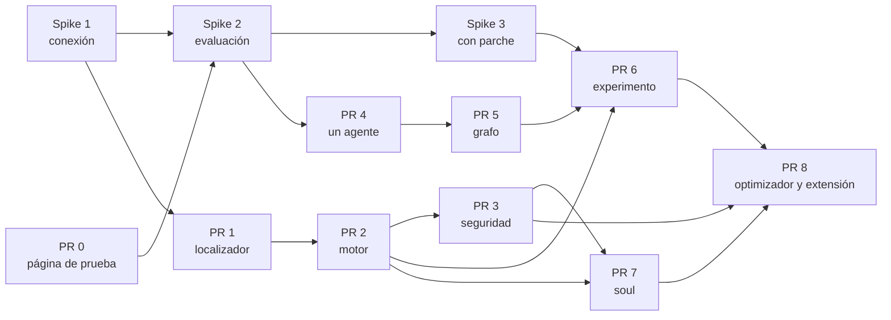

# Plan: qué hay que averiguar y qué hay que construir

> Evaluador = Visitante ([`agents/app/visitor/`](../agents/app/visitor/README.md)).

**Qué es este documento.** El plan de trabajo, para quienes van a programar. Parte de
[la propuesta](index.md); conviene leerla antes. Fecha: 2026-11-21. Se escribió leyendo el repositorio en `main`
(`d9556ea`) y la PR #6, todavía sin fusionar; no se ejecutó nada para escribirlo.

## Resumen

El prototipo resolvió la mitad del camino: la extensión consulta a Claude y aplica su respuesta. Falta que Claude vea
lo que hizo, que agentes prueben una página, y que un parche se acepte con una medición.

El trabajo tiene dos partes:

1. **Tres spikes**, que contestan lo que no sabemos. Van primero. Cómo se escriben está en
   [.spikes/README.md](../.spikes/README.md).
2. **Nueve PRs**, que construyen lo que los spikes confirmen. No caben todos en la hackatón: la sección 7 propone qué
   hacer primero.

## 1. Lo que no sabemos

De estas tres preguntas depende casi todo. Por eso hay spikes.

- **Cómo hacer que Claude vea una página y el resultado de un parche.** Hoy el puente le envía solo texto y no le
  permite usar herramientas. No está probado cómo hacerle llegar una captura.
- **Cuánto tarda y cuesta un paso de un agente.** Si se parece a una adaptación del prototipo (de 6,6 a 9,7 s), cien
  intentos de ocho pasos son unas dos horas seguidas. Es una suposición: no está medido.
- **Cuántos intentos hacen falta para ver una mejora.** Con veinte por lado solo se distinguen mejoras muy grandes
  (de 30 % a 75 % de éxito, no de 30 % a 60 %). La página de prueba necesita un defecto grande.

Hay una cuarta que no intentamos responder: si lo que le cuesta a un agente le cuesta a una persona.

## 2. Lo que ya está decidido

| Decisión | Por qué |
|---|---|
| Un cambio a una página se escribe como datos (un parche), no como código ni como estilo libre. | El estilo libre rompió páginas en el prototipo. Un parche se puede validar, deshacer y explicar. El spike 1 confirma si Claude los escribe bien. |
| La extensión y el evaluador aplican los parches con el mismo código. | Si difieren, lo que miden los agentes no es lo que se le aplica a la persona. |
| El programa decide si una tarea se logró. | Lo que un agente dice de su propio éxito no es evidencia. |
| La extensión sigue en Firefox. | Es donde funciona el prototipo. |
| Todo se guarda en archivos locales, sin servidor. | Alcanza para medir. Deja fuera lo compartido; ver "Decisiones del equipo". |

### Reglas

- Ningún parche oculta, mueve ni debilita un elemento protegido: lo que sirve para salir, rechazar o cancelar.
- Ningún agente causa consecuencias reales: sin sesión iniciada, sin pagos, sin enviar datos a terceros.
- La soul no sale del computador de la persona, salvo hacia su propio Claude.
- Lo que viene de una página se trata como datos, nunca como instrucciones para Claude.
- Cada número mostrado indica sobre cuántos intentos se calculó y aclara que mide agentes, no personas.

## 3. Qué página sirve de prueba

El plan no fija la página de prueba. La elige quien haga el PR 0. Sirve si:

- se puede volver a su estado inicial;
- una secuencia de pasos escrita a mano llega al final de la tarea;
- el programa puede comprobar si la tarea se logró;
- tiene una salvaguarda que vigilar (cancelar, rechazar un extra);
- tiene un defecto conocido y grande, para que haya algo que mejorar;
- no causa consecuencias reales y, si es de terceros, sus condiciones permiten el uso automatizado.

Hay dos candidatas, y sirven para cosas distintas:

- **Una página propia, servida en local.** Permite encender y apagar un defecto y repetir sin sorpresas. Es la que
  usa el spike 1 y la que sirve para calibrar a los agentes. La página de demostración del prototipo no sirve tal
  cual: es una portada de noticias, sin ninguna tarea que completar.
- **Sitios reales.** La PR #6 trae tres tareas en sitios chilenos (dar de baja un servicio en wom.cl, una exención
  en sii.cl, un reclamo en dt.gob.cl), sin sesión iniciada. Cada una tiene una secuencia de pasos escrita a mano que
  llega al final y una condición de éxito que comprueba el programa. Son mejores para mostrar, porque el defecto es
  real.

A las tareas de la PR #6 les falta, respecto de la lista de arriba: una salvaguarda por tarea; revisar que las
condiciones de cada sitio permitan el uso automatizado; y asumir que el sitio cambia (su README ya pide volver a
validar antes de mostrar). En un sitio real no hay versión "sin el defecto": se compara el sitio tal cual contra el
sitio con un parche.

## 4. Los tres spikes

Van en orden. Cada uno usa lo que dejó el anterior.

### Spike 1 · Cómo se conectan Claude y la interfaz de una página

**Es el primero. Todo lo demás depende de él.**

**Qué queremos saber.** Cómo se relacionan el Claude del computador de la persona y la interfaz de una página local:

- **De la página a Claude.** ¿Le basta la estructura en texto, o necesita también una captura?
- **De Claude a la página.** ¿Escribe un parche que se pueda aplicar tal cual? ¿Reconoce, al ver el resultado, si
  quedó bien?
- **Con las preferencias en medio.** Dadas tres preferencias, ¿el parche las refleja?

Pulsar y escribir en la página queda para el spike 2.

**Qué hay que preparar**

- Una página local sencilla con tres defectos puestos a propósito (por ejemplo: dos botones con el mismo nombre, un
  texto con poco contraste, un bloque que estorba).
- Tres preferencias fijas, escritas antes de empezar (por ejemplo: fondo oscuro, texto grande, sin bloques
  laterales).
- Un aplicador mínimo, de unas treinta líneas, que ejecute en la página los tres cambios del parche: estilo, ocultar
  y renombrar. No es el motor de parches: se tira.
- La forma de llamar a Claude que ya usa el puente, con una respuesta que sigue un formato fijo.
- **Lo primero que hay que resolver:** cómo hacerle llegar una captura a Claude. Si en media hora no hay forma, el
  spike sigue solo con la estructura en texto, y eso ya es una respuesta.

**Qué se hace.** Dos condiciones, cinco repeticiones cada una:

- **A:** Claude recibe la estructura de la página en texto (qué es cada elemento y cómo se llama).
- **B:** recibe lo mismo más una captura.

En cada repetición: Claude escribe un parche; el aplicador lo ejecuta; una segunda llamada recibe la página ya
cambiada y responde si quedó bien y por qué. En una repetición por condición se aplica a propósito un parche roto,
para ver si lo detecta.

**Qué se anota**

- Si el parche respeta el formato.
- Si cada cambio encuentra exactamente un elemento.
- Si las tres preferencias quedaron reflejadas, comprobado por el script y no a ojo.
- Si Claude detectó el parche roto.
- Cuántos segundos tardó cada tramo.

**Cómo se decide, fijado de antemano**

- El formato de parche sirve si al menos 4 de 5 parches se aplican completos.
- La captura se usa solo si con ella Claude detecta el parche roto y sin ella no.
- Si una vuelta completa tarda más de 15 segundos con captura, los agentes del spike 2 trabajan solo con texto.

**Si sale mal.** Si menos de 4 de 5 parches se aplican en las dos condiciones, el formato de parche de
[formas de datos](formas-de-datos.md) no sirve como está y hay que simplificarlo antes de seguir.

### Spike 2 · De una página a un grafo de navegación

**Qué queremos saber.** Si agentes locales pueden intentar una tarea de varios pasos en una página, y si de sus
recorridos sale un dato útil. También cuánto tarda y cuesta.

**Qué hay que preparar.** La página local del spike 1, ampliada a una tarea de varios pasos con un defecto que se
puede apagar, y su tarea escrita a mano. Lo que el spike 1 haya decidido sobre qué recibe el agente. Si queda
tiempo, se repite con una tarea de la PR #6.

**Qué se hace**

1. Un agente intenta la tarea: recibe la página, elige una acción (pulsar, escribir, volver, rendirse), el script la
   ejecuta, y se repite hasta terminar o llegar a 15 pasos.
2. Diez intentos sobre la página sin el defecto. Diez sobre la página con el defecto.
3. Se lanzan 1, 2 y 4 intentos a la vez, para ver cuántos aguanta la sesión de Claude sin errores por límite de uso.
4. Los recorridos se guardan en archivos y se resumen en un grafo: cuántos llegan, por dónde, y en qué etapa
   abandonan.

**Qué se anota.** Intentos logrados en cada versión, segundos y costo por paso, errores por límite de uso, y los
archivos tal como quedaron.

**Qué decidimos con la respuesta.** Si el evaluador es viable, cuántos intentos podemos permitirnos en la hackatón, y
cómo se guardan los recorridos. El informe compara los archivos reales con [formas de datos](formas-de-datos.md) y
corrige la propuesta donde no calce.

**Si sale mal.** Si menos de 7 de 10 intentos logran la tarea en la página sin el defecto, o si un paso tarda más de
30 segundos, el evaluador no cabe en la hackatón. El plan se reduce a la soul y al motor de parches.

### Spike 3 · La misma evaluación, con un parche aplicado

**Qué queremos saber.** Si la evaluación distingue la página con un parche de la página original.

**Qué se hace.** Dos parches escritos a mano: uno que quita el defecto y otro que no debería cambiar nada. Veinte
intentos con cada uno y veinte con la página original, partidos en dos mitades para compararla consigo misma.

**Qué se anota.** Los tres grafos, la tasa de éxito de cada uno y el tiempo total.

**Qué decidimos con la respuesta.** Si medir, aplicar un parche y volver a medir da una señal que se distingue del
azar con los intentos que podemos pagar.

**Límite conocido.** Son unos sesenta intentos. Con veinte por lado solo se ve una mejora muy grande. Si el spike 2
muestra que sesenta intentos no caben, este spike se hace con diez por lado y se dice que es solo una demostración.

## 5. Los nueve PRs

Cada uno tiene una condición para darlo por terminado. Cómo se programa lo decide quien lo toma.

| # | Qué construye | Necesita | Está terminado cuando |
|---|---|---|---|
| 0 | **Páginas de prueba.** Una local, con un defecto que se puede encender y apagar; y las tareas en sitios reales de la PR #6, cada una con su salvaguarda. | PR #6 | Cada una cumple la lista de la sección 3, y una secuencia de pasos escrita a mano logra la tarea. |
| 1 | **Localizador.** Encontrar un elemento por lo que es y cómo se llama. | Spike 1 | En la página de prueba, cada elemento que se puede pulsar se encuentra de forma única, o el programa dice que no pudo. |
| 2 | **Motor de parches.** Aplicar y deshacer tres cambios: estilo, ocultar y renombrar. | PR 1 | El mismo parche produce la misma página aplicado desde la extensión y desde el evaluador (misma estructura y mismos estilos), y deshacerlo devuelve la original. |
| 3 | **Comprobación de seguridad.** Detectar los elementos protegidos y verificar que siguen visibles y se pueden pulsar. | PR 2 | Un grupo de parches tramposos (ocultar "No, gracias", volver invisible un enlace de salida, renombrar un precio) se rechaza completo. |
| 4 | **Un agente intenta la tarea** y deja su recorrido. | Spike 2, PR 0 | Hay un recorrido en disco de un intento real, con el resultado decidido por el programa. |
| 5 | **Muchos intentos y el grafo.** Varios perfiles de agente, un tope de gasto y el grafo de navegación. | PR 4 | Tras una tanda sobre la página original, el grafo muestra en qué etapa se abandona más, con ejemplos. |
| 6 | **Experimento.** Variante contra control, con una salvaguarda y una comprobación de azar. | PR 2, PR 5, spike 3 | Con recorridos grabados, la regla da "aceptada" para un parche que mejora y "no concluyente" para uno que no cambia nada. |
| 7 | **Soul.** Un archivo de preferencias que se puede editar y el parche que sale de él para un sitio. | Spike 1, PR 2, PR 3 | Tres souls distintas producen tres parches válidos sobre la misma página; el script comprueba que cada uno refleja sus preferencias y pasa la comprobación de seguridad. |
| 8 | **Optimizador y extensión.** Claude propone un parche a partir del grafo; una persona lo aprueba; la extensión aplica la variante aceptada con la soul encima y lo explica. | PR 3, 6, 7 | En el navegador se ve la página final, qué cambió, sobre cuántos intentos se midió, y la original con un clic. |

El PR 0 puede empezar ya, a la vez que el spike 1. Después del spike 1 hay tres líneas que avanzan en paralelo: el
motor (PR 1 a 3), el evaluador (PR 4 a 6) y la soul (PR 7).

**Lo que este plan todavía no cubre:** el código de emparejamiento del puente; que el puente le entregue parches y
resultados a la extensión, que no puede leer archivos; y cómo conviven las hojas de estilo que el prototipo ya guardó
con los parches nuevos. Se resuelven dentro del PR 8 o antes, si alguien los necesita.

## 6. Decisiones del equipo

Este plan no puede tomarlas. Hay que cerrarlas antes de repartir el trabajo.

| Decisión | Por qué importa |
|---|---|
| **¿Esta propuesta reemplaza a `.specs/MVP.md`, o conviven?** | Hoy hay dos documentos que apuntan a cosas distintas. |
| **¿Qué se muestra de multiplayer?** | Esta propuesta no comparte nada entre personas. Si la categoría lo exige, hay que sumar algo compartido o explicar por qué es el paso siguiente. |
| **¿Qué se muestra al final, y a qué hora se cierra?** | De eso depende el recorte de la sección 7. |
| **¿Quién toma cada spike y cada línea?** | Hay trabajo para tres líneas en paralelo más la página de prueba. |
| **¿Alcanza el plan de Claude de cada uno?** | El evaluador gasta de la misma cuota que se usa para programar. El spike 2 da el número. |
| **¿Con qué navegador trabaja el evaluador?** | Las pruebas del prototipo manejan Firefox; la PR #6 maneja Chrome con otra herramienta. Si el evaluador usa Chrome y la extensión Firefox, el motor de parches tiene que dar el mismo resultado en los dos (condición del PR 2). |
| **¿Qué nombres se usan?** | La PR #6 dice "misión" y "enjambre" y escribe los campos en español (`sitio`, `pasos`, `exito`). Esta propuesta dice "tarea" y "evaluador" y los escribe en inglés. Hay que elegir antes de que haya más código. |

## 7. Propuesta de recorte

Los nueve PRs no caben. Si hay que elegir, este orden muestra lo esencial de la idea con lo mínimo:

1. **Primero:** spike 1, PR 0, PR 1 y PR 2. Queda un parche aplicado en una página, de forma segura.
2. **Después:** spike 2, PR 4 y PR 6 con un parche escrito a mano. Queda el antes y el después medido con agentes.
3. **Si sobra tiempo:** PR 3, PR 5, PR 7 y PR 8.

Con los dos primeros puntos se puede mostrar: "veinte agentes intentan la tarea, tantos fallan aquí; con este parche,
tantos más lo logran". La soul queda representada por lo que ya hace el prototipo.

Es una propuesta. Si el equipo prefiere mostrar la soul antes que la medición, el orden cambia.

## 8. Lo que dejamos fuera

- Compartir optimizaciones entre personas, y el servidor central de `.specs/MVP.md`.
- Usar la navegación de personas reales como dato.
- Combinar varios parches y medir cuánto aporta cada uno.
- Que Claude proponga la tarea de un sitio que no conoce.
- Comprobar una optimización con la soul de una persona encima (el paso 6 del ejemplo de la propuesta).
- Cambiar los nombres del código del prototipo.
