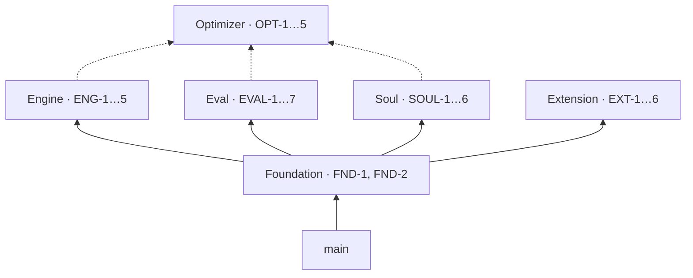

# Camaleón · spec raíz

| | |
|---|---|
| **Status** | Draft, para revisión del equipo |
| **Updated** | 2026-11-21 |
| **Nombre** | Provisional |

Términos en [glossary.md](glossary.md). Formas de datos y reglas en [contracts.md](contracts.md).

## 1. Qué es

```
página efectiva = source page + optimizations + soul
```

Un usuario, con la IA que corre en su propio equipo, hace que un sitio web le funcione mejor.

- Las **optimizations** son patches que hacen que una task se complete mejor. Se validan con evidencia: un harness
  lanza agentes que navegan el sitio.
- La **soul** es el perfil de preferencias del usuario. No sale de su equipo.
- La source page no se modifica: todo se aplica encima, en el navegador, con una extensión.

**Por qué van juntas.** Una optimization es un promedio de la población y puede fallarle a un usuario concreto. La
soul convierte "funciona para la población" en "funciona para ti", y permite comprobarlo sin tráfico real.

## 2. Foco inicial

Un solo flujo de punta a punta, sobre **un target que elige y documenta quien toma EVAL-1**. Ningún spec asume un
sitio; los requisitos de un target válido están en EVAL-1.

**Hito 1 — el bucle cierra.**

1. El harness intenta la task del target y produce un navigation graph con el stage de mayor abandono.
2. Se propone un optimization patch, se corre un experiment y se acepta con evidencia.
3. El usuario tiene una soul; su soul patch se aplica encima.
4. La extensión muestra la página efectiva y explica qué cambió y con qué evidencia.

**Hito 2 — la fórmula se sostiene.** Un soul patch anula el efecto de un optimization patch; la soul persona lo
detecta en un experiment; el sistema ofrece un patch que la soul no puede anular.

Fuera de alcance: todo lo que no sirva a estos dos hitos.

### Punto de partida

El [prototipo](../prototipo/README.md) ya conecta una extensión con la IA local del usuario y aplica una hoja de
estilo generada, con pruebas de punta a punta y tiempos medidos. Es evidencia para el stack Soul y para FND-2.

| Ya existe en el prototipo | Lo que falta | PRs |
|---|---|---|
| Bridge que llama a la IA del usuario y responde a la extensión. | Pairing token; un cliente compartido con salida validada. | SOUL-1, SOUL-2 |
| Mapa de la página sin texto ni valores. | Locators y lista de elementos visibles, compartidos con el harness. | ENG-1 |
| Hoja de estilo saneada, en caché por host. | Patches declarativos, con operaciones cerradas, protected elements e invariants. | ENG-2, ENG-3, SOUL-4 |
| Una instrucción global escrita por el usuario. | Una soul que se ve, se corrige y se borra. | SOUL-3 |
| Pruebas con navegador sin ventana. | Target, harness, navigation graph y experiment. | EVAL-1 a EVAL-5 |

Las ideas de recorridos de usuarios y de validación con agentes que el equipo ya propuso quedan recogidas en el
stack Eval.

## 3. Objetivos y no-objetivos

| # | Objetivo | Lo prueban |
|---|---|---|
| G1 | Medir si la personalización con IA local es factible (latencia, tasa de patches válidos). | SOUL-4, SOUL-6 |
| G2 | Producir un navigation graph a partir de runs de agentes, guardado en local. | EVAL-2 a EVAL-4 |
| G3 | Cerrar el bucle medir → proponer → volver a medir, con guardrails medidos. | EVAL-5, OPT-1 a OPT-3 |
| G4 | Aplicar `source page + patches` igual en la extensión y en el harness. | ENG-2, ENG-4, EXT-3 |
| G5 | Mostrar que soul y optimizations se necesitan (hito 2). | OPT-4 |

**No-objetivos**, a propósito:

- Compartir optimizations entre usuarios. Se diseña (EXT-6); no se construye.
- Targets con sesión iniciada, pagos o efectos reales.
- Probar que mejora la usabilidad para humanos. Los agentes dan fricciones candidatas.
- Ejecutar código generado por un modelo. Los patches son datos.
- Publicación en tiendas de extensiones y cuentas de usuario.

## 4. Stacks

Cada stack es una serie de PRs apilados. Foundation se fusiona a `main` primero; los demás nacen de `main`, no unos
de otros.



| # | Stack | Spec | Entrega |
|---|---|---|---|
| 0 | Foundation | [stacks/0-foundation.md](stacks/0-foundation.md) | Contratos ejecutables, fixtures e incógnitas de plataforma resueltas |
| 1 | Engine | [stacks/1-engine.md](stacks/1-engine.md) | El patch engine: aplicar, revertir, validar, invariants |
| 2 | Eval | [stacks/2-eval.md](stacks/2-eval.md) | Target, harness, trajectories, navigation graph, experiment |
| 3 | Soul | [stacks/3-soul.md](stacks/3-soul.md) | Bridge, cliente de IA, la soul y su soul patch |
| 4 | Extension | [stacks/4-extension.md](stacks/4-extension.md) | Local store y la extensión que aplica variants |
| 5 | Optimizer | [stacks/5-optimizer.md](stacks/5-optimizer.md) | Bucle de mejora y la prueba del hito 2 |

Las líneas punteadas son dependencias de datos reales; hasta entonces cada stack trabaja contra los fixtures de
FND-1. Los owners se asignan al tomar cada stack.

**Prioridades.** P0: necesario para el hito 1. P1: necesario para el hito 2. P2: se recorta primero.

### Orden de construcción

Los stacks se numeran en el orden en que se abren. Dentro de un stack, los PRs van en orden numérico. Entre stacks,
el orden lo dan estas oleadas: los PRs de una misma oleada se pueden construir en paralelo.

| Oleada | PRs | Al terminar existe |
|---|---|---|
| 0 | FND-1 → FND-2 | Contratos ejecutables, fixtures y decisiones de plataforma |
| 1 | ENG-1 · EVAL-1 · SOUL-1 · EXT-1 | Locators, un target validado, bridge emparejado, local store |
| 2 | ENG-2 · EVAL-2 · SOUL-2 · SOUL-3 · EXT-2 · OPT-1 (con fixtures) | Una variant aplicable, una trajectory real, cliente de IA, una soul, scaffold de la extensión |
| 3 | ENG-3 · EVAL-3 · EXT-3 | Validación e invariants, un batch de control, la extensión aplica una variant |
| 4 | ENG-4 · EVAL-4 · SOUL-4 · OPT-2 | Variant estable en la página, navigation graph, soul patch, candidate patches |
| 5 | EVAL-5 · EXT-4 · OPT-3 | Un experiment `accepted` y el panel que lo explica. **Hito 1.** |
| 6 | SOUL-6 · OPT-4 · EVAL-6 | Factibilidad medida, soul persona y la prueba de la fórmula. **Hito 2.** |
| 7 | ENG-5 · EVAL-7 · SOUL-5 · EXT-5 · EXT-6 · OPT-5 | Lo recortable (P2) |

## 5. Definition of Done

Un PR está hecho cuando:

- Cada requisito de su spec tiene **evidencia adjunta** en el PR: el comando y su salida, o una captura. Un
  requisito sin evidencia se considera no cumplido.
- Las comprobaciones globales pasan (las define FND-1).
- No cambia un contrato. Si lo necesita, va antes un PR sobre Foundation.
- Tiene un solo propósito e incluye sus pruebas. Si la descripción se alarga, se divide.

## 6. Decisiones

**Tomadas**

| Decisión | Fundamento |
|---|---|
| Los patches son datos declarativos; nunca código generado. | Seguridad, y las plataformas de extensiones prohíben código remoto. |
| Un único patch engine para la extensión y el harness. El harness lo inyecta; no carga la extensión. | Lo que se mide debe ser lo que ve el usuario (C6). |
| El éxito y los stages se evalúan por código. El navigation graph tiene stages como nodos y admite ciclos. | Los jueces LLM son poco fiables; los grafos de acciones no agregan. |
| La observation por defecto es `som`. | Las fricciones visuales deben afectar al agente. |
| Datos en archivos locales; ids derivados del contenido. | El foco no necesita servidor. |
| Una variant contiene solo optimization patches; el soul patch va encima. | Un experiment vale para cualquier usuario y la soul no viaja. |
| Un cambio de `source_hash` solo avisa; una operación `unresolved` repetida vuelve `stale` la variant. | El hash cambia con detalles irrelevantes. |
| La extensión sigue en el navegador del prototipo. | Funciona y está medida. |
| Un producto distribuible usa clave de API; la sesión personal solo vale para uso propio. | Términos del proveedor de IA. |

**Abiertas.** Las cierra el PR indicado, con evidencia.

| Decisión | PR |
|---|---|
| Transporte entre la extensión y el bridge. | FND-2, SOUL-1 |
| Cómo se invoca a la IA local (salida estructurada, imágenes, paralelismo). | FND-2, SOUL-2 |
| Proveedor y modelo del harness; costo por step. | FND-2, EVAL-3 |
| En qué navegador corre el harness. | FND-2, ENG-4 |
| Cómo se garantiza que un patch no cargue recursos externos ni debilite lo protegido. | ENG-3 |
| Cuándo se aplica una variant para evitar el destello de la source page y sobrevivir a re-renders. | ENG-4, EXT-3 |
| Permisos y forma del panel de la extensión. | EXT-2, EXT-4 |
| Si este spec reemplaza a `specs/MVP.md`. | Equipo |

## 7. Supuestos

| Supuesto | Lo verifica |
|---|---|
| La IA local responde con salida estructurada, sin herramientas y con imágenes. | FND-2 |
| El presupuesto de IA alcanza para un experiment con poder suficiente. | FND-2, EVAL-3 |
| Existe un target válido con margen de mejora en su línea base. | EVAL-1 |
| El patch engine da el mismo resultado en dos navegadores. | FND-2, ENG-4 |
| La conducta de un agente con observation `som` cambia ante fricciones visuales. | EVAL-3 |

## 8. Amenazas y controles

| Amenaza | Control | Requisitos |
|---|---|---|
| Una página inyecta instrucciones en lo que lee el modelo. | Lo que llega de una página son datos; el modelo no tiene herramientas. | SOUL-2, EVAL-6 |
| Una página llama al bridge. | Pairing token; se rechaza todo origen que no sea la extensión. | SOUL-1 |
| Un patch manipula al usuario (oculta la salida, inventa urgencia). | Operaciones cerradas, protected elements, invariants y guardrails medidos. | ENG-3, OPT-3 |
| Un patch importado es malicioso. | Se revalida entero y queda marcado como ajeno. | EXT-5 |
| La soul o las capturas salen del equipo. | Solo al proveedor de IA configurado, con aviso previo; nunca al exportar. | SOUL-3, EXT-5 |
| Un run causa efectos reales en un sitio. | `side_effects`, bloqueo de escrituras a terceros, requisitos del target. | EVAL-1, EVAL-2 |

## 9. Riesgos y plan de recorte

| Riesgo | Señal | Respuesta |
|---|---|---|
| El presupuesto de IA no alcanza para medir y programar a la vez. | FND-2 mide el costo por step. | Experiment mínimo y un target con más margen de mejora. |
| El éxito de un agente no es el de un usuario. | — | Se declara como límite; no se promete usabilidad humana. |
| Optimizar deriva en manipular. | Un guardrail queda `violated`. | El patch se rechaza. Es parte de la demostración. |
| El alcance no cabe. | Punto de control: una trajectory real sobre el target, un patch manual visible en la extensión y un soul patch generado. | Se recortan los P2, y después los P1. |

## 10. Cómo se trabaja

- Stacked PRs con el soporte nativo de la plataforma; si FND-1 muestra que no está disponible, ramas encadenadas.
- Un árbol de trabajo por persona o agente de código. Nunca dos agentes en la misma copia.
- Las decisiones que se cierran se registran con contexto, opciones y resultado.
