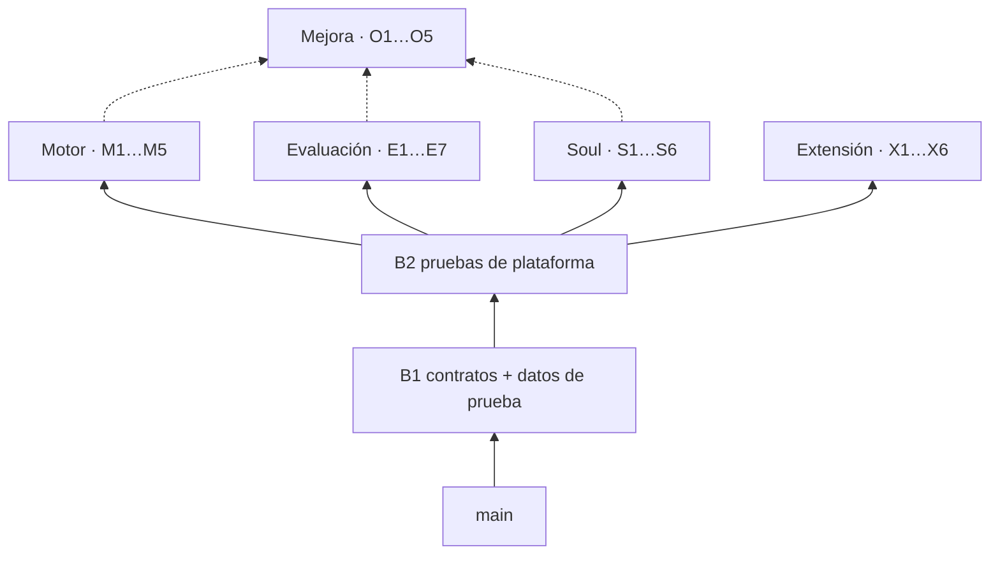

# Camaleón · documento raíz

*Nombre en código provisional. Propuesta para revisión del equipo, 2026-11-21.*

## 1. Qué es y para quién

```
página efectiva = página origen + optimizaciones + soul
```

Una persona, con la IA que corre en su propio equipo, hace que un sitio web le funcione mejor. Las **optimizaciones**
son capas de cambios que hacen que una misión se complete mejor, validadas con evidencia por un enjambre de agentes
que navega el sitio. La **soul** son las preferencias de esa persona, que nunca salen de su equipo. La página origen
no se toca: todo se aplica encima, en el navegador.

**Por qué van juntas:** una optimización es un promedio de la población y puede fallarle a una persona concreta. La
soul convierte "funciona para la población" en "funciona para ti", y permite comprobarlo sin tráfico real.

## 2. Foco inicial

Un solo flujo de punta a punta, sobre una tienda de demostración propia:

1. El enjambre intenta la misión "comprar un producto" y deja un **grafo de navegación** con el hito donde más se
   abandona.
2. Se propone una **capa de optimización**, se vuelve a medir y se acepta con evidencia.
3. La persona tiene una **soul**; su capa se aplica encima.
4. La **extensión** muestra la página efectiva y por qué se ve así.

**Prueba de que la fórmula se sostiene** (segundo paso del foco): una soul tapa la mejora de una optimización, el
agente que navega como esa persona lo detecta, y el sistema cambia a una capa que la soul no puede tocar.

Todo lo que no sirva a este flujo espera.

### Punto de partida

No se empieza de cero. El [prototipo](../prototipo/README.md) ya conecta una extensión de Firefox con la IA local de
la persona y aplica una hoja de estilo generada, con pruebas de punta a punta y tiempos medidos (entre 7 y 10 s por
generación). Eso es evidencia para la pila Soul y para las incógnitas de B2:

| Ya existe en el prototipo | Lo que le falta para esta propuesta | Pila |
|---|---|---|
| Servicio local que llama a la IA de la persona y responde a la extensión. | Secreto de emparejamiento; un cliente compartido con salida validada. | S1, S2 |
| Mapa de la página sin texto ni valores. | Huellas y lista de elementos visibles, compartidas con el enjambre. | M1 |
| Hoja de estilo saneada, en caché por sitio. | Capas como datos, con operaciones cerradas, protegidos y puertas. | M2, M3, S4 |
| Una instrucción global escrita por la persona. | Una soul que se ve, se corrige y se borra. | S3 |
| Página de demostración y pruebas con navegador sin ventana. | Fricciones conmutables, hitos, enjambre, grafo y medición. | E1 a E5 |

Las ideas de recorridos de personas y de validación con agentes que el equipo ya propuso quedan recogidas en la pila
Evaluación (E3 a E5 y E7).

## 3. Objetivos y no-objetivos

| Objetivos | No-objetivos (por ahora, a propósito) |
|---|---|
| Medir si la personalización con IA local es factible (tiempo, tasa de capas válidas). | Compartir optimizaciones entre personas. El modelo se diseña, no se construye. |
| Producir un grafo de navegación a partir de corridas de agentes, guardado en local. | Sitios con sesión iniciada, pagos o efectos reales. |
| Cerrar el bucle medir → proponer capa → volver a medir, con un freno ético medible. | Probar que mejora la usabilidad para humanos. Los agentes dan fricciones candidatas. |
| Aplicar `origen + capas` igual en la extensión y en el enjambre. | Ejecutar código generado por un modelo. Las capas son datos. |
| | Otros navegadores, publicación en tiendas, cuentas de usuario. |

## 4. Contratos congelados

Lo único rígido del proyecto está en [contratos.md](contratos.md): vocabulario, formas de datos y reglas con
DEBE / NO DEBE. Se implementan como esquemas en el primer PR de la base y desde ahí la verdad vive en los esquemas y
sus pruebas, no en este texto. Cambiar un contrato es un PR propio sobre la base.

Todo lo demás (librerías, estructura interna, algoritmos) lo decide quien implementa cada PR.

## 5. Mapa de pilas

Cada pila es una serie de PRs apilados con un dueño. La base se fusiona a `main` en la primera hora; las demás nacen
de `main`, no unas de otras.



| Pila | Propuestas | Resultado | Dueño |
|---|---|---|---|
| Base | [pilas/base.md](pilas/base.md) | Contratos ejecutables, datos de prueba e incógnitas de plataforma resueltas | Todos |
| Motor | [pilas/motor.md](pilas/motor.md) | `origen + capas`: aplicar, revertir, validar, puertas | P2 |
| Evaluación | [pilas/evaluacion.md](pilas/evaluacion.md) | Tienda de demostración, enjambre, trazas, grafo, medición | P1 |
| Soul | [pilas/soul.md](pilas/soul.md) | Conexión con la IA local, la soul y su capa | P3 |
| Extensión | [pilas/extension.md](pilas/extension.md) | Almacén local y la extensión que aplica composiciones | P4 |
| Mejora | [pilas/mejora.md](pilas/mejora.md) | Bucle de mejora y la prueba soul contra optimización | P2, cuando Motor y Evaluación entreguen |

Las líneas punteadas son dependencias de datos reales. Hasta entonces, cada pila trabaja contra los datos de prueba
de B1.

## 6. Definición de hecho

Un PR está hecho cuando:

- Cada validación de su propuesta tiene **evidencia pegada** en el PR: el comando y su salida, o una captura.
  "Las pruebas pasan" sin salida no cuenta.
- Las comprobaciones globales están en verde (las define B1: tipos, estilo, pruebas).
- No cambia un contrato. Si lo necesita, hay antes un PR sobre la base.
- Cabe en una revisión: un solo propósito, con sus pruebas. Si la descripción se alarga, se parte.

Las validaciones se escriben como lista de comprobación, una línea cada una:
`CUANDO <evento> EL SISTEMA DEBE <respuesta>` o `SI <condición> ENTONCES EL SISTEMA DEBE <respuesta>`,
seguida de cómo se comprueba.

## 7. Decisiones

**Tomadas.** Entran solo las que varios análisis independientes sostuvieron o que se verificaron en documentación
oficial.

| Decisión | Sustento |
|---|---|
| La extensión sigue en el navegador del prototipo. | Funciona y está medida. Como el enjambre inyecta el motor y no carga la extensión, no obliga a cambiar de navegador. |
| Las capas son datos declarativos; nunca código generado. | Coinciden todos los análisis; además lo exige la política de extensiones. |
| Un único motor de capas, compartido por la extensión y el enjambre. El enjambre lo inyecta; no carga la extensión. | Coinciden todos. El motor DEBE dar el mismo resultado en el navegador de la extensión y en el del enjambre (validación de M4). |
| Éxito e hitos se evalúan por código. El grafo tiene hitos como nodos y admite ciclos. | Coinciden todos; un árbol de acciones no agrupa nada. |
| El agente observa captura de pantalla más elementos visibles numerados. | Decisión del equipo: las fricciones visuales deben contar. |
| Datos en archivos locales; identificadores derivados del contenido. | Coinciden dos análisis; no hace falta servidor para el foco. |
| Un cambio en la página solo avisa; una operación que no encuentra su elemento hace caducar la composición. | Coinciden dos análisis. |
| Ninguna petición entre extensión y servicio local queda abierta más de 20 s. | El navegador corta el proceso de fondo a los 30 s (verificado). |
| Un producto distribuible usa clave de API. La sesión del plan personal solo vale para uso propio. | Términos del proveedor (verificado). |

**Abiertas.** Las resuelve el PR indicado, con evidencia.

| Decisión | Dónde |
|---|---|
| Transporte entre la extensión y el servicio local. | B2, S1 |
| Cómo se invoca a la IA local (opciones del SDK, salida estructurada con imágenes, llamadas en paralelo). | B2, S2 |
| Con qué proveedor y modelo corre el enjambre, y cuánto cuesta un paso. | B2, E3 |
| En qué navegador corre el enjambre, y si conviene llevar la extensión a otro. | B2, M4 |
| Cómo se garantiza que una capa no cargue recursos externos ni oculte lo protegido. | M3 |
| Cuándo se aplica una composición para que no parpadee ni la borre el propio sitio. | M4, X3 |
| Permisos y forma del panel de la extensión. | X2, X4 |

## 8. Riesgos y plan de recorte

| Riesgo | Señal | Qué se recorta |
|---|---|---|
| La cuota de IA no alcanza para medir y programar a la vez. | B2 mide el costo por paso. | Plan mínimo de medición (unas 90 corridas) y fricciones grandes en la tienda. |
| El éxito de un agente no es el de una persona. | — | Se declara como límite. No se promete usabilidad humana. |
| Optimizar deriva en manipular. | Un antiobjetivo cae. | La capa se rechaza. Es parte de la demostración, no un recorte. |
| El alcance no cabe. | Punto de control a las 6 h: una traza real, una capa manual visible en la extensión, una capa de soul generada. | En orden: pila Mejora más allá de O3, operaciones extra del motor (M5), reconocimiento con IA (E6), recorridos humanos (E7), aprendizaje de la soul (S5), exportar (X5). |

## 9. Cómo se trabaja

- Pilas con el soporte nativo de GitHub para PRs apilados (`gh stack`); si B1 muestra que no está disponible en el
  repositorio, ramas encadenadas con git.
- Un árbol de trabajo por persona o agente. Nunca dos agentes en la misma copia.
