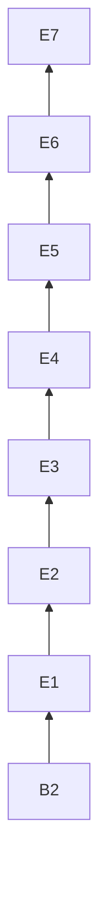

# Pila Evaluación

Entrega la evaluación agéntica: una tienda de demostración con fricciones, un enjambre que intenta la misión, y el
grafo de navegación y la medición que salen de sus trazas, todo guardado en local. Dueño: P1.
Necesita de Base: los esquemas y datos de prueba de B1 (Misión, Traza, Grafo, Medición) y, de B2, el proveedor y
modelo del enjambre, el costo por paso, el tope de corridas y la forma de bloquear peticiones a terceros.
Usa la plantilla de [base.md](base.md). Los contratos viven en [contratos.md](../contratos.md); esta pila no los cambia.

---

## E1 · Publica la tienda de demostración con fricciones conmutables

Depende de: B1 · Desbloquea: E2, E3, y la página sobre la que trabajan M1, M2 y X3 · Prioridad: imprescindible

**Objetivo.** Existe una tienda propia, sin servidor de datos, donde se intenta "comprar un producto". Tiene de 6 a
8 fricciones sembradas que se encienden y apagan una a una, y un extra preseleccionado que sostiene un antiobjetivo.

**Fuera de alcance.** Pagos, sesiones o datos reales. Sitios de terceros. Cualquier lógica del agente.

**Contrato que toca.** §7 Misión: la tienda cumple la misión de prueba de B1 o entrega una válida. No lo cambia.

**Validaciones**

- [ ] CUANDO todas las fricciones están apagadas y un recorrido guionizado intenta la misión EL SISTEMA DEBE llegar
      al criterio de éxito pasando por todos los hitos en orden — prueba automática, salida pegada.
- [ ] CUANDO se evalúa cada hito y el criterio de éxito con su predicado EL SISTEMA DEBE dar verdadero en su pantalla
      y falso en las demás — prueba automática que recorre todas las pantallas.
- [ ] CUANDO se enciende una sola fricción EL SISTEMA DEBE cambiar solo lo que esa fricción declara, y dejar igual
      el resto de la página — prueba que compara la página con cada fricción encendida por separado.
- [ ] Hay fricciones semánticas (etiquetas ambiguas, botón de icono sin nombre, paso escondido) y visuales (botón
      clave bajo el pliegue, contraste bajo, objetivo diminuto) — lista en el PR, con el hito que afecta cada una.
- [ ] SI una fricción visual está encendida ENTONCES EL SISTEMA DEBE conservar intactos el rol y el nombre accesible
      del elemento afectado — prueba; así la fricción solo se nota al mirar la página.
- [ ] CUANDO se intenta el antiobjetivo "comprar sin el extra" EL SISTEMA DEBE permitirlo, y su criterio de éxito
      DEBE ser falso si el extra sigue marcado — prueba automática con los dos recorridos.
- [ ] Calibración: con las fricciones elegidas encendidas, el éxito de control del enjambre queda en un rango bajo,
      en torno al 30 %, que deja sitio a una mejora grande. Se mide, no se promete — lote de control de E3 con N e
      intervalo, enlazado aquí; si no cae en el rango, se cambia el juego de fricciones.

**Decisiones abiertas.** Cómo se conmutan las fricciones y cómo se sirve la tienda. Qué fricciones forman el juego
por defecto. Límites exactos del rango de calibración. Qué extra se preselecciona.

**Estado del arte.** Los bancos de prueba de agentes web usan sitios propios y deciden el éxito comprobando el
estado final. Con unas 40 corridas por brazo solo se distinguen saltos de unos 30 puntos: hay que partir de abajo.

---

## E2 · Un agente intenta la misión y deja una traza válida

Depende de: E1, B2, M1 (huellas); M2 para composiciones reales · Desbloquea: E3, E6 · Prioridad: imprescindible

**Objetivo.** Una corrida de un agente sobre la tienda termina con un resultado decidido por código y deja en el
almacén una traza completa. La corrida recibe una composición y la aplica con el Motor; hasta que M2 entregue, solo
se usa el control (composición vacía).

**Fuera de alcance.** Personas, réplicas, paralelismo y presupuesto (E3). Segunda implementación de huellas.

**Contrato que toca.** §3 Huella, §7 Misión, §8 Traza, §12 Almacén. No los cambia.

**Validaciones**

- [ ] CUANDO un agente intenta la misión sobre el control EL SISTEMA DEBE guardar una cabecera, un paso por acción y
      un cierre que validan contra el esquema; cada paso lleva la huella del elemento, el hito evaluado por código y
      una captura que existe en disco — comando y salida pegados, más la ruta de la traza.
- [ ] CUANDO se construye la observación EL SISTEMA DEBE entregar la captura y una lista numerada que solo incluye
      elementos visibles y no tapados — prueba con una página que tiene un elemento fuera de pantalla y otro bajo
      una superposición: ninguno recibe número.
- [ ] SI el agente declara `listo` sin que se cumpla el criterio de éxito ENTONCES EL SISTEMA DEBE cerrar la corrida
      con un resultado distinto de `exito` — prueba con un agente guionizado.
- [ ] SI la decisión recibida no es una acción del tipo permitido o apunta a un número que no existe ENTONCES EL
      SISTEMA NO DEBE actuar sobre la página, y DEBE dejarlo registrado — prueba automática.
- [ ] CUANDO se alcanza `max_pasos` EL SISTEMA DEBE cerrar con `tope`; SI falla el navegador o el proveedor ENTONCES
      DEBE cerrar con `error` — pruebas automáticas de ambos casos.
- [ ] CUANDO la página intenta una petición que no es de lectura hacia un tercero EL SISTEMA DEBE bloquearla, y SI
      la misión declara `efectos: "reales"` NO DEBE ejecutar el paso irreversible — prueba con un servidor local
      que cuenta peticiones (recibe cero) y con una misión de ejemplo cuyo criterio se corta antes.
- [ ] CUANDO la corrida recibe una composición EL SISTEMA DEBE aplicarla con el Motor antes de la primera
      observación y anotar su `composicion_id`; con el control, la página DEBE ser idéntica al origen — prueba con
      el control ahora, y con una capa de prueba de B1 cuando M2 esté disponible.

**Decisiones abiertas.** Cómo se marcan los números sobre la captura. Cómo se pide y se valida la decisión del
modelo. Formato de las capturas. Cómo se avanza antes de M1 sin crear una segunda implementación de huellas.

**Estado del arte.** Observación al estilo *set-of-marks*: la captura con los elementos interactivos numerados, de
modo que el modelo ve la página y actúa sobre algo comprobable. Éxito por comprobación de estado, como en los bancos
de prueba de agentes web.

---

## E3 · Lanza un enjambre con personas y presupuesto

Depende de: E2, B2 · Desbloquea: E4, E5, O3 (lotes), S6 y O4 (persona-soul) · Prioridad: imprescindible

**Objetivo.** Con una orden se lanza un lote: varias personas, varias réplicas, en paralelo, sobre una composición y
una misión o antiobjetivo. El lote respeta un tope duro, sobrevive a una caída y etiqueta la causa de cada fallo.

**Fuera de alcance.** Construir el grafo (E4) y decidir veredictos (E5). Generar la persona-soul (S6).

**Contrato que toca.** §1 Persona y Corrida, §8 Traza, §11 (tokens aplicados por código), §12. No los cambia.

**Validaciones**

- [ ] SI se pide un lote sin tope de presupuesto ENTONCES EL SISTEMA DEBE negarse a empezar, sin abrir el navegador
      ni llamar al modelo — prueba automática.
- [ ] CUANDO el lote alcanza su tope EL SISTEMA DEBE dejar de iniciar corridas, conservar las terminadas y dejar el
      lote marcado como pausado — prueba con un tope pequeño, estado del lote pegado.
- [ ] CUANDO el proceso se mata a mitad de un lote y se reanuda EL SISTEMA DEBE completar lo que falta sin duplicar
      corridas; las interrumpidas no cuentan en las tasas — prueba que mata el proceso y cuenta corridas por
      persona y réplica.
- [ ] SI una persona declara parámetros que el navegador puede fijar (tamaño de ventana, tope de pasos, tokens)
      ENTONCES EL SISTEMA DEBE aplicarlos por código — prueba que lee el valor dentro del navegador del agente.
- [ ] CUANDO se lanza el mismo lote con dos personas de conducta opuesta EL SISTEMA DEBE producir recorridos
      distinguibles (pasos medianos o hito final) — tabla por persona con N; si no, se redefinen las personas.
- [ ] CUANDO una corrida no termina en `exito` EL SISTEMA DEBE etiquetar la causa como `agente` o `interfaz` —
      una muestra de fallos revisada a mano, con la tabla de acuerdos y desacuerdos pegada.
- [ ] Ablación: CUANDO el mismo lote corre con y sin captura sobre la tienda con las fricciones visuales encendidas
      EL SISTEMA DEBE dejar dos conjuntos de trazas comparables — tabla de éxito e hito de abandono por brazo, con N
      e intervalo. Si la captura no cambia la conducta, se anota y E1 se recalibra con fricciones semánticas.
- [ ] CUANDO termina el lote de control sobre las fricciones por defecto EL SISTEMA DEBE informar el éxito con N e
      intervalo — salida pegada; es la evidencia que cierra la calibración de E1.

**Decisiones abiertas.** Qué personas y cuántas réplicas. Grado de paralelismo. En qué unidades se expresa el tope
(llamadas, dinero, tiempo). Dónde y cómo se guarda el estado del lote. Cómo se asigna la causa del fallo.

**Estado del arte.** Las simulaciones con modelos de lenguaje tienden al colapso de personas: perfiles distintos
acaban navegando igual. Por eso la diversidad se define por conducta y se aplica por código, no por temperatura.

---

## E4 · Construye y muestra el grafo de navegación

Depende de: E3 (puede empezar con los datos de prueba de B1) · Desbloquea: E5, E7, O1 · Prioridad: imprescindible

**Objetivo.** Las trazas de un lote se convierten en un Grafo que cumple el contrato, y una vista local muestra dónde
se abandona, por dónde se pasa y ejemplos de fallo con su captura, con el control y una composición lado a lado.

**Fuera de alcance.** Intervalos y veredictos (E5). Proponer capas (O1). Recorridos humanos (E7).

**Contrato que toca.** §9 Grafo, §12 Almacén. No los cambia.

**Validaciones**

- [ ] CUANDO se calcula el grafo desde las trazas de control de B1 EL SISTEMA DEBE producir un Grafo válido cuyos
      conteos coinciden con el grafo de prueba, e idéntico al recalcularlo — prueba automática.
- [ ] SI una corrida terminó en `error` ENTONCES EL SISTEMA NO DEBE contarla en visitas, abandonos ni
      `n_corridas` — prueba con un lote que incluye errores.
- [ ] CUANDO una corrida vuelve a un hito anterior EL SISTEMA DEBE registrar la transición de vuelta sin crear un
      nodo nuevo — prueba con una traza que tiene un ciclo.
- [ ] CUANDO una composición cambia la etiqueta de un botón EL SISTEMA DEBE dar un grafo con los mismos nodos que
      el del control — prueba con trazas de una capa que reetiqueta.
- [ ] SI una línea de la traza no valida contra el esquema ENTONCES EL SISTEMA DEBE rechazarla y nombrar el archivo y
      la línea — prueba automática.
- [ ] CUANDO se abre la vista local de un lote real EL SISTEMA DEBE mostrar el embudo por hito con sus conteos, las
      transiciones y al menos un ejemplo de fallo con su captura y sus razones — captura de pantalla.
- [ ] CUANDO hay grafos del control y de una composición EL SISTEMA DEBE mostrarlos lado a lado — captura.

**Decisiones abiertas.** Cómo se eligen los ejemplos de fallo. Forma de la vista y cómo se abre. Cómo se dibujan
los ciclos. Si el grafo se recalcula entero o por incrementos.

**Estado del arte.** Grafos *directly-follows* de la minería de procesos: nodos, transiciones y conteos sacados de
un registro de eventos. WebGraphEval muestra que los nodos de acción de grano fino no se fusionan entre corridas;
por eso los nodos son hitos y la acción vive en la transición.

---

## E5 · Mide una composición contra el control

Depende de: E4; M2 para medir capas reales · Desbloquea: O3, X4 · Prioridad: imprescindible (placebo: deseable)

**Objetivo.** Dadas las corridas del control y de una composición, existe una Medición guardada con el intervalo de
la diferencia, la comprobación A/A, un antiobjetivo y un veredicto que se puede defender.

**Fuera de alcance.** Decidir qué composición queda activa (O3). Mostrar la evidencia en la extensión (X4).

**Contrato que toca.** §2 regla 4 (`con_soul`), §10 Medición, §12 Almacén. No los cambia.

**Validaciones**

- [ ] CUANDO se mide con los datos de prueba de B1 EL SISTEMA DEBE reproducir la medición `aceptada` y la
      `rechazada` — prueba automática.
- [ ] CUANDO se comparan dos lotes del mismo control EL SISTEMA DEBE calcular el intervalo A/A y marcarlo válido
      solo si contiene 0; SI no es válido ENTONCES el veredicto NO DEBE ser `aceptada` — prueba automática y la
      salida de un A/A real.
- [ ] SI el antiobjetivo cae de forma clara ENTONCES EL SISTEMA DEBE dar `rechazada`, aunque el objetivo suba — prueba.
- [ ] SI el límite inferior del intervalo de la diferencia no supera 0 ENTONCES EL SISTEMA NO DEBE dar `aceptada` —
      prueba con una diferencia pequeña y pocas corridas, que sale `no_concluyente`.
- [ ] SI hay corridas con `error` ENTONCES EL SISTEMA NO DEBE contarlas en ninguna tasa ni en ningún N, y SI la
      composición no incluye una capa `soul` ENTONCES la medición DEBE llevar `con_soul: false` — pruebas.
- [ ] CUANDO se muestra una medición a una persona EL SISTEMA DEBE acompañar cada cifra con su N y su intervalo —
      captura de pantalla o salida pegada, sin ninguna cifra suelta.
- [ ] (Deseable) CUANDO se mide una capa placebo, solo cosmética, EL SISTEMA NO DEBE dar `aceptada` — la medición
      real guardada en el almacén.

**Decisiones abiertas.** Método del intervalo de la diferencia. Qué significa "caer de forma clara" en un
antiobjetivo. Cuántas corridas por brazo y si hay un cribado previo más barato. Qué cambia la capa placebo.

**Estado del arte.** Práctica de experimentación: intervalo de Wilson para una proporción, de Newcombe para la
diferencia, y prueba A/A como medida del ruido propio. Aviso de AgentA/B: 414 contra 403 sobre 500 no es señal.

---

## E6 · Reconoce un sitio y propone una misión con la IA de la persona

Depende de: E2; B2 para invocar la IA local · Desbloquea: misiones en otros sitios · Prioridad: deseable

**Objetivo.** El asistente de IA de la persona explora un sitio y deja un borrador de Misión con hitos,
antiobjetivos y `efectos`. Ningún enjambre corre sobre ella hasta que una persona la aprueba.

**Fuera de alcance.** Sitios con sesión iniciada o pagos. Lanzar enjambres. Proponer capas.

**Contrato que toca.** §7 Misión, §13 (lo que llega de una página son datos). No los cambia.

**Validaciones**

- [ ] CUANDO termina el reconocimiento de la tienda EL SISTEMA DEBE guardar un borrador que valida contra el esquema
      de Misión, con al menos un antiobjetivo y con `efectos` declarado — archivo en el almacén y salida de la
      validación.
- [ ] CUANDO se evalúan los predicados del borrador sobre las páginas visitadas EL SISTEMA DEBE dar verdadero para
      cada hito en alguna página, y falso para el criterio de éxito en la página de inicio — prueba automática.
- [ ] SI la misión no está aprobada por una persona ENTONCES EL SISTEMA DEBE negarse a lanzar un lote — prueba.
- [ ] CUANDO se explora el sitio EL SISTEMA NO DEBE emitir peticiones que no sean de lectura — prueba de red con un
      servidor local que cuenta peticiones.
- [ ] SI una página contiene texto que da órdenes al asistente ENTONCES EL SISTEMA DEBE tratarlo como contenido y
      no cambiar de sitio ni de tarea — prueba con una página trampa.
- [ ] CUANDO la persona corrige el borrador y lo aprueba EL SISTEMA DEBE guardar la versión corregida — prueba.

**Decisiones abiertas.** Cómo se le da el navegador al asistente. Cómo se registra la aprobación. Cuánta exploración
se permite antes de proponer. Cómo se presenta el borrador para revisarlo.

**Estado del arte.** En los bancos de prueba de agentes web, las tareas y sus comprobadores de estado los escriben
personas. Aquí el asistente redacta y la persona aprueba: como UXAgent, pilota; no sustituye el criterio humano.

---

## E7 · Registra recorridos humanos como capa aparte del grafo

Depende de: E4, M1 (huellas) · Desbloquea: comparar la dirección de humanos y agentes · Prioridad: recortable

**Objetivo.** Una persona intenta la misión en la tienda y su recorrido queda como traza de origen `humano`, con
los mismos hitos y huellas que las de los agentes. Es una capa separada y solo sirve para comparar la dirección.

**Fuera de alcance.** Sitios que no sean la tienda. Mezclar humanos en tasas, mediciones o veredictos.

**Contrato que toca.** §8 Traza (`origen: "humano"`), §9 Grafo, §11 (nada sale del equipo). No los cambia.

**Validaciones**

- [ ] CUANDO una persona completa o abandona la misión EL SISTEMA DEBE guardar una traza con `origen: "humano"`
      que valida contra el esquema — archivo en el almacén y salida de la validación.
- [ ] CUANDO la persona escribe en un campo EL SISTEMA NO DEBE guardar lo escrito — prueba que escribe una cadena
      conocida y la busca en todo el almacén: cero coincidencias.
- [ ] CUANDO una persona y un agente pulsan el mismo elemento en la misma pantalla EL SISTEMA DEBE registrar la
      misma huella y el mismo hito — prueba automática con las dos trazas.
- [ ] CUANDO se añaden trazas humanas al almacén EL SISTEMA DEBE dejar idénticos el Grafo y la Medición de los
      agentes — prueba que compara antes y después.
- [ ] CUANDO la vista muestra recorridos humanos EL SISTEMA DEBE mostrarlos como capa distinguible sobre los mismos
      hitos, con su N, y decir solo si la dirección coincide con la de los agentes — captura de pantalla.
- [ ] SI el registro está apagado ENTONCES EL SISTEMA NO DEBE guardar nada del recorrido — prueba automática.

**Decisiones abiertas.** Cómo se captura el recorrido en la tienda. Cómo se guarda la capa humana sin tocar el grafo
de los agentes. Cómo se pide el consentimiento. Qué cuenta como "misma dirección".

**Estado del arte.** AgentA/B y UXAgent son herramientas para pilotar estudios, no sustitutos de las personas; el
primero solo coincide con los humanos en la dirección del efecto.
