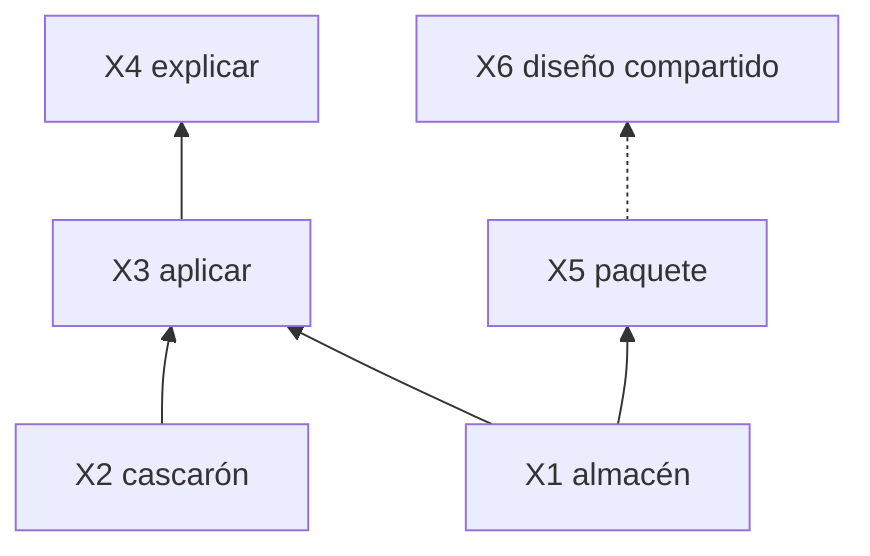

# Pila Extensión

Entrega el almacén local y la extensión que lo consume: guardar la fórmula en disco, aplicarla al navegar y
explicar a la persona por qué la página se ve así. Dueño: P4.

Necesita de Base: los esquemas y datos de prueba de B1, y de B2 el resultado de la prueba entre el proceso de fondo
de una extensión y el servicio local. Plantilla y definición de hecho: [base.md](base.md) y el documento raíz.

---

## X1 · Guarda y lee el almacén local

Depende de: B1 · Desbloquea: X3, X5, E3 y E5 (trazas y mediciones), O3 (promover), la capa de la pila Soul ·
Prioridad: imprescindible

**Objetivo.** Una biblioteca es la única que escribe bajo `sitios/`. Toda pila guarda y lee por ella misiones,
capas, composiciones, trazas, grafos y mediciones, y lo guardado sobrevive a caídas y a varios procesos a la vez.

**Fuera de alcance.** El contenido de `soul/` (pila Soul). Exponer el almacén a la extensión (X3). Consultas entre
sitios, limpieza de capturas, migraciones de esquema.

**Contrato que toca.** §4, §6, §8 y §12 (incluida la forma de `activa.json`); no los cambia. Si
hace falta cambiarla, va antes en un PR sobre la base.

**Validaciones**

- [ ] CUANDO se guarda dos veces una capa o una composición con el mismo contenido EL SISTEMA DEBE devolver el mismo
      `id` y dejar un solo archivo — prueba automática, salida pegada.
- [ ] CUANDO cambia una operación de una capa, o el orden de las capas de una composición, EL SISTEMA DEBE producir
      un `id` distinto — prueba automática.
- [ ] SI se intenta guardar bajo un `id` existente un contenido distinto ENTONCES EL SISTEMA DEBE rechazarlo y dejar
      el original intacto; el único cambio admitido es `estado` de una composición — prueba automática.
- [ ] CUANDO varios procesos añaden trazas a la vez sobre la misma misión y composición EL SISTEMA DEBE conservar
      todas las corridas completas, sin líneas mezcladas — prueba con procesos reales; conteo esperado y obtenido.
- [ ] SI un proceso muere a mitad de una escritura ENTONCES EL SISTEMA DEBE dejar el archivo anterior completo o el
      nuevo completo, nunca uno a medias, y una corrida sin cierre NO DEBE leerse como completa — prueba que mata el
      proceso durante la escritura.
- [ ] SI se promueve a `activa.json` una composición sin medición `aceptada` ENTONCES EL SISTEMA DEBE rechazarlo;
      CUANDO se fuerza, DEBE aceptarlo y dejar una marca legible de que fue forzada — prueba automática con las dos
      mediciones de prueba de B1.
- [ ] SI se guarda un objeto que no cumple su esquema ENTONCES EL SISTEMA DEBE rechazarlo nombrando el campo, sin
      escribir nada — prueba automática.
- [ ] SI otro código escribe bajo `sitios/` sin pasar por la biblioteca ENTONCES las comprobaciones globales DEBEN
      fallar — captura de una ejecución en rojo provocada a propósito.

**Decisiones abiertas.** Qué campos de una capa entran en su `id`. Cómo se coordinan los procesos que escriben. Cómo
se representa el control. Forma de `activa.json` y de la marca de forzado. Dónde vive la raíz.

**Estado del arte.** Datos inmutables identificados por su contenido, como en git: guardar es idempotente y dos
copias nunca entran en conflicto. Escritura atómica por reemplazo y registros de solo añadir, la práctica habitual
para sobrevivir a una caída sin base de datos.

---

## X2 · Monta el cascarón de la extensión conectado al servicio local

Depende de: B2, S1 (puede empezar contra un servicio local falso) · Desbloquea: X3, X4, S4 (área de la soul) ·
Prioridad: imprescindible

**Objetivo.** Existe la única extensión del proyecto. La persona la empareja con el servicio local, la activa sitio
por sitio y ve en todo momento si hay conexión. Las demás pilas le añaden áreas; nadie construye una segunda.

**Fuera de alcance.** Aplicar capas (X3). Contenido del panel (X4, S4). Otros navegadores además del que usa el prototipo. Tiendas.

**Contrato que toca.** §12 (la extensión no lee el disco) y §13; no los cambia.

**Validaciones**

- [ ] CUANDO la persona activa un sitio EL SISTEMA DEBE actuar solo en ese sitio y recordar la activación tras
      reiniciar el navegador — grabación de pantalla.
- [ ] SI un sitio no está activado ENTONCES EL SISTEMA NO DEBE leer ni modificar sus páginas ni enviar nada sobre
      ellas al servicio local — prueba automática: el DOM es igual con y sin la extensión, y el servicio no recibe
      peticiones.
- [ ] CUANDO se empareja con el secreto correcto EL SISTEMA DEBE mostrar "conectado"; SI el secreto es incorrecto
      ENTONCES DEBE mostrar "sin emparejar" y no recibir ningún dato — prueba automática contra el servicio falso.
- [ ] CUANDO el servicio local se apaga EL SISTEMA DEBE mostrar "sin conexión" sin alterar ni bloquear la página, y
      volver a "conectado" cuando regresa — grabación de pantalla.
- [ ] SI una petición al servicio local no ha respondido a los 20 s ENTONCES EL SISTEMA DEBE cortarla y mostrar el
      fallo; CUANDO el navegador detiene el proceso de fondo (lo hace tras unos 30 s) DEBE conservar emparejamiento
      y sitios activados — prueba automática con un servicio falso que no responde y con la detención forzada.
- [ ] SI el código de una página, activada o no, intenta obtener el secreto de emparejamiento o hablar con el
      servicio local a través de la extensión ENTONCES EL SISTEMA NO DEBE permitirlo — prueba automática con una
      página hostil de prueba.
- [ ] Cada permiso que pide la extensión aparece en el PR con su motivo, ninguno da acceso a todos los sitios por
      defecto, y el paquete no descarga ni ejecuta código remoto — lista pegada y salida de la inspección del paquete.
- [ ] Otra pila puede añadir un área al panel sin modificar el cascarón — demostrado con un área de ejemplo y el
      diff que la añade.

**Decisiones abiertas.** Conjunto de permisos y cómo se concede el acceso por sitio. Dónde guarda la extensión su
estado. Cómo las pruebas automáticas sortean el diálogo de permisos sin relajar lo que usa la persona.

**Estado del arte.** Mínimo privilegio con permisos por sitio concedidos en el momento de uso, que es lo que
recomienda la plataforma de extensiones. La misma plataforma prohíbe el código alojado en remoto: todo lo que se
ejecuta viaja dentro del paquete.

---

## X3 · Aplica la composición activa al navegar

Depende de: X1, X2, M2 y M4 (puede empezar contra un motor de sustitución con la misma forma de resultado) ·
Desbloquea: X4, el punto de control de las 6 h, O3 visible en el navegador · Prioridad: imprescindible

**Objetivo.** En un sitio activado, la persona ve la página efectiva: la extensión obtiene del servicio local la
composición activa, guarda una copia y la aplica con el motor compartido en cada carga y cada cambio de ruta. Si la
composición deja de encajar con el sitio, deja de aplicarse sola.

**Fuera de alcance.** El motor y sus puertas (pila Motor). Generar o medir capas. Marcos incrustados de terceros.
Elementos que la página pinta mucho después de cargar, más allá de lo que resuelva M4.

**Contrato que toca.** §2, §5, §6 y §12; no los cambia. El contrato no dice cuántas veces es "repetida": este PR
fija el número con evidencia.

**Validaciones**

- [ ] CUANDO se carga una ruta de un sitio activado con composición `vigente` EL SISTEMA DEBE aplicar, con el motor
      compartido, las capas cuyo patrón coincide e informar operaciones aplicadas, rotas y resultado de las puertas —
      prueba automática sobre la tienda de demostración o una página de prueba.
- [ ] CUANDO el servicio local está apagado EL SISTEMA DEBE aplicar la última copia guardada — prueba automática.
- [ ] CUANDO la ruta cambia sin recargar la página EL SISTEMA DEBE retirar las capas que ya no corresponden y aplicar
      las de la nueva ruta — prueba automática.
- [ ] CUANDO se carga la página con la red limitada EL SISTEMA DEBE mostrarla ya compuesta, sin que se vea antes el
      original; SI aplicar supera el tope que fije este PR ENTONCES DEBE mostrarla igualmente, nunca en blanco —
      grabación revisada cuadro a cuadro y prueba del tope.
- [ ] SI una puerta falla ENTONCES EL SISTEMA NO DEBE dejar la composición aplicada en esa carga; SI una operación
      queda `rota` o una puerta falla de forma repetida ENTONCES DEBE marcar la composición `desactualizada` y no
      volver a aplicarla, tampoco tras recargar — prueba automática cambiando la página de prueba.
- [ ] SI la `firma_origen` difiere pero ninguna operación queda rota ni falla una puerta ENTONCES EL SISTEMA DEBE
      seguir aplicando y solo avisar — prueba automática.
- [ ] CUANDO la persona pide "ver original" EL SISTEMA DEBE restaurar el origen sin recargar, con un DOM equivalente
      al de la página sin extensión, y volver a aplicar cuando lo desactiva — prueba automática y grabación.
- [ ] SI la copia guardada contiene una capa alterada que no pasa la validación del motor ENTONCES EL SISTEMA NO
      DEBE aplicarla — prueba automática que manipula la copia.

**Decisiones abiertas.** Cuándo se aplica y cómo se evita el parpadeo (junto con M4). Tope de espera. Cuántos
fallos cuentan como "repetida". Cuándo se refresca la copia. Qué punto del servicio local entrega la composición
activa y quién lo añade. Qué queda aplicado en una carga con una operación rota aislada.

**Estado del arte.** Software local primero: la copia de la persona es la principal y funciona sin conexión; el
servicio solo la pone al día. Las herramientas de experimentación en el cliente sufren el destello del contenido
original; se mitiga aplicando antes del primer pintado y con un tope que nunca deja la página oculta.

---

## X4 · Explica en el panel qué cambió y con qué evidencia

Depende de: X3; E5 para mediciones reales (antes, las de prueba de B1) · Desbloquea: el paso 4 del foco y la
prueba soul contra optimización a la vista; S4 comparte el panel · Prioridad: imprescindible, en versión reducida

**Objetivo.** La persona abre el panel y entiende, en lenguaje llano, qué capas están aplicadas, qué cambia cada
una, por qué y con qué evidencia. Puede apagar cada capa y la soul, y avisar de un problema.

**Fuera de alcance.** Ver y editar la soul (S4). Lanzar mediciones desde el panel. Historial y deshacer. X5.

**Contrato que toca.** §2 regla 4, §10 (cifras con N e intervalo) y §11; no los cambia.

**Validaciones**

- [ ] CUANDO se abre el panel en un sitio con composición activa EL SISTEMA DEBE listar las capas en orden de
      aplicación, cada una con su nombre, lo que cambia y su `hipotesis`; con el servicio local apagado lo hace
      desde la copia guardada y dice de cuándo es — capturas de ambos casos sobre la tienda de demostración.
- [ ] CUANDO una optimización tiene medición EL SISTEMA DEBE mostrar el resultado con su N y su intervalo, y el de
      cada antiobjetivo; SI no la tiene (forzada) ENTONCES DEBE decir que está sin medir — captura de ambos casos y
      prueba de que ninguna cifra se pinta sin N e intervalo.
- [ ] SI la medición tiene `con_soul: false` ENTONCES EL SISTEMA DEBE decir "medido sin tu soul"; el aviso solo
      desaparece con una medición de la persona-soul sobre esa composición — prueba automática con ambos datos.
- [ ] CUANDO la persona apaga una capa EL SISTEMA DEBE reflejarlo en la página sin recargar y decir que la
      combinación resultante no está medida — grabación de pantalla.
- [ ] CUANDO la persona apaga la soul EL SISTEMA DEBE dejar origen más optimizaciones, y restituirla al encenderla —
      grabación de pantalla.
- [ ] CUANDO la persona informa un problema EL SISTEMA DEBE guardarlo en su equipo sin la URL completa, sin texto de
      la página y sin nada de lo que tecleó en ella — registro guardado pegado en el PR.
- [ ] SI el nombre o la `hipotesis` de una capa contienen marcado o guiones ENTONCES EL SISTEMA DEBE mostrarlos como
      texto y no interpretarlos — prueba automática con una capa manipulada.

**Decisiones abiertas.** Forma del panel (lateral, emergente u otra). Redacción de las explicaciones y cómo se
derivan de la capa y la medición. Dónde se guardan los problemas informados. Si los interruptores son por sitio o
por ruta, y si persisten.

**Estado del arte.** La investigación en interfaces adaptativas encuentra que la gente acepta mejor un cambio
cuando es predecible, se le explica y puede deshacerlo. La regulación sobre diseño engañoso va en la misma
dirección: un cambio que influye en una decisión no debe ser opaco.

---

## X5 · Exporta e importa un paquete de sitio

Depende de: X1, M3 (validación de capas) · Desbloquea: pasar una mejora a un compañero en la demostración; da el
formato de partida a X6 · Prioridad: deseable (último en el plan de recorte)

**Objetivo.** Una persona pasa a otra, en un solo archivo, lo que aprendió de un sitio. Quien lo recibe lo vuelve a
validar entero en su equipo y lo ve como ajeno y no medido aquí.

**Fuera de alcance.** Cualquier servidor o sincronización. Activar algo automáticamente al importar. Firmas o
identidad del autor.

**Contrato que toca.** §4, §6, §10, §11 y §12; no los cambia. El formato del paquete es interno a esta pila; si otra
pila lo consume, pasa a la base.

**Validaciones**

- [ ] CUANDO se exporta un sitio EL SISTEMA DEBE producir un único archivo con la misión, las capas `optimizacion`,
      la composición y sus mediciones, todos válidos contra sus esquemas — prueba automática.
- [ ] SI el sitio tiene soul, capas `soul`, trazas humanas o capturas ENTONCES EL SISTEMA NO DEBE incluir ninguna en
      el archivo, ni mediciones con `con_soul` verdadero — prueba automática que inspecciona el
      archivo generado desde un almacén que sí las contiene.
- [ ] CUANDO se importa un paquete EL SISTEMA DEBE recalcular cada `id` y volver a validar cada capa con las reglas
      del motor antes de escribir — prueba automática.
- [ ] SI una capa del paquete fue alterada (`id` que no corresponde al contenido, operación no permitida, código,
      recurso externo) ENTONCES EL SISTEMA DEBE rechazar el paquete entero sin escribir nada — un paquete por caso.
- [ ] CUANDO termina una importación EL SISTEMA DEBE marcar lo importado como ajeno y no medido aquí, y NO DEBE
      activar nada — prueba automática sobre `activa.json` antes y después.
- [ ] SI se intenta promover una composición importada apoyándose solo en su medición ajena ENTONCES EL SISTEMA DEBE
      exigir una medición local o el forzado marcado — prueba automática.
- [ ] CUANDO se exporta en un equipo y se importa en un almacén vacío EL SISTEMA DEBE obtener los mismos `id`, y
      repetir la importación NO DEBE cambiar nada — prueba automática de ida y vuelta.

**Decisiones abiertas.** Formato y extensión del archivo. Desde dónde se exporta e importa (línea de comandos,
panel o ambos). Cómo se registra la procedencia. Qué se hace con una medición ajena cuando ya existe una local.

**Estado del arte.** Con datos identificados por su contenido, quien recibe verifica la integridad recalculando el
identificador, sin confiar en quien envía. Lo que llega de fuera se trata como no fiable hasta validarlo en local,
igual que cualquier entrada externa.

---

## X6 · Diseña el almacenamiento compartido

Depende de: nada estricto; X5 aporta el formato de partida · Desbloquea: una decisión futura sobre compartir, hoy
no-objetivo · Prioridad: recortable (solo diseño, sin código)

**Objetivo.** Un registro de decisión corto en el repositorio que diga cómo se compartirían optimizaciones entre
personas sin romper la promesa de la soul, y qué riesgos quedan abiertos.

**Fuera de alcance.** Cualquier código, servidor, cuenta o prototipo. Elegir proveedor o producto.

**Contrato que toca.** Ninguno. Si el diseño concluye que un contrato debería cambiar, lo propone; no lo cambia.

**Validaciones.** Se comprueban leyendo el documento; lo revisa al menos otra persona del equipo.

- [ ] El registro tiene contexto, opciones consideradas, decisión y consecuencias, y el PR no contiene código — diff.
- [ ] Cada entidad del contrato (misión, capa `optimizacion`, capa `soul`, composición, traza de agente, traza
      humana, captura, grafo, medición, soul, `activa.json`) está clasificada como compartible o como "nunca sale del
      equipo", con su motivo y sin contradecir §11.
- [ ] SI una capa llega de otra persona ENTONCES el diseño DEBE describir, paso a paso, cómo se vuelve a verificar
      en local antes de usarse y qué estado tiene hasta entonces.
- [ ] El orden entre mejoras se define por evidencia (N, intervalo, antiobjetivos, reverificaciones independientes),
      no por votos, y dice qué pasa con una medición que nadie logra reproducir.
- [ ] El diseño dice qué aprende un observador del almacén compartido sobre los sitios que usa una persona al buscar
      y al publicar, y propone al menos una mitigación con su costo.
- [ ] El modelo de amenazas de una capa compartida maliciosa cubre al menos: texto engañoso por `reetiquetar`,
      ocultar información no protegida, mediciones inventadas y capas dirigidas a un sitio sensible. Para cada una
      dice qué la frena (lista cerrada de operaciones, elementos protegidos, puertas, reverificación), y hay una
      lista explícita de lo que esos frenos **no** impiden.

**Decisiones abiertas.** Topología (servidor central, repositorio común, entre pares). Identidad y reputación de
quien publica. Si se devuelve información de uso a quien compartió.

**Estado del arte.** En el software local primero el servidor es un catálogo opcional, y los datos inmutables
direccionados por contenido se sincronizan sin conflictos. Decisiones registradas con contexto, opciones y
resultado (formato MADR), con un modelo de amenazas explícito antes de aceptar contenido de terceros.
