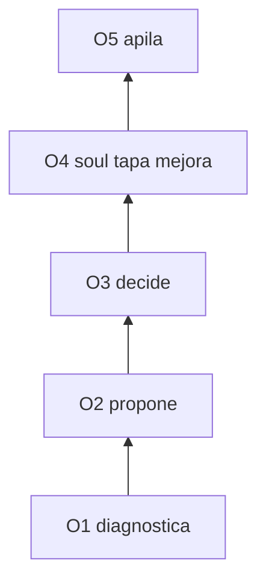

# Pila Mejora

Entrega el proceso iterativo de mejora: evaluar cómo funciona la página DADA una capa de modificaciones y decidir con
evidencia si esa capa se queda. Incluye la prueba de la fórmula: una soul tapa una mejora y el sistema responde.
Dueño: P2, cuando Motor y Evaluación entreguen. Necesita el Grafo real (E4), los lotes de corridas y la Medicion
(E5), la validación y las puertas (M3) y el cliente de IA compartido (S2). Hasta entonces trabaja contra los datos de
prueba de Base. Usa la plantilla de [base.md](base.md) y no cambia [contratos.md](../contratos.md).

---

## O1 · Diagnostica dónde se pierde la misión

Depende de: B1 (grafo de prueba); E4 para el grafo real · Desbloquea: O2 · Prioridad: imprescindible

**Objetivo.** A partir de un Grafo, se obtiene la lista de hitos ordenada por fricción, con los fallos de interfaz
separados de los fallos del agente, y la evidencia que una persona o un modelo necesita para proponer un cambio:
ejemplos de fallo y elementos presentes en ese hito.

**Fuera de alcance.** Proponer cambios. Lanzar corridas. Dibujar el grafo.

**Contrato que toca.** §8 Traza y §9 Grafo, solo lectura; no los cambia.

**Validaciones**

- [ ] CUANDO se diagnostica el grafo de prueba de Base EL SISTEMA DEBE devolver sus hitos ordenados por fricción, y
      el primero DEBE ser el hito con más abandonos de interfaz de ese grafo — prueba automática, salida pegada.
- [ ] SI los abandonos de un hito son todos de causa `agente` ENTONCES EL SISTEMA NO DEBE ponerlo por delante de un
      hito con abandonos de causa `interfaz`, y DEBE mostrar las dos cifras por separado — prueba con un grafo
      sembrado.
- [ ] CUANDO se pide la evidencia del primer hito EL SISTEMA DEBE entregar al menos un ejemplo de fallo con sus
      razones y su captura, y los elementos presentes en el hito, cada uno con una huella que cumple el esquema —
      prueba automática sobre los datos de prueba.
- [ ] SI un hito tiene pocas visitas ENTONCES EL SISTEMA DEBE marcar su evidencia como insuficiente en vez de
      presentarlo como hallazgo; toda cifra va con su N — prueba con un grafo sembrado.
- [ ] SI el grafo no tiene abandonos ENTONCES EL SISTEMA DEBE decir que no hay hito que mejorar y NO DEBE inventar
      uno — prueba automática.
- [ ] CUANDO se diagnostica dos veces el mismo grafo EL SISTEMA DEBE dar el mismo resultado — prueba automática.
- [ ] CUANDO E4 entrega un grafo real de la tienda EL SISTEMA DEBE diagnosticarlo con el mismo comando — salida
      pegada, con el hito señalado.

**Decisiones abiertas.** Qué es "fricción" y cómo se combina (abandono, pasos, retrocesos). Umbral de visitas para
evidencia suficiente. De dónde salen los elementos presentes en un hito: el Grafo no los lleva. Forma del resultado
y cuánta evidencia cabe sin desbordar a quien la lee.

**Estado del arte.** En los bucles de optimización reflexiva con modelos (OPRO, GEPA) la señal que guía la siguiente
propuesta son las trazas que fallaron, no solo la métrica. Los agentes dan fricciones candidatas, no usabilidad
humana: AgentA/B solo coincide con personas en la dirección del efecto.

---

## O2 · Propone capas candidatas con hipótesis

Depende de: O1, M3, S2 · Desbloquea: O3 · Prioridad: imprescindible

**Objetivo.** Del diagnóstico salen varias capas candidatas, cada una con una `hipotesis` comprobable atada a un
hito. Una capa escrita a mano en el mismo formato es un camino de primera clase y es el respaldo si la IA falla.

**Fuera de alcance.** Medir o aceptar candidatas. Capas de soul. Reescribir la validación de M3.

**Contrato que toca.** §4 Capa (`origen`, `hipotesis`, `hito_objetivo`) y §13 (lo que llega de una página son
datos); no los cambia.

**Validaciones**

- [ ] CUANDO se pasa por el comando de revisión la capa de optimización de los datos de prueba EL SISTEMA DEBE
      aceptarla; CUANDO se le pasa una capa manual inválida (con código, con `reetiquetar` sobre un precio, sin
      `hipotesis`) DEBE rechazarla nombrando el campo o la regla — salida del comando pegada.
- [ ] CUANDO una persona registra una capa manual válida EL SISTEMA DEBE dejarla como candidata con `origen` manual,
      indistinguible en formato de una generada — prueba automática.
- [ ] CUANDO se piden propuestas para el diagnóstico del grafo de prueba EL SISTEMA DEBE devolver más de una
      candidata, con `id` distintos, cada una con `hipotesis` no vacía y un `hito_objetivo` que existe en el
      diagnóstico — prueba con respuesta grabada y una ejecución real pegada.
- [ ] SI el modelo devuelve una candidata que no pasa la validación estática (código, recurso externo, ocultar un
      protegido, objetivo que no está en la evidencia) ENTONCES EL SISTEMA DEBE descartarla con su motivo y NO DEBE
      entregarla — prueba con respuestas sembradas.
- [ ] CUANDO existe historial de pares (capa, medicion) EL SISTEMA DEBE incluirlo en lo que recibe el proponente y
      NO DEBE volver a entregar una capa ya `rechazada` — prueba automática con historial sembrado.
- [ ] SI el texto de la página incluye instrucciones dirigidas al modelo ENTONCES EL SISTEMA DEBE tratarlas como
      datos: las candidatas siguen pasando la validación y no tocan hitos fuera del diagnóstico — prueba con una
      página sembrada.
- [ ] SI la IA no responde o ninguna candidata es válida ENTONCES EL SISTEMA DEBE decirlo y dejar usable el camino
      manual; NO DEBE fabricar una candidata — prueba automática.

**Decisiones abiertas.** Cuántas candidatas y cómo se asegura que sean distintas. Qué evidencia y cuánto historial
se entrega al modelo. Cómo se pide salida que cumpla el esquema. Qué hace "comprobable" a una hipótesis. Nombre y
forma del comando de revisión.

**Estado del arte.** OPRO y GEPA: el candidato es un parche pequeño, y el historial de intentos con su resultado
vuelve al modelo como contexto para la siguiente ronda. Los productos de experimentación con IA (Coframe, Evolv) ya
generan variantes, pero las validan con tráfico real; por eso aquí la propuesta va separada de la decisión.

---

## O3 · Decide con evidencia qué candidata se acepta

Depende de: O2, M3, E5, X1 · Desbloquea: O4, O5, X4 · Prioridad: imprescindible

**Objetivo.** Cada candidata recorre el mismo camino: validación estática → aplicación en seco sobre la página real
(nada `rota`, puertas en verde) → cribado barato → medición completa de la mejor → veredicto según el contrato de
Medicion, con antiobjetivos. Una persona aprueba antes de que la composición quede activa. Todo el bucle tiene un
presupuesto duro. Para el foco inicial basta una ronda.

**Fuera de alcance.** Varias rondas y capas apiladas (O5). Medir con soul (O4). Afirmar algo sobre personas: una
`aceptada` es evidencia sobre agentes, y así se muestra.

**Contrato que toca.** §2, §5, §10 Medicion y §12 (`activa.json`); no los cambia.

**Validaciones**

- [ ] SI una candidata falla la validación estática o la aplicación en seco (una operación `rota` o una puerta
      fallida) ENTONCES EL SISTEMA NO DEBE gastar ninguna corrida en ella — prueba automática con contador de
      corridas.
- [ ] CUANDO varias candidatas pasan el cribado EL SISTEMA DEBE llevar a medición completa solo a la mejor, y NO
      DEBE dar un veredicto `aceptada` con solo el cribado — prueba automática sobre lotes sembrados.
- [ ] SI una candidata sube el éxito de la misión pero hace caer un antiobjetivo (atrapa al usuario sin romper las
      puertas) ENTONCES EL SISTEMA DEBE terminarla `rechazada` — archivo de Medicion en el almacén, pegado.
- [ ] SI una capa placebo (cambio cosmético sin relación con la misión) recorre el camino ENTONCES EL SISTEMA NO
      DEBE terminarla `aceptada`; SI el control A/A no es válido ENTONCES ninguna candidata DEBE quedar `aceptada`
      — archivos de Medicion pegados.
- [ ] SI el presupuesto no alcanza para el siguiente lote ENTONCES EL SISTEMA DEBE parar antes de lanzarlo, decir
      que el presupuesto se agotó y conservar lo ya medido; el gasto NO DEBE superar el tope en ningún caso — prueba
      automática con un tope pequeño.
- [ ] CUANDO una medición termina `aceptada` EL SISTEMA NO DEBE cambiar la composición activa hasta que una persona
      la apruebe; SI se fuerza una sin `aceptada` ENTONCES DEBE quedar marcado — prueba automática y captura.
- [ ] CUANDO se muestra el veredicto EL SISTEMA DEBE dar cada cifra con su N y su intervalo y decir que es evidencia
      medida con agentes — captura o salida pegada.
- [ ] CUANDO se ejecuta una ronda completa sobre la tienda de demostración EL SISTEMA DEBE dejar una Medicion válida
      contra el esquema para la capa candidata o la manual de respaldo — archivo en el almacén, pegado.

**Decisiones abiertas.** Tamaño del cribado y de la medición. En qué se mide el presupuesto y cuál es su tope. Si
las corridas del cribado se reutilizan en la medición (si se hace, explicar por qué no premia la suerte). Qué es
"caer de forma clara" en un antiobjetivo. Dónde queda registrada la aprobación. Cómo se reanuda un bucle cortado.

**Estado del arte.** Cribar muchas candidatas con poco gasto y medir a fondo solo la mejor es la reducción sucesiva a
la mitad (successive halving). El A/B simulado con agentes (AgentA/B, SimAB) da señal direccional, no equivalencia
con personas. Los antiobjetivos existen porque los agentes caen en diseño engañoso más que las personas (DECEPTICON:
70 % contra 31 %; SusBench) y porque una métrica convertida en meta deja de medir (ley de Goodhart).

---

## O4 · Detecta cuándo la soul tapa una mejora y responde

Depende de: O3, S4, S6, X4 · Desbloquea: la prueba de la fórmula (segundo paso del foco) · Prioridad: deseable

**Objetivo.** Cuando una capa de soul se pone encima de una optimización aceptada, el sistema comprueba si la
mejora sobrevive para esa persona. Si se pierde, se lo dice en el panel ("tu estilo tapa esta mejora") y le ofrece
una capa alternativa que la soul no puede tocar por territorio.

**Fuera de alcance.** Cambiar o corregir la soul sin que la persona lo pida. Generar la capa de soul. Resolver
choques entre dos optimizaciones (O5).

**Contrato que toca.** §2 (orden, puertas sobre la composición completa, lo medido sin soul no se presenta como
medido con soul), §4 (territorio de cada tipo), §10 (`con_soul`) y §11; no los cambia.

**Validaciones**

- [ ] SI la composición de la optimización aceptada más la soul falla una puerta ENTONCES EL SISTEMA NO DEBE dejarla
      aplicada y DEBE decir qué elemento falló — prueba automática sobre los datos de prueba.
- [ ] CUANDO una operación de la soul pisa lo que una operación de la optimización hizo sobre el mismo elemento EL
      SISTEMA DEBE señalar el choque con el elemento y las dos operaciones — prueba con una soul sembrada.
- [ ] SI la soul y la optimización no comparten elemento ENTONCES EL SISTEMA NO DEBE avisar de ningún choque —
      prueba automática.
- [ ] CUANDO hay un choque EL SISTEMA DEBE correr la persona-soul sobre la composición con soul y sobre la
      optimización sola, y guardar el resultado con `con_soul` verdadero — archivo de Medicion en el almacén.
- [ ] SI con la soul la mejora ya no se sostiene ENTONCES EL SISTEMA DEBE mostrar en el panel "tu estilo tapa esta
      mejora", con N e intervalo — captura.
- [ ] CUANDO muestra ese aviso EL SISTEMA DEBE ofrecer una capa alternativa hecha con operaciones vedadas a la soul
      (por ejemplo `reetiquetar`), que pasa el camino de O3 compuesta con la soul; NO DEBE activarla sin aprobación
      — prueba automática y Medicion pegada.
- [ ] SI no existe medición con soul ENTONCES EL SISTEMA NO DEBE mostrar la cifra medida sin soul como propia de la
      persona: la muestra marcada como medida sin su estilo — captura.

**Decisiones abiertas.** Cómo se decide que una operación pisa a otra (misma propiedad, mismo elemento, efecto
visible). Cuándo se considera perdido el beneficio. Cuántas corridas de persona-soul bastan. Si la alternativa se
genera con O2 o se deriva de la capa tapada. Texto y lugar del aviso en el panel.

**Estado del arte.** Una optimización es un promedio de la población; medirla con un agente que navega como la
persona es A/B simulado (AgentA/B, SimAB) llevado a un solo perfil, y vale como señal direccional. Separar por
territorio lo que cada tipo de capa puede tocar sigue la práctica de resolver conflictos por diseño y no por
arbitraje en caliente.

---

## O5 · Apila y revalida varias capas aceptadas

Depende de: O3 (va sobre O4 en la pila) · Desbloquea: nada · Prioridad: recortable

**Objetivo.** Una capa nueva solo se apila sobre una composición aceptada si añade una mejora marginal medida. Si
más tarde hay una regresión, el sistema vuelve a la última composición aceptada. La evaluación usa un grupo de
personas reservado, que no inspiró el cambio.

**Fuera de alcance.** Compartir capas entre personas. Búsqueda sin tope de rondas. Fusionar capas en una sola.

**Contrato que toca.** §6 Composición guardada (`estado`), §10 y §12; no los cambia. Si la mejora marginal necesita
una base de comparación distinta del control, antes va un PR sobre la base.

**Validaciones**

- [ ] CUANDO se propone una capa sobre una composición aceptada EL SISTEMA DEBE medir la composición nueva contra la
      anterior, además de contra el control — archivos de Medicion en el almacén.
- [ ] SI la mejora marginal no se distingue de cero ENTONCES EL SISTEMA NO DEBE apilar la capa y DEBE guardar el
      motivo — prueba automática con una capa placebo como segunda capa.
- [ ] SI al apilar cae un antiobjetivo respecto de la composición anterior ENTONCES EL SISTEMA NO DEBE apilar la
      capa, aunque suba el éxito — prueba con una capa sembrada.
- [ ] CUANDO una remedición de la composición activa muestra una regresión, o la composición queda
      `desactualizada`, EL SISTEMA DEBE volver a la última composición aceptada y dejar registro — prueba automática.
- [ ] SI las personas usadas para decidir coinciden con las que alimentaron el diagnóstico ENTONCES EL SISTEMA DEBE
      negarse a dar veredicto `aceptada` — prueba automática.
- [ ] SI una capa mejora en el grupo que inspiró el cambio pero no en el reservado ENTONCES EL SISTEMA NO DEBE
      aceptarla — prueba con lotes sembrados.
- [ ] CUANDO se encadenan rondas EL SISTEMA DEBE respetar el mismo presupuesto duro de O3 — prueba con un tope
      pequeño.

**Decisiones abiertas.** Cómo se parte a las personas en grupo de trabajo y grupo reservado. Qué cuenta como
regresión y cada cuánto se remide. Cuántas capas admite una composición. Criterio de parada entre rondas.

**Estado del arte.** Evaluar en un conjunto reservado evita sobreajustar el cambio a los agentes que lo inspiraron;
GEPA separa los ejemplos que guían la reflexión de los que deciden qué candidato sobrevive. La ley de Goodhart
empeora con cada ronda: por eso cada capa nueva vuelve a pasar antiobjetivos y puertas sobre la composición completa.
