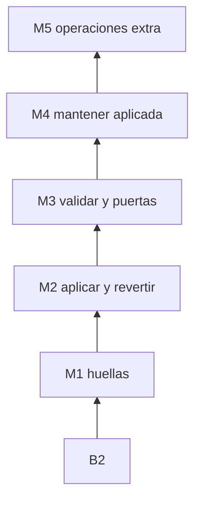

# Pila Motor

Entrega el módulo que **es** `origen + capas`: calcula huellas, aplica y revierte composiciones, valida capas y
evalúa puertas. Es una sola implementación, compartida por la extensión y el enjambre. Dueño: P2.
Necesita de Base: los esquemas y datos de prueba de B1, y el resultado de B2 sobre inyectar un guion en una página
con política de seguridad de contenido estricta. Usa la plantilla de [base.md](base.md).

---

## M1 · Calcula y resuelve huellas

Depende de: B2 · Desbloquea: M2, M3, E2 (observación del agente), S4 (mapa de la página) · Prioridad: imprescindible

**Objetivo.** Dado un elemento, el motor devuelve su huella; dada una huella, devuelve ese elemento o dice que no
resuelve. Además entrega la lista de elementos interactivos visibles de la página, cada uno con su huella. Evaluación
y Soul reutilizan esa lista: no hay una segunda implementación.

**Fuera de alcance.** Cambiar la página. Numerar elementos o componer la observación del agente (eso es de
Evaluación). Contenido dentro de marcos incrustados.

**Contrato que toca.** [§3 Huella](../contratos.md) y la regla de observación de §8; no los cambia.

**Validaciones**

- [ ] CUANDO se calcula la huella de cada interactivo visible de las páginas de prueba y luego se resuelve EL
      SISTEMA DEBE devolver el mismo elemento — prueba automática en un navegador real, salida pegada.
- [ ] CUANDO se compara el rol y el nombre calculados con los del árbol de accesibilidad del navegador, en un
      conjunto de casos (texto, etiqueta asociada, nombre por atributo, botón sin nombre) EL SISTEMA DEBE coincidir
      — prueba automática con la tabla de casos.
- [ ] SI dos elementos comparten rol y nombre y el selector de respaldo señala uno solo ENTONCES EL SISTEMA DEBE
      resolver ese; SI el respaldo falta o también es ambiguo ENTONCES EL SISTEMA DEBE responder que no resuelve,
      nunca el primero — prueba automática con dos botones "Continuar".
- [ ] SI la huella no tiene ningún candidato ENTONCES EL SISTEMA DEBE responder que no resuelve, sin lanzar un
      error que detenga la página — prueba automática.
- [ ] CUANDO se pide la lista de interactivos visibles EL SISTEMA DEBE excluir los ocultos, los de tamaño nulo y
      los tapados por otro elemento, e incluir los demás una sola vez — prueba automática con una página que tiene
      un diálogo encima.
- [ ] CUANDO se pide la lista dos veces sobre la misma página sin cambios EL SISTEMA DEBE devolver las mismas
      huellas en el mismo orden — prueba automática.
- [ ] SI un nombre accesible contiene comillas, marcado o texto con forma de instrucción ENTONCES EL SISTEMA DEBE
      tratarlo como texto: la huella se calcula y se resuelve sin ejecutar ni alterar nada — prueba automática.

**Decisiones abiertas.** Cómo se obtienen rol y nombre accesible. Cómo se construye el selector de respaldo y qué
se considera un identificador inestable. Qué roles cuentan como interactivos. Cómo se decide "tapado". Páginas de
prueba propias mientras la tienda de demostración no exista.

**Estado del arte.** Localizar por rol y nombre accesible, como recomiendan las bibliotecas de pruebas centradas en
el usuario, resiste mejor los cambios de marcado que los selectores; el nombre se calcula según la especificación
"Accessible Name and Description Computation" del W3C.

---

## M2 · Aplica y revierte una composición con las operaciones mínimas

Depende de: M1 · Desbloquea: M3, M4, E2 (el ejecutor de corridas la inyecta), X3 · Prioridad: imprescindible

**Objetivo.** Dada una composición y sus capas, el motor deja la página en su forma efectiva usando `css`,
`ocultar` y `reetiquetar`, informa qué operaciones quedaron aplicadas y cuáles rotas, y puede devolver la página
exactamente a su origen.

**Fuera de alcance.** Decidir si una capa es aceptable (M3). Reaccionar a cambios posteriores de la página (M4).
Las operaciones `resaltar`, `mover_antes` y `llevar_a` (M5).

**Contrato que toca.** [§2 Composición](../contratos.md), §3 (nombre original), §4 Capa y §6 (patrón de ruta); no
los cambia.

**Validaciones**

- [ ] CUANDO se aplica la composición de prueba de B1 sobre su página EL SISTEMA DEBE dejar cada cambio observable
      (estilo calculado, elemento no visible, nuevo nombre accesible) e informar cada operación como aplicada —
      prueba automática en navegador real y captura de antes y después.
- [ ] CUANDO se aplica dos veces seguidas la misma composición EL SISTEMA DEBE dejar la página y el informe iguales
      que tras la primera — prueba automática que compara el documento.
- [ ] CUANDO se revierte EL SISTEMA DEBE dejar el documento idéntico al origen, incluidos los estilos y atributos
      que el sitio ya tenía en los elementos tocados — prueba automática que compara el documento serializado.
- [ ] SI el objetivo de una operación no resuelve ENTONCES EL SISTEMA DEBE informarla como `rota` y no aplicarla a
      ningún otro elemento — prueba automática con una huella inexistente y otra ambigua.
- [ ] CUANDO una capa reetiqueta un elemento y otra operación posterior lo apunta por su nombre original EL SISTEMA
      DEBE resolverlo — prueba automática con el ejemplo "Continuar" → "Ir a pagar" de contratos §4.
- [ ] CUANDO la composición trae capas `optimizacion` y una capa `soul` que tocan la misma propiedad del mismo
      elemento EL SISTEMA DEBE aplicar primero las de optimización y después la de soul — prueba automática.
- [ ] CUANDO la ruta actual no coincide con el patrón de una capa EL SISTEMA DEBE dejarla sin aplicar y no
      informarla como rota — prueba automática con dos rutas.
- [ ] SI el valor de un `reetiquetar` contiene marcado ENTONCES EL SISTEMA DEBE mostrarlo como texto literal, sin
      crear elementos ni ejecutar nada — prueba automática.

**Decisiones abiertas.** Cómo se escribe cada cambio en la página y cómo se recuerda lo necesario para deshacerlo.
Si una capa con una operación rota se aplica en parte o se retira entera (se anota la elección y su motivo). Forma
exacta del informe, mientras contenga aplicadas y rotas por capa y operación.

**Estado del arte.** Parches idempotentes sobre el DOM, como la reconciliación de las bibliotecas de interfaz
declarativa: se describe el estado deseado y se aplica solo la diferencia, guardando el valor previo para deshacer.

---

## M3 · Valida capas, calcula protegidos y evalúa puertas

Depende de: M2 · Desbloquea: M4, S4 (valida la capa de soul), O3 (filtra candidatas) · Prioridad: imprescindible

**Objetivo.** Antes de aplicar, el motor dice si una capa cumple las reglas de su tipo y por qué no. Sobre la
página, calcula por código qué elementos son protegidos. Tras aplicar la composición completa, evalúa las puertas;
si una falla, la página queda como el origen. Cierra la decisión abierta sobre recursos externos y protegidos.

**Fuera de alcance.** Juzgar si una capa mejora algo (lo mide Evaluación). Detectar manipulación en el texto que
propone un modelo más allá de las reglas del contrato.

**Contrato que toca.** [§2](../contratos.md) (reglas 1 a 3), §4 (tabla de operaciones) y §5; no los cambia. Si la
lista permitida de `css` o el léxico de salida necesitan fijarse en el contrato, va antes un PR sobre la base.

**Validaciones**

- [ ] CUANDO se validan las capas válidas de B1 EL SISTEMA DEBE aceptarlas — prueba automática.
- [ ] CUANDO se presenta cada capa de la colección manipuladora EL SISTEMA DEBE rechazarla, o impedir que quede
      aplicada, con un motivo que nombre la regla. La colección incluye al menos: ocultar "No, gracias"; un `css`
      que vuelve invisible un enlace de salida; un `css` que lo deja sin poder recibir clic; reetiquetar un precio;
      una capa `soul` con una operación solo de optimización; un `css` que carga un recurso externo — prueba
      automática, una por caso, salida pegada.
- [ ] CUANDO se calculan los protegidos de las páginas de prueba EL SISTEMA DEBE devolver exactamente la lista
      esperada: opciones de un grupo de selección, botones hermanos de un diálogo, casilla de consentimiento,
      nombres del léxico de salida (también en mayúsculas y sin tildes), precios y texto legal — prueba automática
      contra una lista escrita a mano.
- [ ] SI dos capas pasan las puertas por separado pero juntas dejan un protegido por debajo del contraste exigido
      ENTONCES EL SISTEMA DEBE fallar la puerta de la composición — prueba automática.
- [ ] SI tras aplicar un protegido o de hito queda con menos área que en el origen, o con contraste menor que el
      menor entre 4,5:1 y el de origen ENTONCES EL SISTEMA DEBE fallar la puerta; con los valores justo en el límite
      DEBE pasar — prueba automática con casos a ambos lados del límite.
- [ ] CUANDO una puerta falla EL SISTEMA DEBE dejar el documento idéntico al origen e informar qué puerta falló y
      en qué elemento — prueba automática y captura.
- [ ] CUANDO una capa `soul` aplica `css` a un grupo (por ejemplo `botones`) EL SISTEMA DEBE dejar sin tocar a los
      protegidos de ese grupo — prueba automática con "No, gracias" entre los botones.
- [ ] SI una composición no respeta el orden origen → optimización → soul ENTONCES EL SISTEMA DEBE rechazarla
      entera — prueba automática.

**Decisiones abiertas.** Mecanismo que asegura que un `css` solo usa propiedades permitidas y no carga nada externo.
Qué reglas se comprueban antes de aplicar y cuáles solo como puerta sobre la página real. Cómo se miden visible,
clicable, contraste y área, y con qué tolerancia de redondeo. Contenido y normalización del léxico. De dónde salen
los elementos de hito que recibe la evaluación de puertas.

**Estado del arte.** El contraste usa la fórmula de luminancia relativa de WCAG 2.x. Las reglas vienen de la
investigación sobre diseño engañoso (el catálogo de Brignull; Mathur et al., "Dark Patterns at Scale", 2019), que
describe justo estos patrones: salida escondida, opciones asimétricas, coste disfrazado. Para el `css`, lista
permitida en vez de lista prohibida, como recomienda OWASP para sanear entradas.

---

## M4 · Mantiene la composición aplicada mientras la página vive

Depende de: M3 · Desbloquea: X3 (aplica con M2 y M4), M5 · Prioridad: imprescindible, en versión reducida

**Objetivo.** La composición se ve desde que la página aparece y sigue ahí aunque el sitio se vuelva a dibujar o
cambie de ruta sin recargar. Si una operación deja de encontrar su elemento, el motor lo detecta y lo informa. La
misma composición da el mismo resultado en la extensión y cuando la inyecta el automatizador de navegador. Cierra,
junto con X3, la decisión abierta "cuándo se aplica una composición".

**Fuera de alcance.** Guardar el estado de la composición (almacén). Mostrar el aviso a la persona (Extensión).
Marcos incrustados. Más casos que una página que se redibuja y otra con rutas en el cliente.

**Contrato que toca.** [§2](../contratos.md) (reglas 5 y 6) y §6 (firma, `rota`, `desactualizada`); no los cambia.

**Validaciones**

- [ ] CUANDO la página carga con una composición activa EL SISTEMA DEBE mostrarla sin que se vea antes el origen —
      grabación de la carga con red lenta: ningún cuadro muestra el objetivo en su estado de origen.
- [ ] CUANDO el sitio vuelve a dibujar la zona tocada EL SISTEMA DEBE dejar la composición aplicada de nuevo, sin
      efectos duplicados y con el mismo informe — prueba automática sobre una página que se redibuja.
- [ ] CUANDO la ruta cambia en el cliente, sin recarga EL SISTEMA DEBE retirar las capas cuyo patrón ya no coincide
      y aplicar las que ahora coinciden — prueba automática con dos rutas y capas distintas.
- [ ] SI tras un redibujado una operación ya no encuentra su elemento ENTONCES EL SISTEMA DEBE informarla como
      `rota` al anfitrión y no aplicarla a otro elemento — prueba automática.
- [ ] SI una operación `rota` o una puerta fallida se repite ENTONCES EL SISTEMA DEBE dejar de aplicar la
      composición e informar que debe pasar a `desactualizada` — prueba automática.
- [ ] SI la firma del origen difiere de la guardada y nada está roto ENTONCES EL SISTEMA DEBE avisar y seguir
      aplicando — prueba automática.
- [ ] SI el sitio deshace un cambio una y otra vez ENTONCES EL SISTEMA DEBE rendirse tras un número acotado de
      intentos, informarlo y dejar la página utilizable — prueba automática con una página hostil; se pega el
      tiempo de respuesta de la página.
- [ ] CUANDO la misma composición se aplica a la misma página desde una extensión y desde el automatizador,
      incluida una página con política de seguridad de contenido estricta EL SISTEMA DEBE producir el mismo informe
      y el mismo estado calculado en los elementos tocados — prueba automática que compara ambas salidas.

**Decisiones abiertas.** Momento de la primera aplicación y cómo se evita el parpadeo. Cómo se detectan redibujados
y cambios de ruta. Cuántas repeticiones vuelven `desactualizada` una composición y cuántos intentos se conceden a un
sitio que deshace los cambios. Cómo se calcula la firma del origen. Cómo recibe el anfitrión los informes.

**Estado del arte.** Las herramientas de experimentación en el cliente resuelven lo mismo: observan las mutaciones
del DOM para volver a aplicar sus cambios en aplicaciones de una sola página y evitan el parpadeo actuando antes
del primer pintado.

---

## M5 · Añade `resaltar`, `mover_antes` y `llevar_a`

Depende de: M4 · Desbloquea: candidatas más ricas en la pila Mejora · Prioridad: recortable

**Objetivo.** Las tres operaciones reservadas a las capas de optimización funcionan con las mismas garantías que
las de M2: idempotentes, reversibles, informadas, validadas y sujetas a puertas.

**Fuera de alcance.** Cualquier operación nueva fuera de contratos §4. Clics, envíos de formulario o relleno de
campos.

**Contrato que toca.** [§4 Capa](../contratos.md) (filas `resaltar`, `mover_antes`, `llevar_a`); no lo cambia.

**Validaciones**

- [ ] CUANDO se aplica y se revierte una capa con las tres operaciones EL SISTEMA DEBE dejar el documento idéntico
      al origen, con cada elemento en su posición original — prueba automática que compara el documento.
- [ ] CUANDO se aplica dos veces una capa con `mover_antes` EL SISTEMA DEBE dejar el elemento movido una sola vez —
      prueba automática.
- [ ] SI un `resaltar` apunta a una sola opción de un grupo protegido ENTONCES EL SISTEMA DEBE rechazar la capa;
      SI resalta todas por igual ENTONCES DEBE aceptarla — prueba automática con "Añadir seguro" y "Sin seguro".
- [ ] SI un `mover_antes` mueve un elemento protegido ENTONCES EL SISTEMA DEBE rechazar la capa — prueba automática.
- [ ] CUANDO se aplica `llevar_a` EL SISTEMA DEBE dejar el objetivo dentro de la vista y con el foco, sin emitir
      ningún clic, envío ni navegación — prueba automática que cuenta eventos en la página.
- [ ] SI una capa `soul` contiene cualquiera de las tres operaciones ENTONCES EL SISTEMA DEBE rechazarla — prueba
      automática.
- [ ] SI tras un `mover_antes` o un `resaltar` un protegido queda tapado o con menos área ENTONCES EL SISTEMA DEBE
      fallar la puerta y dejar el origen — prueba automática.

**Decisiones abiertas.** Aspecto del resaltado y si es fijo o configurable. Qué significa "asimétrico" en términos
medibles. Qué movimientos se permiten. Si un `llevar_a` se repite cuando el sitio se redibuja.

**Estado del arte.** WCAG da los criterios que estas operaciones no deben romper: foco visible (2.4.7) y orden de
foco (2.4.3). La asimetría visual entre opciones es un patrón engañoso documentado ("interferencia en la
interfaz" en la taxonomía de Gray et al., 2018).
