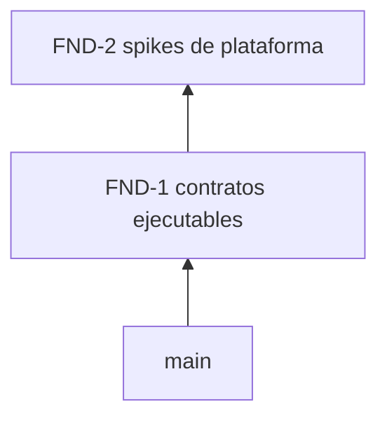

# Stack: Foundation

| | |
|---|---|
| **Status** | Draft |
| **Owner** | Por asignar (todo el equipo, primera hora y media) |
| **Updated** | 2026-11-21 |
| **Entrega** | Contratos ejecutables, fixtures y las incógnitas de plataforma resueltas |

Se fusiona a `main` antes de abrir cualquier otro stack.



## Plantilla de spec de PR

Todos los stacks usan esta forma. Un spec fija el objetivo y los requisitos; no prescribe la implementación.

```
## <ID> · <título en imperativo>
Depends on · Unblocks · Priority (P0 hito 1 | P1 hito 2 | P2 se recorta primero)
Objetivo            resultado observable, 1–2 frases
Fuera de alcance
Contracts           secciones de contracts.md que toca; no las cambia
Requisitos          <ID>.R<n> — WHEN/IF … THE SYSTEM MUST … — Verificación: cómo se comprueba
Decisiones abiertas lo que elige quien implementa
Referencias         práctica o investigación en que se apoya
```

---

## FND-1 · Vuelve ejecutables los contratos

Depends on: — · Unblocks: todos los stacks · Priority: P0

**Objetivo.** Cada forma de [contracts.md](../contracts.md) existe como esquema importable, con fixtures válidos e
inválidos, y el repositorio ejecuta las comprobaciones que todo PR debe pasar.

**Fuera de alcance.** Lógica de producto.

**Contracts.** Todos; no los cambia. Si al escribir un esquema aparece una ambigüedad, se corrige `contracts.md` en
este mismo PR.

**Requisitos**

- **FND-1.R1** — WHEN se valida cada fixture válido contra su esquema THE SYSTEM MUST aceptarlo. — Verificación:
  prueba automática; salida adjunta.
- **FND-1.R2** — IF un fixture es inválido (un patch con código, una task con un predicate vacío, un soul patch con
  `relabel`) THEN THE SYSTEM MUST rechazarlo con un mensaje que nombre el campo. — Verificación: prueba automática,
  un caso por regla.
- **FND-1.R3** — THE SYSTEM MUST incluir fixtures de: una task con un guardrail, 20 trajectories de control con
  abandonos, su navigation graph, un optimization patch, un soul patch, una variant, un experiment `accepted` y otro
  `rejected`. Todos usan el host `example.test`. — Verificación: listado de archivos y prueba R1.
- **FND-1.R4** — THE SYSTEM MUST incluir una página de prueba estática que cumpla la task de los fixtures, para
  quien necesite un DOM real antes de que exista un target. — Verificación: un recorrido guionizado llega al success
  criteria.
- **FND-1.R5** — WHEN se abre un PR THE SYSTEM MUST ejecutar tipos, estilo y pruebas, y bloquear la fusión si
  fallan. — Verificación: enlace a una ejecución fallida y a otra correcta.
- **FND-1.R6** — IF un bloque de código de `specs/` o un identificador del código usa un término retirado del
  glosario THEN las comprobaciones MUST fallar. — Verificación: PR de prueba con un término retirado.
- **FND-1.R7** — WHEN se crea y se sincroniza un stack de dos PRs de prueba THE SYSTEM MUST dejar ambos enlazados y
  con sus comprobaciones. — Verificación: enlaces a los PRs.
- **FND-1.R8** — THE SYSTEM MUST incluir un archivo de instrucciones para agentes de código que contenga solo los
  comandos de construir, probar y validar. — Verificación: revisión del archivo.

**Decisiones abiertas.** Librería de esquemas, gestor de paquetes, estructura de carpetas, herramienta de stacks si
el soporte nativo de la plataforma no está disponible, y si el código del prototipo se renombra a los términos del
glosario.

**Referencias.** Contratos en la base del stack (guías de stacked PRs); la verdad en esquemas y pruebas, no
en prosa (crítica al spec-driven development); instrucciones para agentes cortas y con comandos (AGENTS.md).

---

## FND-2 · Resuelve las incógnitas de plataforma

Depends on: FND-1 · Unblocks: decisiones abiertas de SOUL-1, SOUL-2, EVAL-3, ENG-4, EXT-2 · Priority: P0

**Objetivo.** Un registro en el repositorio con el resultado medido de cada incógnita que podría invalidar el plan,
y la decisión tomada con cada una.

**Fuera de alcance.** Código que se conserve. Son spikes.

**Contracts.** Ninguno.

**Requisitos.** Cada uno se cierra con el comando usado, su salida y la decisión.

- **FND-2.R1** — WHEN se invoca a la IA local del usuario sin herramientas y con salida estructurada THE SYSTEM MUST
  devolver un objeto que cumple el esquema, sin haber podido usar ninguna herramienta. — Verificación: salida
  adjunta; se registra qué configuración lo logra. Punto de partida: la invocación que ya usa el prototipo.
- **FND-2.R2** — WHEN esa llamada incluye una imagen THE SYSTEM MUST seguir devolviendo salida estructurada válida.
  — Verificación: salida adjunta.
- **FND-2.R3** — WHEN se lanzan 4 llamadas simultáneas de 10 steps THE SYSTEM MUST registrar segundos por step,
  tokens por step y errores por límite de uso, con la sesión personal y con clave de API. — Verificación: tabla.
- **FND-2.R4** — THE SYSTEM MUST fijar, con las cifras de R3, el proveedor y el modelo del harness y un presupuesto
  máximo de runs para todo el evento. — Verificación: decisión registrada.
- **FND-2.R5** — WHEN el proceso de fondo de la extensión llama al bridge THE SYSTEM MUST responder sin pedir
  permisos inesperados al usuario. — Verificación: captura en cada equipo del grupo.
- **FND-2.R6** — WHEN el automatizador de navegador inyecta un script antes de la carga en una página con política
  de seguridad de contenido estricta THE SYSTEM MUST poder leer el DOM y fijar un estilo. — Verificación: prueba
  sobre un fixture; se registra el navegador y las opciones necesarias.
- **FND-2.R7** — WHEN se aplica el mismo cambio de DOM en el navegador de la extensión y en el del harness THE
  SYSTEM MUST producir el mismo DOM resultante. — Verificación: comparación automática; decide si ambos pueden
  diferir.
- **FND-2.R8** — IF una página intenta una petición que no es de lectura hacia un tercero durante un run THEN THE
  SYSTEM MUST poder bloquearla. — Verificación: prueba con un fixture.

**Decisiones abiertas.** Ninguna: este PR existe para cerrarlas.

**Referencias.** Una meta comprobable antes de construir; decisiones registradas con contexto, opciones y resultado
(formato ADR).
