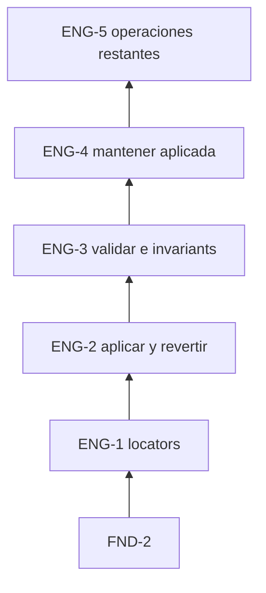

# Stack: Engine

| | |
|---|---|
| **Status** | Draft |
| **Owner** | Por asignar |
| **Updated** | 2026-11-21 |
| **Entrega** | El patch engine: calcula locators, aplica y revierte variants, valida patches y evalúa invariants |

Una sola implementación, compartida por la extensión y el harness (C6). Requiere de Foundation los esquemas, los
fixtures y la página de prueba de FND-1, y los resultados FND-2.R6 y FND-2.R7. Usa la plantilla de
[foundation.md](0-foundation.md). Las páginas de prueba adicionales que citan los requisitos son fixtures de este
stack: usan el host `example.test` y los nombres neutros de [contracts.md](../contracts.md).

---

## ENG-1 · Calcula y resuelve locators

Depends on: FND-2 · Unblocks: ENG-2, ENG-3, EVAL-2 (observation del agente), SOUL-4 (mapa de la página) · Priority: P0

**Objetivo.** Dado un elemento, el patch engine devuelve su locator; dado un locator, devuelve ese elemento o
indica que no resuelve. Entrega además la lista de elementos interactivos visibles de la página, cada uno con su
locator. Eval y Soul reutilizan esa lista: no existe una segunda implementación.

**Fuera de alcance.** Modificar la página. Numerar elementos o componer la observation (EVAL-2). Contenido dentro
de marcos incrustados.

**Contracts.** [§2 Locator](../contracts.md) y la regla de observation `som` de §7; no los cambia.

**Requisitos**

- **ENG-1.R1** — WHEN se calcula el locator de cada elemento interactivo visible de la página de prueba de FND-1 y
  luego se resuelve THE SYSTEM MUST devolver el mismo elemento en el 100 % de los casos. — Verificación: prueba
  automática en un navegador real; salida adjunta.
- **ENG-1.R2** — WHEN se comparan `role` y `name` calculados con los del árbol de accesibilidad del navegador en al
  menos 4 casos (texto visible, etiqueta asociada, nombre por atributo, botón sin nombre) THE SYSTEM MUST coincidir
  en todos. — Verificación: prueba automática con la tabla de casos.
- **ENG-1.R3** — IF dos elementos comparten `role` y `name` y `css` señala exactamente uno THEN THE SYSTEM MUST
  resolver ese; IF `css` falta o también es ambiguo THEN THE SYSTEM MUST responder que no resuelve y MUST NOT usar
  `nth` ni elegir el primero. — Verificación: prueba automática con dos botones "Acción ambigua".
- **ENG-1.R4** — IF `role` + `name` no tienen candidatos THEN THE SYSTEM MUST buscar por `css`; IF tampoco queda
  exactamente uno THEN THE SYSTEM MUST responder que no resuelve, sin lanzar un error que detenga la página. —
  Verificación: prueba automática con ambos casos.
- **ENG-1.R5** — WHEN se pide la lista de elementos interactivos visibles THE SYSTEM MUST excluir los ocultos, los
  de área 0 y los cubiertos por otro elemento, e incluir cada uno de los demás exactamente una vez. — Verificación:
  prueba automática con una página que tiene un diálogo superpuesto.
- **ENG-1.R6** — WHEN se pide la lista dos veces sobre la misma página sin cambios THE SYSTEM MUST devolver los
  mismos locators en el mismo orden. — Verificación: prueba automática.
- **ENG-1.R7** — IF un `name` contiene comillas, marcado o texto con forma de instrucción THEN THE SYSTEM MUST
  tratarlo como texto: el locator se calcula y se resuelve sin ejecutar ni alterar nada. — Verificación: prueba
  automática; el documento serializado no cambia.

**Decisiones abiertas.** Cómo se obtienen `role` y `name`. Cómo se construye `css` y qué se considera un
identificador inestable. Qué roles cuentan como interactivos. Criterio medible de "cubierto".

**Referencias.** Localización por rol y nombre accesible (bibliotecas de pruebas centradas en el usuario), más
estable ante cambios de marcado que los selectores; "Accessible Name and Description Computation" del W3C.

---

## ENG-2 · Aplica y revierte una variant con las operaciones mínimas

Depends on: ENG-1 · Unblocks: ENG-3, ENG-4, EVAL-2 (el harness la inyecta), EXT-3 · Priority: P0

**Objetivo.** Dados una variant, sus patches y un soul patch opcional, el patch engine deja la página en su forma
efectiva con `set_style`, `hide` y `relabel`, devuelve el apply report y puede restituir exactamente la source page.

**Fuera de alcance.** Decidir si un patch es aceptable (ENG-3). Reaccionar a cambios posteriores de la página
(ENG-4). Las operaciones `highlight`, `move_before` y `scroll_into_view` (ENG-5).

**Contracts.** [§1](../contracts.md) (C1, C5, C7), §2 (nombre original), §3 Patch y §5 Variant y apply report; no
los cambia.

**Requisitos**

- **ENG-2.R1** — WHEN se aplica la variant de los fixtures de FND-1 sobre la página de prueba de FND-1 THE SYSTEM
  MUST dejar observable cada cambio (estilo calculado, elemento no visible, nuevo nombre accesible) y listar cada
  operación en `applied`. — Verificación: prueba automática en navegador real; capturas de antes y después.
- **ENG-2.R2** — WHEN se aplica dos veces seguidas la misma variant THE SYSTEM MUST dejar el documento y el apply
  report iguales que tras la primera. — Verificación: prueba automática que compara el documento serializado.
- **ENG-2.R3** — WHEN se revierte THE SYSTEM MUST dejar el documento idéntico a la source page, incluidos los
  estilos y atributos que los elementos modificados ya tenían. — Verificación: comparación del documento serializado.
- **ENG-2.R4** — IF el `target` de una operación no resuelve THEN THE SYSTEM MUST listarla en `unresolved` y MUST
  NOT aplicarla a ningún otro elemento. — Verificación: prueba automática con un locator inexistente y otro ambiguo.
- **ENG-2.R5** — IF un optimization patch tiene una operación `unresolved` THEN THE SYSTEM MUST retirar el patch
  entero; IF la tiene un soul patch THEN THE SYSTEM MUST aplicar el resto de sus operaciones. — Verificación: prueba
  automática, un caso por `kind`.
- **ENG-2.R6** — WHEN un patch aplica `relabel` a un elemento y una operación posterior lo apunta por su nombre
  original THE SYSTEM MUST resolverlo. — Verificación: prueba automática con el ejemplo de §3 ("Acción ambigua" →
  "Acción clara").
- **ENG-2.R7** — WHEN una operación de `optimization` y una de `soul` fijan la misma propiedad del mismo elemento
  THE SYSTEM MUST aplicar el orden de C1, dejar el valor de soul y listar la operación en `overridden_by_soul`. —
  Verificación: prueba automática sobre el estilo calculado y el apply report.
- **ENG-2.R8** — WHEN la ruta actual no coincide con el `path_pattern` de un patch THE SYSTEM MUST dejarlo sin
  aplicar y MUST NOT listarlo en `unresolved`. — Verificación: prueba automática con dos rutas.
- **ENG-2.R9** — IF el `value` de un `relabel` contiene marcado THEN THE SYSTEM MUST mostrarlo como texto literal,
  sin crear elementos ni ejecutar nada. — Verificación: prueba automática; el número de elementos no cambia.

**Decisiones abiertas.** Cómo se escribe cada cambio en la página y cómo se conserva lo necesario para revertirlo.
Forma de cada entrada de `applied`, `unresolved` y `overridden_by_soul`, siempre que identifique patch y operación.

**Referencias.** Parches idempotentes sobre el DOM (reconciliación de las bibliotecas de interfaz declarativa): se
describe el estado deseado, se aplica solo la diferencia y se conserva el valor previo para revertir.

---

## ENG-3 · Valida patches, calcula protected elements y evalúa invariants

Depends on: ENG-2 · Unblocks: ENG-4, SOUL-4 (valida el soul patch), OPT-3 (filtra candidatos) · Priority: P0

**Objetivo.** Antes de aplicar, el patch engine indica si un patch cumple las reglas de su `kind` y, si no, qué
regla incumple. Sobre la página calcula por código los protected elements. Tras aplicar todo, evalúa los
invariants y retira lo que los incumple. Cierra la decisión abierta sobre recursos externos y protected elements.

**Fuera de alcance.** Juzgar si un patch mejora algo (lo mide Eval). Detectar manipulación en el texto que propone
un modelo más allá de las reglas del contrato.

**Contracts.** [§1](../contracts.md) (C1 a C3), §3 (tabla de operaciones), §4 y §5 (`invariants`); no los cambia.
Las listas que contracts.md deja abiertas (propiedades permitidas de `set_style`, opt-out lexicon, tolerancias)
quedan fijadas en el esquema por este PR, con pruebas.

**Requisitos**

- **ENG-3.R1** — WHEN se validan los patches válidos de los fixtures de FND-1 THE SYSTEM MUST aceptarlos todos. —
  Verificación: prueba automática; salida adjunta.
- **ENG-3.R2** — WHEN se presenta cada patch de la colección manipuladora THE SYSTEM MUST rechazarlo, o impedir que
  quede aplicado, con un motivo que nombre la regla. La colección incluye al menos 6 casos: `hide` sobre un elemento
  del opt-out lexicon; `set_style` que vuelve invisible un enlace de salida; `set_style` que le impide recibir clic;
  `relabel` de un precio; soul patch con una operación exclusiva de `optimization`; `set_style` que carga un recurso
  externo. — Verificación: prueba automática, una por caso; salida adjunta.
- **ENG-3.R3** — WHEN se calculan los protected elements de las páginas de prueba THE SYSTEM MUST devolver
  exactamente la lista esperada: opciones de un grupo de selección, botones hermanos de un diálogo, casilla de
  consentimiento, nombres del opt-out lexicon (también en mayúsculas y sin tildes), precios y texto legal. —
  Verificación: prueba automática contra una lista escrita a mano.
- **ENG-3.R4** — IF dos patches cumplen los invariants por separado pero juntos dejan un protected element por
  debajo del contraste exigido THEN THE SYSTEM MUST marcar `invariants.pass: false` para el resultado completo. —
  Verificación: prueba automática.
- **ENG-3.R5** — IF tras aplicar un protected o stage element queda con área menor que la original, o con contraste
  menor que el menor entre 4,5:1 y el de la source page THEN THE SYSTEM MUST fallar el invariant; con los valores
  exactamente en el límite MUST cumplirlo. — Verificación: prueba automática con casos a ambos lados del límite.
- **ENG-3.R6** — IF un invariant falla por la variant THEN THE SYSTEM MUST retirar la variant y dejar el documento
  idéntico a la source page; IF falla por el soul patch THEN THE SYSTEM MUST retirar solo el soul patch. En ambos
  casos MUST listar en `invariants.failures` el invariant y el elemento. — Verificación: prueba automática y captura.
- **ENG-3.R7** — WHEN un soul patch aplica `set_style` a un grupo (§3, por ejemplo `buttons`) THE SYSTEM MUST dejar
  sin modificar los protected elements de ese grupo. — Verificación: prueba automática con un botón del opt-out
  lexicon dentro del grupo.
- **ENG-3.R8** — IF una variant incluye un patch con `kind: "soul"` THEN THE SYSTEM MUST rechazarla entera. —
  Verificación: prueba automática.

**Decisiones abiertas.** Mecanismo que asegura que `set_style` usa solo propiedades permitidas y no carga recursos
externos. Qué reglas se comprueban antes de aplicar y cuáles solo como invariant sobre la página real. Cómo se
miden visible, clicable, contraste y área, y con qué tolerancia de redondeo. Contenido y normalización del opt-out
lexicon. Cómo recibe el patch engine los stage elements definidos en §4.

**Referencias.** Luminancia relativa y contraste de WCAG 2.x. Investigación sobre deceptive design (catálogo de
Brignull; Mathur et al., "Dark Patterns at Scale", 2019): salida oculta, opciones asimétricas, costo encubierto.
Lista permitida en lugar de lista prohibida para sanear entradas (OWASP).

---

## ENG-4 · Mantiene la variant aplicada durante la vida de la página

Depends on: ENG-3 · Unblocks: EXT-3 (aplica con ENG-2 y ENG-4), ENG-5 · Priority: P0 para el subconjunto R1, R2,
R4 y R8; P1 para R3, R5, R6 y R7

**Objetivo.** La variant es visible desde la primera carga y persiste aunque el sitio vuelva a renderizar o cambie
de ruta sin recargar. Si una operación deja de resolver, el patch engine lo detecta y lo informa. La misma variant
da el mismo resultado en la extensión y en el harness. Cierra, junto con EXT-3, la decisión abierta sobre el
momento de aplicación de una variant.

**Fuera de alcance.** Persistir `status` (local store, stack Extension). Mostrar el aviso al usuario (Extension).
Marcos incrustados. Más casos que una página que se vuelve a renderizar y otra con rutas en el cliente.

**Contracts.** [§1](../contracts.md) (C5, C6) y §5 (`source_hash`, `unresolved`, `stale`, apply report); no los
cambia.

**Requisitos**

- **ENG-4.R1** — WHEN la página carga con una variant activa THE SYSTEM MUST mostrarla sin destello de la source
  page (FOUC). — Verificación: grabación de la carga con el perfil de red limitada fijado en el repositorio; 0
  cuadros muestran un elemento modificado en su estado de source page.
- **ENG-4.R2** — WHEN el sitio vuelve a renderizar la zona modificada THE SYSTEM MUST dejar la variant aplicada de
  nuevo, sin efectos duplicados y con el mismo apply report. — Verificación: prueba automática sobre una página que
  se vuelve a renderizar.
- **ENG-4.R3** — WHEN la ruta cambia en el cliente, sin recarga THE SYSTEM MUST retirar los patches cuyo
  `path_pattern` ya no coincide y aplicar los que ahora coinciden. — Verificación: prueba automática con dos rutas
  y patches distintos.
- **ENG-4.R4** — IF tras un re-render una operación ya no resuelve THEN THE SYSTEM MUST entregar al anfitrión un
  apply report con esa operación en `unresolved` y MUST NOT aplicarla a otro elemento. — Verificación: prueba
  automática.
- **ENG-4.R5** — IF una operación `unresolved` o un invariant fallido se repite en el número de cargas sucesivas
  fijado en el repositorio antes de medir THEN THE SYSTEM MUST dejar de aplicar la variant e informar que pasa a
  `stale`. — Verificación: prueba automática a ambos lados del umbral.
- **ENG-4.R6** — IF `source_hash` difiere del guardado y no hay operaciones `unresolved` ni invariants fallidos
  THEN THE SYSTEM MUST informar `source_hash_matches: false` y seguir aplicando. — Verificación: prueba automática.
- **ENG-4.R7** — IF el sitio revierte un cambio de forma repetida THEN THE SYSTEM MUST desistir tras el número de
  intentos fijado en el repositorio antes de medir, informarlo y mantener la respuesta de la página a una
  interacción por debajo del umbral fijado en el repositorio antes de medir. — Verificación: prueba automática con
  una página que revierte cada cambio; tiempo de respuesta adjunto.
- **ENG-4.R8** — WHEN la misma variant se aplica a la misma página desde la extensión y desde el harness, incluida
  una página con política de seguridad de contenido estricta THE SYSTEM MUST producir el mismo apply report y el
  mismo estado calculado en los elementos modificados. — Verificación: prueba automática que compara ambas salidas.

**Decisiones abiertas.** Momento de la primera aplicación y cómo se evita el FOUC. Cómo se detectan re-renders y
cambios de ruta. Valores de los umbrales de R1, R5 y R7. Cómo se calcula `source_hash`. Cómo recibe el anfitrión
los apply reports. En qué navegador se verifica R8 (según FND-2.R7).

**Referencias.** Herramientas de experimentación en el cliente: observan las mutaciones del DOM para reaplicar sus
cambios en aplicaciones de una sola página y actúan antes del primer pintado para evitar el FOUC.

---

## ENG-5 · Añade `highlight`, `move_before` y `scroll_into_view`

Depends on: ENG-4 · Unblocks: candidatos más ricos en el stack Optimizer · Priority: P2

**Objetivo.** Las tres operaciones reservadas a los optimization patches funcionan con las mismas garantías que
las de ENG-2: idempotentes, reversibles, informadas en el apply report, validadas y sujetas a invariants.

**Fuera de alcance.** Cualquier operación ajena a la tabla de §3. Clics, envíos de formulario o relleno de campos.

**Contracts.** [§3 Patch](../contracts.md) (filas `highlight`, `move_before`, `scroll_into_view`) y §4; no los
cambia. El umbral de `highlight` asimétrico queda fijado en el esquema por este PR.

**Requisitos**

- **ENG-5.R1** — WHEN se aplica y se revierte un patch con las tres operaciones THE SYSTEM MUST dejar el documento
  idéntico a la source page, con cada elemento en su posición original. — Verificación: comparación del documento
  serializado.
- **ENG-5.R2** — WHEN se aplica dos veces un patch con `move_before` THE SYSTEM MUST dejar el elemento movido una
  sola vez. — Verificación: prueba automática.
- **ENG-5.R3** — IF un `highlight` apunta a una sola de varias opciones protegidas THEN THE SYSTEM MUST rechazar el
  patch; IF resalta todas por igual THEN THE SYSTEM MUST aceptarlo. — Verificación: prueba automática con las dos
  opciones que distingue el guardrail `decline-optional-extra` de §6.
- **ENG-5.R4** — IF un `move_before` mueve un protected element THEN THE SYSTEM MUST rechazar el patch. —
  Verificación: prueba automática.
- **ENG-5.R5** — WHEN se aplica `scroll_into_view` THE SYSTEM MUST dejar el `target` dentro de la vista y con el
  foco, y MUST NOT producir ningún clic, envío ni navegación. — Verificación: prueba automática que cuenta eventos
  en la página; 0 eventos de esos tres tipos.
- **ENG-5.R6** — IF un soul patch contiene cualquiera de las tres operaciones THEN THE SYSTEM MUST rechazarlo. —
  Verificación: prueba automática, un caso por operación.
- **ENG-5.R7** — IF tras un `move_before` o un `highlight` un protected element queda cubierto o con área menor que
  la original THEN THE SYSTEM MUST fallar el invariant y actuar según ENG-3.R6. — Verificación: prueba automática.

**Decisiones abiertas.** Aspecto del `highlight` y si es fijo o configurable. Definición medible de "asimétrico".
Qué movimientos se permiten. Si un `scroll_into_view` se repite tras un re-render.

**Referencias.** WCAG: foco visible (2.4.7) y orden de foco (2.4.3), criterios que estas operaciones no pueden
romper. La asimetría visual entre opciones es un patrón de deceptive design documentado ("interface interference",
Gray et al., 2018).
