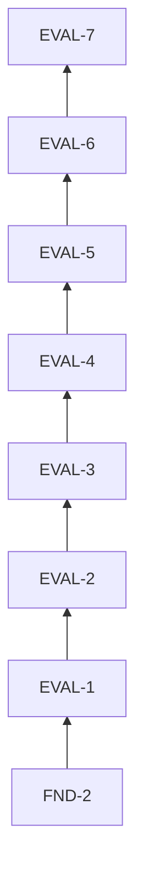

# Stack: Eval

| | |
|---|---|
| **Status** | Draft |
| **Owner** | Por asignar |
| **Updated** | 2026-11-21 |
| **Entrega** | Target, harness, trajectories, navigation graph y experiment, todo en el local store |

Necesita de Foundation los esquemas, los fixtures y la página de prueba de FND-1 y, de FND-2, el proveedor y el
modelo del harness, el costo por step, el presupuesto máximo de runs y el bloqueo de peticiones a terceros. Usa la
plantilla de [foundation.md](0-foundation.md). Contratos en [contracts.md](../contracts.md); este stack no los cambia.

---

## EVAL-1 · Define y entrega el target de evaluación

Depends on: FND-1 · Unblocks: EVAL-2, EVAL-3, y la página sobre la que trabajan ENG-1, ENG-2 y EXT-3 · Priority: P0

**Objetivo.** Quien toma este PR elige la página o el sitio sobre el que se evalúa (propio, réplica local o de un
tercero) y demuestra que es un target válido entregando un **target profile** y su task.

**Target profile.** Vive en el repositorio y contiene: URL, cómo se sirve y cómo se restablece el target; la task
con sus stages y predicates; el guardrail; `side_effects`; la base legal de uso; las fricciones conocidas o
hipótesis de mejora por stage; y el resultado de la calibración con N e intervalo.

**Fuera de alcance.** Lógica del agente. Targets con sesión iniciada, pagos o datos personales reales.

**Contracts.** §6 Task; §5 (`source_hash`). No los cambia.

**Requisitos**

- **EVAL-1.R1** — WHEN el mismo recorrido guionizado se ejecuta 3 veces, restableciendo el target antes de cada
  una, THE SYSTEM MUST producir la misma secuencia de stages y el mismo `source_hash`. — Verificación: prueba
  automática; salida adjunta.
- **EVAL-1.R2** — WHEN un recorrido guionizado intenta la task THE SYSTEM MUST llegar al success criteria pasando
  por todos los stages en orden. — Verificación: prueba automática; salida adjunta.
- **EVAL-1.R3** — WHEN se evalúa cada predicate (stages y success criteria) en todos los estados del recorrido THE
  SYSTEM MUST dar verdadero solo en su propio estado. — Verificación: prueba automática.
- **EVAL-1.R4** — WHEN se recorre el target THE SYSTEM MUST NOT enviar a terceros peticiones que no sean de
  lectura, y IF la task declara `side_effects: "real"` THEN el success criteria MUST cortarse antes del paso
  irreversible. — Verificación: registro de red del recorrido de R2 con cero peticiones de ese tipo.
- **EVAL-1.R5** — IF el target exige iniciar sesión, pagar o introducir datos personales reales THEN MUST NOT
  aceptarse como target. — Verificación: el recorrido de R2 termina sin credenciales ni datos reales.
- **EVAL-1.R6** — WHEN se intenta el guardrail declarado THE SYSTEM MUST permitir completarlo, y su success
  criteria MUST ser falso en el recorrido que no lo satisface. — Verificación: prueba con los dos recorridos.
- **EVAL-1.R7** — WHEN termina el batch de control de EVAL-3 THE SYSTEM MUST mostrar que el intervalo del éxito de
  la línea base queda dentro de un rango fijado en el repositorio antes de medir, que deja margen de mejora; IF
  queda fuera THEN se cambia el target o su configuración. — Verificación: salida de EVAL-3.R8 enlazada.
- **EVAL-1.R8** — IF el target es de un tercero THEN el target profile MUST citar la cláusula de sus términos o de
  su `robots.txt` que permite el uso automatizado; IF no existe THEN MUST usarse una réplica local. — Verificación:
  cita y enlace en el target profile.
- **EVAL-1.R9** — WHEN se valida la task entregada contra el esquema de FND-1 THE SYSTEM MUST aceptarla, con al
  menos 3 stages, un guardrail y `side_effects` declarado. — Verificación: salida de la validación adjunta.
- **EVAL-1.R10** — IF el target expone configuraciones conmutables (fricciones que se activan una a una) THEN cada
  una MUST cambiar solo lo que declara, y una fricción declarada como visual MUST conservar `role` y `name` del
  elemento afectado. — Verificación: prueba que compara la página con cada configuración. Es un medio opcional.

**Decisiones abiertas.** Qué target se elige y cómo se sirve y se restablece. Límites del rango de calibración.
Qué guardrail se declara. Si se usan configuraciones conmutables y cuál es la de control.

**Referencias.** Los benchmarks de agentes web usan entornos reproducibles y deciden el éxito por el estado final.
Con unos 40 runs por brazo solo se distinguen diferencias de unos 30 puntos: la línea base necesita margen.

---

## EVAL-2 · Un agente intenta la task y deja una trajectory válida

Depends on: EVAL-1, FND-2, ENG-1 (locators); ENG-2 para variants reales · Unblocks: EVAL-3, EVAL-6 · Priority: P0

**Objetivo.** Un run de un agente sobre el target de EVAL-1 termina con un `outcome` decidido por código y deja en
el local store una trajectory completa. El run recibe una variant y la aplica con el patch engine; hasta que ENG-2
entregue, solo se usa el control.

**Fuera de alcance.** Personas, réplicas, paralelismo y presupuesto (EVAL-3). Otra implementación de locators.

**Contracts.** §2 Locator, §5 Variant y apply report, §6 Task, §7 Trajectory, §11 Local store. No los cambia.

**Requisitos**

- **EVAL-2.R1** — WHEN un agente intenta la task sobre el control THE SYSTEM MUST guardar un `run_start`, un `step`
  por acción y un `run_end` que validan contra el esquema; cada `step` lleva el `locator` del elemento, el `stage`
  evaluado por código y un `screenshot` que existe en disco. — Verificación: comando y salida adjunta.
- **EVAL-2.R2** — WHEN se construye la observation `som` THE SYSTEM MUST entregar la captura y una lista numerada
  que incluya solo elementos visibles y no tapados. — Verificación: prueba sobre una página con un elemento fuera
  de pantalla y otro bajo una superposición; ninguno recibe número.
- **EVAL-2.R3** — IF el agente declara `done` sin que se cumpla el success criteria THEN THE SYSTEM MUST cerrar el
  run con un `outcome` distinto de `success`. — Verificación: prueba con un agente guionizado.
- **EVAL-2.R4** — IF la decisión recibida no es una acción de un tipo permitido o apunta a un número inexistente
  THEN THE SYSTEM MUST NOT actuar sobre la página, y MUST dejarlo registrado. — Verificación: prueba automática.
- **EVAL-2.R5** — WHEN se alcanza `max_steps` THE SYSTEM MUST cerrar con `step_limit`; IF falla el navegador o el
  proveedor THEN MUST cerrar con `error`. — Verificación: una prueba automática por caso.
- **EVAL-2.R6** — WHEN la página intenta una petición que no es de lectura hacia un tercero THE SYSTEM MUST
  bloquearla, y IF la task declara `side_effects: "real"` THEN MUST NOT ejecutar el paso irreversible. —
  Verificación: prueba con un servidor local que recibe cero peticiones y con una task de los fixtures.
- **EVAL-2.R7** — WHEN el run recibe una variant THE SYSTEM MUST aplicarla con el patch engine antes de la primera
  observation y anotar su `variant_id`; con el control, el apply report MUST dar `applied: []` y
  `source_hash_matches: true`. — Verificación: prueba con el control ahora, y con el optimization patch de los
  fixtures de FND-1 una vez disponible ENG-2.

**Decisiones abiertas.** Cómo se marcan los números sobre la captura. Cómo se pide y se valida la decisión del
modelo. Formato de las capturas. Cómo se avanza antes de ENG-1 sin crear una segunda implementación de locators.

**Referencias.** Set-of-Marks: la captura con los elementos interactivos numerados, de modo que el modelo ve la
página y actúa sobre algo comprobable. Éxito por comprobación de estado, como en los benchmarks de agentes web.

---

## EVAL-3 · Lanza un batch con personas y presupuesto

Depends on: EVAL-2, FND-2 · Unblocks: EVAL-4, EVAL-5, OPT-3 (batches), SOUL-6 y OPT-4 (soul persona) · Priority: P0

**Objetivo.** Con una orden el harness lanza un batch: varias personas y réplicas, en paralelo, sobre una variant
y una task o un guardrail. Respeta un presupuesto máximo, sobrevive a una caída y etiqueta el `failure_cause`.

**Fuera de alcance.** El navigation graph (EVAL-4), los experiments (EVAL-5) y generar la soul persona (SOUL-6).

**Contracts.** §7 Trajectory y persona, §10 (`tokens` aplicados por código), §11 Local store. No los cambia.

**Requisitos**

- **EVAL-3.R1** — IF se pide un batch sin presupuesto máximo THEN THE SYSTEM MUST negarse a empezar, sin abrir el
  navegador ni llamar al modelo. — Verificación: prueba automática.
- **EVAL-3.R2** — WHEN el batch alcanza su presupuesto THE SYSTEM MUST dejar de iniciar runs, conservar los
  terminados y dejar el batch marcado como pausado. — Verificación: prueba con un presupuesto pequeño.
- **EVAL-3.R3** — WHEN el proceso se interrumpe a mitad de un batch y se reanuda THE SYSTEM MUST completar lo que
  falta sin duplicar runs; los interrumpidos MUST NOT contar en las tasas. — Verificación: prueba que mata el
  proceso y cuenta runs por `persona_id` y `replicate`.
- **EVAL-3.R4** — IF una persona declara en `params` valores que el navegador puede fijar (tamaño de ventana,
  `max_steps`, `tokens`) THEN THE SYSTEM MUST aplicarlos por código. — Verificación: prueba que lee el valor
  dentro del navegador del agente.
- **EVAL-3.R5** — WHEN se lanza el mismo batch con dos personas de conducta opuesta THE SYSTEM MUST producir
  recorridos cuya diferencia en mediana de steps o en `final_stage` supere un umbral fijado en el repositorio antes
  de medir; IF no lo supera THEN se redefinen las personas. — Verificación: tabla por persona con N.
- **EVAL-3.R6** — WHEN un run termina en `abandoned` o `step_limit` THE SYSTEM MUST asignarle `failure_cause`
  `agent` o `ui`, y la etiqueta MUST coincidir con una revisión humana de 20 fallos en al menos el 80 %, umbral
  fijado en el repositorio antes de medir. — Verificación: tabla de acuerdos y desacuerdos adjunta.
- **EVAL-3.R7** — WHEN el mismo batch corre con observation `som` y con `a11y_only` sobre el target de EVAL-1 en su
  configuración de control THE SYSTEM MUST dejar dos conjuntos de trajectories comparables. — Verificación: tabla
  de éxito y `final_stage` por brazo, con N e intervalo; la consecuencia (si la captura cambia o no la conducta)
  se registra en el target profile.
- **EVAL-3.R8** — WHEN termina el batch de control sobre el target de EVAL-1 THE SYSTEM MUST informar la tasa de
  éxito con su N y su intervalo. — Verificación: salida adjunta; es la evidencia que cierra EVAL-1.R7.

**Decisiones abiertas.** Qué personas, con qué `split`, y cuántas réplicas. Grado de paralelismo. Unidad del
presupuesto (llamadas, dinero, tiempo). Cómo se guarda el estado del batch. Cómo se asigna el `failure_cause`.

**Referencias.** Las simulaciones con modelos de lenguaje tienden al colapso de personas: perfiles distintos
navegan igual. Por eso la diversidad se define por conducta y se aplica por código.

---

## EVAL-4 · Construye y muestra el navigation graph

Depends on: EVAL-3 (puede empezar con los fixtures de FND-1) · Unblocks: EVAL-5, EVAL-7, OPT-1 · Priority: P0

**Objetivo.** Las trajectories de un batch se convierten en un navigation graph que cumple el contrato, y una vista
local muestra abandonos, transiciones y ejemplos de fallo con su captura, con el control y una variant lado a lado.

**Fuera de alcance.** Intervalos y decisiones (EVAL-5). Proponer patches (OPT-1). Recorridos humanos (EVAL-7).

**Contracts.** §8 Navigation graph, §11 Local store. No los cambia.

**Requisitos**

- **EVAL-4.R1** — WHEN se calcula el navigation graph desde las trajectories de control de FND-1 THE SYSTEM MUST
  producir uno válido, con los conteos del fixture e idéntico al recalcularlo. — Verificación: prueba automática.
- **EVAL-4.R2** — IF un run terminó en `error` THEN THE SYSTEM MUST NOT contarlo en `visits`, `dropoffs` ni
  `n_runs`; un run en `step_limit` MUST contar como abandono en su `final_stage`. — Verificación: prueba con un
  batch que incluye ambos casos.
- **EVAL-4.R3** — WHEN un run vuelve a un stage anterior THE SYSTEM MUST registrar la transición de vuelta sin crear
  un nodo nuevo. — Verificación: prueba con una trajectory que tiene un ciclo.
- **EVAL-4.R4** — WHEN una variant cambia la etiqueta de un elemento con `relabel` THE SYSTEM MUST dar un
  navigation graph con los mismos stages que el del control. — Verificación: prueba automática.
- **EVAL-4.R5** — IF una línea de una trajectory no valida contra el esquema THEN THE SYSTEM MUST rechazarla y
  nombrar el archivo y la línea. — Verificación: prueba automática.
- **EVAL-4.R6** — WHEN se abre la vista local de un batch real THE SYSTEM MUST mostrar el embudo por stage con sus
  conteos, las transiciones y al menos un elemento de `failure_examples` con su captura y sus `thoughts`. —
  Verificación: captura de pantalla.
- **EVAL-4.R7** — WHEN existen navigation graphs del control y de una variant THE SYSTEM MUST mostrarlos lado a
  lado. — Verificación: captura de pantalla.

**Decisiones abiertas.** Cómo se eligen los `failure_examples`. Forma de la vista y cómo se abre. Cómo se dibujan
los ciclos. Si el navigation graph se recalcula entero o por incrementos.

**Referencias.** Directly-follows graphs de process mining. WebGraphEval muestra que los nodos de acción de grano
fino no se fusionan entre runs; por eso los nodos son stages y la acción vive en la transición.

---

## EVAL-5 · Corre un experiment de una variant contra el baseline

Depends on: EVAL-4; ENG-2 para patches reales · Unblocks: OPT-3, EXT-4 · Priority: P0 (R7: P1)

**Objetivo.** Dados los runs del baseline y de una variant, existe un experiment guardado con el intervalo de la
diferencia, el A/A test, un guardrail y una `decision` defendible según las reglas de contracts §9.

**Fuera de alcance.** Decidir qué variant queda activa (OPT-3). Mostrar la evidencia en la extensión (EXT-4).

**Contracts.** §1 C4 (`with_soul`), §9 Experiment, §11 Local store. No los cambia ni redefine sus umbrales.

**Requisitos**

- **EVAL-5.R1** — WHEN se calcula el experiment con los fixtures de FND-1 THE SYSTEM MUST reproducir el `accepted`
  y el `rejected`. — Verificación: prueba automática.
- **EVAL-5.R2** — WHEN se parte el baseline en dos mitades y se comparan THE SYSTEM MUST calcular el `diff_ci95` de
  `aa_test` y marcarlo `valid` solo si contiene 0; IF no es válido THEN la `decision` MUST NOT ser `accepted`. —
  Verificación: prueba automática y salida adjunta de un A/A test real.
- **EVAL-5.R3** — IF un guardrail queda `violated` (límite superior de su `diff_ci95` menor que 0) THEN THE SYSTEM
  MUST dar `rejected`, aunque `primary_metric` suba. — Verificación: prueba automática.
- **EVAL-5.R4** — IF el límite inferior del `diff_ci95` de `primary_metric` no es mayor que 0 THEN THE SYSTEM MUST
  NOT dar `accepted`. — Verificación: prueba con una diferencia pequeña y pocos runs, que da `inconclusive`.
- **EVAL-5.R5** — IF hay runs con `error` THEN THE SYSTEM MUST NOT contarlos en ninguna tasa ni en ningún N, y IF
  los runs no llevan soul patch THEN el experiment MUST llevar `with_soul: false` y `soul_patch_id: null`. —
  Verificación: una prueba automática por caso.
- **EVAL-5.R6** — WHEN se muestra un experiment a un usuario THE SYSTEM MUST acompañar cada cifra con su N y su
  intervalo, y presentarlo como evidencia sobre agentes. — Verificación: captura o salida adjunta.
- **EVAL-5.R7** — (P1) WHEN un experiment incluye `placebo` (un patch solo cosmético) THE SYSTEM MUST marcarlo
  `valid` solo si su `diff_ci95` contiene 0; IF no es válido THEN la `decision` MUST NOT ser `accepted`. —
  Verificación: el experiment real guardado en el local store.

**Decisiones abiertas.** Método del intervalo de la diferencia. Cuántos runs por brazo y si hay un cribado previo
más barato. Qué cambia el patch placebo.

**Referencias.** Intervalo de Wilson para una proporción, de Newcombe para la diferencia, y A/A test como medida
del ruido propio. Aviso de AgentA/B: 414 contra 403 sobre 500 no es señal.

---

## EVAL-6 · Reconoce un sitio y propone una task con la IA del usuario

Depends on: EVAL-2; FND-2 para invocar la IA local · Unblocks: tasks en otros sitios · Priority: P1

**Objetivo.** La IA local del usuario explora un sitio sin task previa y deja un borrador de task con stages,
guardrails y `side_effects`. Se ejecuta sobre un sitio distinto del target de EVAL-1 o sobre la página de prueba de
FND-1. Ningún batch corre sobre el borrador hasta que un usuario lo aprueba.

**Fuera de alcance.** Sitios con sesión iniciada o pagos. Lanzar batches. Proponer patches.

**Contracts.** §6 Task (`approved_at`), §12 Bridge (lo que llega de una página son datos). No los cambia.

**Requisitos**

- **EVAL-6.R1** — WHEN termina el reconocimiento THE SYSTEM MUST guardar un borrador que valida contra el esquema
  de task, con al menos un guardrail, con `side_effects` declarado y sin `approved_at`. — Verificación: archivo en
  el local store y salida de la validación.
- **EVAL-6.R2** — WHEN se evalúan los predicates del borrador sobre las páginas visitadas THE SYSTEM MUST dar
  verdadero para cada stage en alguna página, y falso para el success criteria en `start_url`. — Verificación:
  prueba automática.
- **EVAL-6.R3** — IF la task no tiene `approved_at` THEN THE SYSTEM MUST negarse a lanzar un batch. —
  Verificación: prueba automática.
- **EVAL-6.R4** — WHEN se explora el sitio THE SYSTEM MUST NOT enviar peticiones que no sean de lectura. —
  Verificación: prueba de red con un servidor local que cuenta peticiones.
- **EVAL-6.R5** — IF una página contiene texto que da órdenes a la IA THEN THE SYSTEM MUST tratarlo como datos y
  MUST NOT cambiar de sitio ni de tarea. — Verificación: prueba con una página de inyección de los fixtures.
- **EVAL-6.R6** — WHEN el usuario corrige el borrador y lo aprueba THE SYSTEM MUST guardar la versión corregida con
  `approved_at`. — Verificación: prueba automática.

**Decisiones abiertas.** Cómo se le da el navegador a la IA. Cómo se registra la aprobación. Cuánta exploración se
permite antes de proponer. Cómo se presenta el borrador para revisarlo.

**Referencias.** En los benchmarks de agentes web, las tasks y sus comprobadores los escriben humanos. Aquí la IA
redacta y el usuario aprueba: no sustituye el criterio humano.

---

## EVAL-7 · Registra recorridos humanos como navigation graph aparte

Depends on: EVAL-4, ENG-1 (locators) · Unblocks: comparar la dirección de humanos y agentes · Priority: P2

**Objetivo.** Un usuario intenta la task en el target de EVAL-1 y su recorrido queda como trajectory con
`actor: "human"`, con los mismos stages y locators que las de los agentes. Va en un navigation graph separado y
solo sirve para comparar la dirección.

**Fuera de alcance.** Sitios distintos del target de EVAL-1. Sumar humanos a tasas, experiments o decisiones.

**Contracts.** §7 Trajectory (`actor: "human"`), §8 Navigation graph, §10 (nada sale del equipo). No los cambia.

**Requisitos**

- **EVAL-7.R1** — WHEN un usuario completa o abandona la task THE SYSTEM MUST guardar una trajectory con
  `actor: "human"` que valida contra el esquema y no lleva capturas. — Verificación: archivo en el local store y
  salida de la validación.
- **EVAL-7.R2** — WHEN el usuario escribe en un campo THE SYSTEM MUST NOT guardar lo escrito. — Verificación:
  prueba que escribe una cadena conocida y la busca en todo el local store; cero coincidencias.
- **EVAL-7.R3** — WHEN un usuario y un agente accionan el mismo elemento en el mismo estado THE SYSTEM MUST
  registrar el mismo `locator` y el mismo `stage`. — Verificación: prueba automática con las dos trajectories.
- **EVAL-7.R4** — WHEN se añaden trajectories humanas al local store THE SYSTEM MUST dejar idénticos el navigation
  graph y el experiment de los agentes. — Verificación: prueba que compara antes y después.
- **EVAL-7.R5** — WHEN la vista muestra recorridos humanos THE SYSTEM MUST mostrarlos como un navigation graph
  distinguible sobre los mismos stages, con su N, e indicar únicamente si la dirección coincide con la de los
  agentes. — Verificación: captura de pantalla.
- **EVAL-7.R6** — IF el registro está desactivado THEN THE SYSTEM MUST NOT guardar nada del recorrido. —
  Verificación: prueba automática.

**Decisiones abiertas.** Cómo se registra el recorrido en el target. Cómo se pide el consentimiento. Qué cuenta
como "misma dirección".

**Referencias.** AgentA/B y UXAgent son herramientas para pilotar estudios, no sustitutos de los usuarios; el
primero solo coincide con los humanos en la dirección del efecto.
