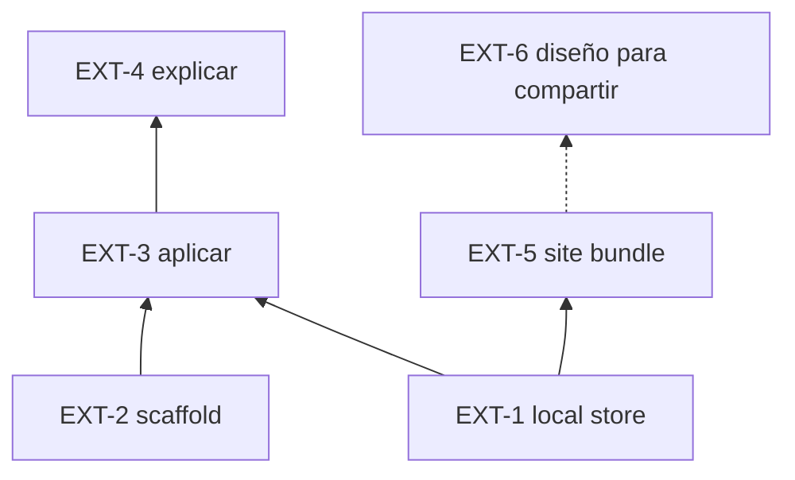

# Stack: Extension

| | |
|---|---|
| **Status** | Draft |
| **Owner** | Por asignar |
| **Updated** | 2026-11-21 |
| **Entrega** | El local store y la extensión que aplica variants y explica al usuario por qué la página se ve así |

Nace de `main` una vez fusionado Foundation. Usa de FND-1 los esquemas y fixtures, y de FND-2 el resultado del
spike entre el proceso de fondo de la extensión y el bridge. Plantilla de spec y Definition of Done:
[foundation.md](0-foundation.md) y el [spec raíz](../README.md). Términos en [glossary.md](../glossary.md).

---

## EXT-1 · Guarda y lee el local store

Depends on: FND-1 · Unblocks: EXT-3, EXT-5, EVAL-3 y EVAL-5 (trajectories y experiments), OPT-3 (promover una
variant), el soul patch del stack Soul · Priority: P0

**Objetivo.** Una sola biblioteca escribe bajo `sites/`. Todos los stacks guardan y leen por ella tasks, patches,
variants, trajectories, navigation graphs y experiments, y lo guardado sobrevive a caídas y a varios procesos a la
vez.

**Fuera de alcance.** El contenido de `soul/` (stack Soul). Exponer el local store a la extensión (EXT-3).
Consultas entre hosts y migraciones de esquema.

**Contracts.** §3, §5, §7, §8, §9 y §11 (incluida la forma de `active.json`); no los cambia.

**Requisitos**

- **EXT-1.R1** — WHEN se guarda dos veces un patch o una variant con el mismo contenido THE SYSTEM MUST devolver el
  mismo `id` y dejar un solo archivo. — Verificación: prueba automática; salida adjunta.
- **EXT-1.R2** — WHEN cambia una operación de un patch, o el orden de los patches de una variant, THE SYSTEM MUST
  producir un `id` distinto; WHEN solo cambia `title` o `hypothesis` MUST producir el mismo `id`; el control
  (`patches: []`) MUST derivar su `id` igual que cualquier variant. — Verificación: prueba automática, un caso por
  regla.
- **EXT-1.R3** — IF se intenta guardar un objeto cuyo `id` no corresponde a su contenido, o reemplazar un patch o
  una variant existente, THEN THE SYSTEM MUST rechazarlo y dejar el original intacto; el único cambio admitido es
  `status` de una variant. — Verificación: prueba automática.
- **EXT-1.R4** — IF una variant referencia un patch con `kind: "soul"`, o se intenta guardar un soul patch bajo
  `sites/`, THEN THE SYSTEM MUST rechazarlo sin escribir nada. — Verificación: prueba automática con el soul patch
  de los fixtures de FND-1.
- **EXT-1.R5** — WHEN varios procesos añaden trajectories a la vez sobre la misma task y la misma variant THE SYSTEM
  MUST conservar todos los runs completos, sin líneas mezcladas. — Verificación: prueba con procesos reales; conteo
  esperado y obtenido.
- **EXT-1.R6** — IF un proceso muere durante una escritura THEN THE SYSTEM MUST dejar el archivo anterior completo o
  el nuevo completo, y un run sin `run_end` MUST NOT leerse como completo. — Verificación: prueba que detiene el
  proceso durante la escritura.
- **EXT-1.R7** — IF se promueve a `active.json` una variant sin un experiment `accepted` y sin forzado THEN THE
  SYSTEM MUST rechazarlo; WHEN se fuerza MUST aceptarlo con `forced: true`; al promover MUST conservar
  `soul_patch_id` y `soul_enabled`. — Verificación: prueba automática con los dos experiments de los fixtures de
  FND-1.
- **EXT-1.R8** — IF se guarda un objeto que no cumple su esquema THEN THE SYSTEM MUST rechazarlo nombrando el campo,
  sin escribir nada. — Verificación: prueba automática.
- **EXT-1.R9** — IF otro código escribe bajo `sites/` sin pasar por la biblioteca THEN las comprobaciones globales
  MUST fallar. — Verificación: enlace a una ejecución fallida provocada a propósito.

**Decisiones abiertas.** Cómo se coordinan los procesos que escriben. Dónde vive `<root>`. Qué ocurre con un segundo
`title` o `hypothesis` para un `id` ya guardado. Cómo se identifica un experiment en disco. Retención y limpieza de
las capturas de las trajectories (cuánto se conservan, quién las borra y con qué límite de espacio): este PR la deja
escrita como decisión abierta con su dueño, no la resuelve.

**Referencias.** Datos inmutables identificados por su contenido, como en git: guardar es idempotente y dos copias
nunca entran en conflicto. Escritura atómica por reemplazo y registros de solo añadir, la práctica habitual para
sobrevivir a una caída sin base de datos.

---

## EXT-2 · Monta el scaffold de la extensión conectado al bridge

Depends on: FND-2, SOUL-1 (puede empezar contra un bridge simulado) · Unblocks: EXT-3, EXT-4, SOUL-4 (área de la
soul en el panel) · Priority: P0

**Objetivo.** Existe la única extensión del proyecto. El usuario la empareja con el bridge, la activa host por host
y ve en todo momento si hay conexión. Los demás stacks le añaden áreas; ninguno construye una segunda. Parte de la
extensión del [prototipo](../../prototipo/README.md), sin obligación de conservar su código.

**Fuera de alcance.** Aplicar patches (EXT-3). Contenido del panel (EXT-4, SOUL-4). Otros navegadores además del
que usa el prototipo. Publicación en catálogos de extensiones.

**Contracts.** §11 (la extensión no lee el disco) y §12; no los cambia.

**Requisitos**

- **EXT-2.R1** — WHEN el usuario activa un host THE SYSTEM MUST actuar solo en ese host y recordar la activación
  tras reiniciar el navegador. — Verificación: grabación de pantalla.
- **EXT-2.R2** — IF un host no está activado THEN THE SYSTEM MUST NOT leer ni modificar sus páginas ni enviar nada
  sobre ellas al bridge. — Verificación: prueba automática: el DOM es igual con y sin la extensión, y el bridge no
  recibe peticiones.
- **EXT-2.R3** — WHEN se empareja con el pairing token correcto THE SYSTEM MUST mostrar "conectado"; IF el pairing
  token es incorrecto THEN MUST mostrar "sin emparejar" y no recibir ningún dato. — Verificación: prueba automática
  contra el bridge simulado.
- **EXT-2.R4** — WHEN el bridge se detiene THE SYSTEM MUST mostrar "sin conexión" sin alterar ni bloquear la página,
  y volver a "conectado" al regresar. — Verificación: grabación de pantalla.
- **EXT-2.R5** — IF una petición al bridge no ha respondido a los 20 s THEN THE SYSTEM MUST cerrarla y mostrar el
  fallo; WHEN el navegador detiene el proceso de fondo de la extensión MUST conservar el emparejamiento y los hosts
  activados. — Verificación: prueba automática con un bridge simulado que no responde y con la detención forzada.
- **EXT-2.R6** — IF el código de una página, activada o no, intenta obtener el pairing token o comunicarse con el
  bridge a través de la extensión THEN THE SYSTEM MUST NOT permitirlo. — Verificación: prueba automática con una
  página hostil de prueba.
- **EXT-2.R7** — THE SYSTEM MUST declarar cada permiso de la extensión con su motivo, MUST NOT pedir acceso a todos
  los hosts por defecto y MUST NOT descargar ni ejecutar código remoto. — Verificación: lista adjunta y salida de la
  inspección del paquete.
- **EXT-2.R8** — WHEN otro stack añade un área al panel THE SYSTEM MUST admitirla sin cambios en el scaffold. —
  Verificación: un área de ejemplo y el diff que la añade.

**Decisiones abiertas.** Conjunto de permisos y cómo se concede el acceso por host. Dónde guarda la extensión su
estado. Cómo las pruebas automáticas resuelven el diálogo de permisos sin relajar lo que usa el usuario. Qué se
reutiliza del prototipo.

**Referencias.** Mínimo privilegio con permisos por host concedidos en el momento de uso, que es lo que recomienda
la plataforma de extensiones. La misma plataforma prohíbe el código alojado en remoto: todo lo que se ejecuta viaja
dentro del paquete.

---

## EXT-3 · Aplica la variant activa al navegar

Depends on: EXT-1, EXT-2, ENG-2 y ENG-4 (puede empezar contra un patch engine simulado que devuelva el mismo apply
report) · Unblocks: EXT-4, el punto de control del spec raíz (§9), OPT-3 visible en el navegador · Priority: P0

**Objetivo.** En un host activado, el usuario ve la página efectiva: la extensión obtiene del bridge lo que indica
`active.json`, guarda una copia y, en cada carga y cada cambio de ruta, aplica con el patch engine la variant y,
encima, el soul patch. Si la variant deja de corresponder al sitio, deja de aplicarse sin intervención.

**Fuera de alcance.** El patch engine y sus invariants (stack Engine). Generar patches o correr experiments. Marcos
incrustados de terceros. Elementos que la página pinta mucho después de cargar, más allá de lo que resuelva ENG-4.

**Contracts.** §1, §4, §5 y §11; no los cambia. El número de cargas fallidas que vuelve `stale` una variant está
abierto en el contrato: este PR lo fija con evidencia y lo deja en el esquema.

**Requisitos**

- **EXT-3.R1** — WHEN se carga una ruta de un host activado con una variant `current` THE SYSTEM MUST aplicar, con
  el patch engine, los patches cuyo `path_pattern` coincide y, si `soul_enabled` es verdadero y hay `soul_patch_id`,
  el soul patch encima (C1), y producir el apply report de §5 completo. — Verificación: prueba automática sobre el
  target de EVAL-1; si no está disponible, la página de prueba de FND-1 (se indica cuál).
- **EXT-3.R2** — WHEN el bridge está detenido THE SYSTEM MUST aplicar la última copia guardada. — Verificación:
  prueba automática.
- **EXT-3.R3** — WHEN la ruta cambia sin recargar la página THE SYSTEM MUST retirar los patches que ya no
  corresponden y aplicar los de la nueva ruta. — Verificación: prueba automática.
- **EXT-3.R4** — WHEN se carga la página con la red limitada THE SYSTEM MUST registrar el tiempo durante el que la
  source page es visible antes de aplicarse la variant (destello de la source page), y ese tiempo MUST NOT superar
  el presupuesto fijado en el repositorio antes de medir. — Verificación: cifra medida adjunta (mediana y máximo,
  con el número de cargas), frente al presupuesto y al commit que lo fijó, anterior a medir.
- **EXT-3.R5** — IF aplicar supera el tiempo máximo de espera que fije este PR THEN THE SYSTEM MUST mostrar la
  página igualmente, nunca en blanco. — Verificación: prueba automática del tiempo máximo.
- **EXT-3.R6** — IF un invariant falla por la variant THEN THE SYSTEM MUST NOT dejarla aplicada en esa carga; IF
  falla por el soul patch THEN MUST retirar solo el soul patch y mantener la variant. — Verificación: prueba
  automática, un caso por rama, modificando la página de prueba.
- **EXT-3.R7** — IF una operación de un optimization patch queda `unresolved` THEN THE SYSTEM MUST retirar ese patch
  entero en esa carga (C5); IF eso o un invariant fallido se repite el número de cargas fijado THEN MUST marcar la
  variant `stale` y no volver a aplicarla, tampoco tras recargar. — Verificación: prueba automática modificando la
  página de prueba.
- **EXT-3.R8** — IF `source_hash` difiere pero ninguna operación queda `unresolved` ni falla un invariant THEN THE
  SYSTEM MUST seguir aplicando y solo avisar (`source_hash_matches: false`). — Verificación: prueba automática.
- **EXT-3.R9** — WHEN el usuario pide ver la source page THE SYSTEM MUST restaurarla sin recargar, con un DOM
  equivalente al de la página sin extensión, y volver a aplicar al desactivarlo. — Verificación: prueba
  automática y grabación.
- **EXT-3.R10** — IF la copia guardada contiene un patch alterado que no pasa la validación del patch engine THEN
  THE SYSTEM MUST NOT aplicarlo. — Verificación: prueba automática que manipula la copia.

**Decisiones abiertas.** Cuándo se aplica y cómo se evita el destello de la source page (junto con ENG-4). Valor del
presupuesto de destello y del tiempo máximo de espera. Cuántas cargas fallidas vuelven `stale` una variant. Cuándo
se refresca la copia. Qué ruta del bridge entrega la variant activa y el soul patch, y quién la añade. Qué se aplica
si `soul_patch_id` apunta a un soul patch caducado.

**Referencias.** Local-first software: la copia del usuario es la principal y funciona sin conexión; el bridge solo
la pone al día. Las herramientas de experimentación en el cliente sufren el destello del contenido original; se
mitiga aplicando antes del primer pintado y con un tiempo máximo que nunca deja la página oculta.

---

## EXT-4 · Explica en el panel qué cambió y con qué evidencia

Depends on: EXT-3; EVAL-5 para experiments reales (antes, los fixtures de FND-1) · Unblocks: el paso 4 del foco
inicial y la prueba de soul contra optimization a la vista (OPT-4); SOUL-4 comparte el panel · Priority: P0 para
R1, R2, R3 y R7; P1 para R4, R5 y R6

**Objetivo.** El usuario abre el panel y entiende, en lenguaje llano, qué patches están aplicados, qué cambia cada
uno, por qué y con qué evidencia. Puede desactivar cada patch y el soul patch, e informar de un problema.

**Fuera de alcance.** Ver y editar la soul (SOUL-3, SOUL-4). Lanzar experiments desde el panel. Historial y
deshacer. EXT-5.

**Contracts.** §1 (C4 y C7), §5 (apply report), §9 (cifras con N e intervalo) y §10; no los cambia.

**Requisitos**

- **EXT-4.R1** — WHEN se abre el panel en un host con variant activa THE SYSTEM MUST listar los patches en orden de
  aplicación, cada uno con su `title`, lo que cambia y su `hypothesis`; con el bridge detenido MUST hacerlo desde
  la copia guardada e indicar su fecha. — Verificación: capturas de ambos casos sobre el target de EVAL-1; si no
  está disponible, la página de prueba de FND-1 (se indica cuál).
- **EXT-4.R2** — WHEN la variant tiene un experiment THE SYSTEM MUST mostrar el resultado de `primary_metric` y el
  de cada guardrail con su N y su intervalo, presentado como evidencia sobre agentes; IF no lo tiene (`forced`)
  THEN MUST indicar que está sin medir. — Verificación: captura de ambos casos y prueba de que ninguna cifra se
  muestra sin N e intervalo.
- **EXT-4.R3** — IF el experiment tiene `with_soul: false` THEN THE SYSTEM MUST indicar "medido sin tu soul"; el
  aviso solo desaparece con un experiment `with_soul: true` de la soul persona sobre esa variant. — Verificación:
  prueba automática con ambos datos.
- **EXT-4.R4** — WHEN el usuario desactiva un patch THE SYSTEM MUST reflejarlo en la página sin recargar e indicar
  que la combinación resultante no tiene experiment. — Verificación: grabación de pantalla.
- **EXT-4.R5** — WHEN el usuario desactiva la soul THE SYSTEM MUST dejar la source page más la variant, y restituir
  el soul patch al activarla; con la soul activa MUST listar las entradas de `overridden_by_soul` del apply report.
  — Verificación: grabación de pantalla y prueba automática con un apply report que las contiene.
- **EXT-4.R6** — WHEN el usuario informa de un problema THE SYSTEM MUST guardarlo en su equipo sin la URL completa,
  sin texto de la página y sin nada de lo que escribió en ella. — Verificación: registro guardado adjunto al PR.
- **EXT-4.R7** — IF el `title` o la `hypothesis` de un patch contienen marcado o scripts THEN THE SYSTEM MUST
  mostrarlos como texto y no interpretarlos. — Verificación: prueba automática con un patch manipulado.

**Decisiones abiertas.** Forma del panel (lateral, emergente u otra). Redacción de las explicaciones y cómo se
derivan del patch y del experiment. Dónde se guardan los problemas informados. Si los interruptores son por host o
por ruta, si persisten y cómo se representa una variant con un patch desactivado.

**Referencias.** La investigación en interfaces adaptativas encuentra que un cambio se acepta mejor si es
predecible, se explica y puede deshacerse. La regulación sobre deceptive design va en la misma dirección: un cambio
que influye en una decisión no puede ser opaco.

---

## EXT-5 · Exporta e importa un site bundle

Depends on: EXT-1, ENG-3 (validación de patches) · Unblocks: entregar una optimization a otro usuario en la
demostración; da el formato de partida a EXT-6 · Priority: P1 (el último P1 en recortarse)

**Objetivo.** Un usuario entrega a otro, en un solo archivo, lo aprendido sobre un host. Quien lo recibe lo vuelve a
validar entero en su equipo y lo ve como ajeno y no medido en ese equipo.

**Fuera de alcance.** Cualquier servidor o sincronización. Activar algo automáticamente al importar. Firmas o
identidad del autor.

**Contracts.** §3, §5, §9, §10 y §11; no los cambia. El formato del site bundle es interno a este stack; si otro
stack lo consume, pasa a Foundation.

**Requisitos**

- **EXT-5.R1** — WHEN se exporta un host THE SYSTEM MUST producir un único archivo con la task, los optimization
  patches, la variant y sus experiments, todos válidos contra sus esquemas. — Verificación: prueba automática.
- **EXT-5.R2** — IF el local store contiene soul, soul patches, trajectories humanas, capturas o experiments con
  `with_soul: true` THEN THE SYSTEM MUST NOT incluir ninguno en el archivo, ni nada de `soul/`. — Verificación:
  prueba automática que inspecciona el archivo generado desde un local store que sí los contiene.
- **EXT-5.R3** — WHEN se importa un site bundle THE SYSTEM MUST recalcular cada `id` y volver a validar cada patch
  con las reglas del patch engine antes de escribir. — Verificación: prueba automática.
- **EXT-5.R4** — IF un patch del site bundle fue alterado (`id` que no corresponde al contenido, `kind: "soul"`,
  operación no permitida, código, recurso externo) THEN THE SYSTEM MUST rechazar el site bundle entero sin escribir
  nada. — Verificación: prueba automática, un site bundle por caso.
- **EXT-5.R5** — WHEN termina una importación THE SYSTEM MUST marcar lo importado como ajeno y no medido en este
  equipo, y MUST NOT modificar `active.json`. — Verificación: prueba automática que compara `active.json` antes y
  después.
- **EXT-5.R6** — IF se intenta promover una variant importada con el único respaldo de su experiment ajeno THEN THE
  SYSTEM MUST exigir un experiment local `accepted` o el forzado con `forced: true`. — Verificación: prueba
  automática.
- **EXT-5.R7** — WHEN se exporta en un equipo y se importa en un local store vacío THE SYSTEM MUST obtener los
  mismos `id`, y repetir la importación MUST NOT cambiar nada. — Verificación: prueba automática de ida y vuelta.

**Decisiones abiertas.** Formato y extensión del archivo. Desde dónde se exporta e importa (línea de comandos, panel
o ambos). Cómo se registra la procedencia. Qué se hace con un experiment ajeno si ya existe uno local.

**Referencias.** Con datos identificados por su contenido, quien recibe verifica la integridad recalculando el
identificador, sin confiar en quien envía. Lo que llega de fuera se considera no fiable hasta validarlo en local,
igual que cualquier entrada externa.

---

## EXT-6 · Diseña cómo se compartirían optimizations entre usuarios

Depends on: — (EXT-5 aporta el formato de partida) · Unblocks: una decisión futura sobre compartir, hoy no-objetivo
· Priority: P2 (solo diseño, sin código)

**Objetivo.** Un registro de decisión corto en el repositorio que indique cómo se compartirían optimizations entre
usuarios sin romper la garantía de que la soul no sale del equipo, y qué riesgos quedan abiertos.

**Fuera de alcance.** Cualquier código, servidor, cuenta o prototipo. Elegir proveedor o producto.

**Contracts.** Ninguno. Si el diseño concluye que un contrato tendría que cambiar, lo propone; no lo cambia.

**Requisitos.** Se comprueban leyendo el documento; lo revisa al menos otro integrante del equipo.

- **EXT-6.R1** — THE DOCUMENT MUST tener contexto, opciones consideradas, decisión y consecuencias, y el PR MUST NOT
  contener código. — Verificación: diff.
- **EXT-6.R2** — THE DOCUMENT MUST clasificar cada entidad del contrato (task, optimization patch, soul patch,
  variant, trajectory de agente, trajectory humana, captura, navigation graph, experiment con y sin soul, soul,
  `active.json`) como compartible o como "nunca sale del equipo", con su motivo y sin contradecir §10 ni §11. —
  Verificación: tabla con una fila por entidad.
- **EXT-6.R3** — THE DOCUMENT MUST describir, paso a paso, cómo se vuelve a verificar en local un patch recibido de
  otro usuario antes de usarse, y qué estado tiene hasta entonces. — Verificación: lectura; los pasos coinciden con
  EXT-5.R3 a R6 o justifican la diferencia.
- **EXT-6.R4** — THE DOCUMENT MUST ordenar las optimizations por evidencia (N, intervalo, guardrails,
  reverificaciones independientes), no por votos, e indicar qué ocurre con un experiment que nadie logra
  reproducir. — Verificación: lectura.
- **EXT-6.R5** — THE DOCUMENT MUST indicar qué aprende un observador del servicio compartido sobre los hosts que usa
  un usuario al buscar y al publicar, y proponer al menos una mitigación con su costo. — Verificación: lectura.
- **EXT-6.R6** — THE DOCUMENT MUST incluir un modelo de amenazas de un patch compartido malicioso que cubra al
  menos: texto engañoso por `relabel`, ocultar información no protegida, experiments inventados y patches dirigidos
  a un sitio sensible; para cada amenaza MUST indicar qué control la frena (lista cerrada de operaciones, protected
  elements, invariants, reverificación) y MUST listar de forma explícita lo que esos controles **no** impiden. —
  Verificación: tabla con una fila por amenaza y la lista de límites.

**Decisiones abiertas.** Topología (servidor central, repositorio común, entre pares). Identidad y reputación de
quien publica. Si se devuelve información de uso a quien compartió.

**Referencias.** En el local-first software el servidor es un catálogo opcional, y los datos inmutables
direccionados por contenido se sincronizan sin conflictos. Decisiones registradas con contexto, opciones y
resultado (formato MADR), con un modelo de amenazas explícito antes de aceptar contenido de terceros.
