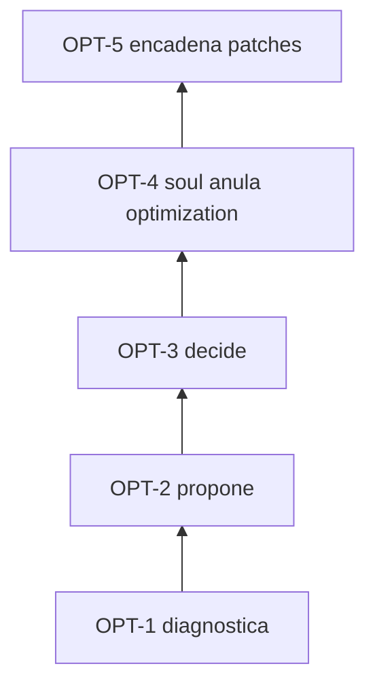

# Stack: Optimizer

| | |
|---|---|
| **Status** | Draft |
| **Owner** | Por asignar |
| **Updated** | 2026-11-21 |
| **Entrega** | Bucle de mejora (diagnosticar, proponer, decidir con evidencia) y la prueba del hito 2 |

Nace de `main` una vez que Engine, Eval y Soul entregan. Necesita el navigation graph real (EVAL-4), los batches y el
experiment (EVAL-5), la validación y los invariants (ENG-3) y el cliente de IA compartido (SOUL-2). Hasta entonces
trabaja contra los fixtures de FND-1. Usa la plantilla de [foundation.md](0-foundation.md) y no cambia
[contracts.md](../contracts.md).

---

## OPT-1 · Diagnostica en qué stage se pierde la task

Depends on: FND-1 (fixtures); EVAL-4 para el navigation graph real · Unblocks: OPT-2 · Priority: P0

**Objetivo.** A partir de un navigation graph se obtiene la lista de stages ordenada por fricción, con los abandonos
de causa `ui` separados de los de causa `agent`, y la evidencia que un usuario o un modelo necesita para proponer un
cambio: ejemplos de fallo y elementos presentes en ese stage.

**Fuera de alcance.** Proponer cambios. Lanzar runs. Dibujar el navigation graph.

**Contracts.** §7 Trajectory y §8 Navigation graph, solo lectura; no los cambia.

**Requisitos**

- **OPT-1.R1** — WHEN se diagnostica el navigation graph de los fixtures de FND-1 THE SYSTEM MUST devolver sus
  stages ordenados por fricción, y el primero MUST ser el stage con mayor `ui_dropoffs` de ese navigation graph. —
  Verificación: prueba automática; salida adjunta.
- **OPT-1.R2** — IF todos los `dropoffs` de un stage son de causa `agent` (`ui_dropoffs` igual a 0) THEN THE SYSTEM
  MUST NOT ordenarlo por delante de un stage con `ui_dropoffs` mayor que 0, y MUST mostrar las dos cifras por
  separado. — Verificación: prueba con un navigation graph sembrado.
- **OPT-1.R3** — WHEN se pide la evidencia del primer stage THE SYSTEM MUST entregar al menos una entrada de
  `failure_examples` con sus `thoughts` y su `screenshot`, y los elementos de `elements_by_stage` de ese stage, cada
  uno con un locator que cumple el esquema. — Verificación: prueba automática sobre los fixtures de FND-1.
- **OPT-1.R4** — IF `visits` de un stage es menor que el mínimo fijado en el repositorio THEN THE SYSTEM MUST marcar
  su evidencia como insuficiente y MUST NOT presentarlo como hallazgo; toda cifra MUST ir con su N. — Verificación:
  prueba con un navigation graph sembrado.
- **OPT-1.R5** — IF el navigation graph no tiene `dropoffs` THEN THE SYSTEM MUST informar que no hay stage que
  mejorar y MUST NOT devolver ninguno. — Verificación: prueba automática.
- **OPT-1.R6** — WHEN se diagnostica dos veces el mismo navigation graph THE SYSTEM MUST dar el mismo resultado. —
  Verificación: prueba automática que compara ambas salidas.
- **OPT-1.R7** — WHEN EVAL-4 entrega el navigation graph del batch de control de EVAL-3 sobre el target de EVAL-1
  THE SYSTEM MUST diagnosticarlo con el mismo comando. — Verificación: salida adjunta, con el stage señalado.

**Decisiones abiertas.** Qué es "fricción" y cómo se combina (abandono, steps, retrocesos). Valor del mínimo de
`visits`. Forma del resultado y cuánta evidencia cabe sin desbordar a quien la lee.

**Referencias.** En los bucles de optimización reflexiva con modelos (OPRO, GEPA) la señal que guía la siguiente
propuesta son las trajectories que fallaron, no solo la métrica. Los agentes dan fricciones candidatas, no
usabilidad humana: AgentA/B solo coincide con humanos en la dirección del efecto.

---

## OPT-2 · Propone candidate patches con hypothesis

Depends on: OPT-1, ENG-3, SOUL-2 · Unblocks: OPT-3 · Priority: P0

**Objetivo.** Del diagnóstico salen varios candidate patches (optimization patches aún sin experiment), cada uno con
una `hypothesis` comprobable ligada a un `target_stage`. Un patch escrito a mano en el mismo formato es un camino de
primera clase y es el respaldo si la IA falla.

**Fuera de alcance.** Medir o aceptar candidate patches. Soul patches. Reescribir la validación de ENG-3.

**Contracts.** §3 Patch (`author`, `hypothesis`, `target_stage`), §7 (split `holdout`) y §12 (lo que llega de una
página son datos); no los cambia.

**Requisitos**

- **OPT-2.R1** — WHEN el comando de revisión recibe el optimization patch de los fixtures de FND-1 THE SYSTEM MUST
  aceptarlo. — Verificación: salida adjunta.
- **OPT-2.R2** — IF un patch manual es inválido (contiene código, aplica `relabel` a un elemento cuyo nombre contiene
  moneda, o carece de `hypothesis`) THEN THE SYSTEM MUST rechazarlo nombrando el campo o la regla. — Verificación:
  salida adjunta, un caso por regla.
- **OPT-2.R3** — WHEN un usuario registra un patch manual válido THE SYSTEM MUST guardarlo como candidate patch con
  `author: "manual"` y con el mismo esquema que uno generado. — Verificación: prueba automática.
- **OPT-2.R4** — WHEN se piden propuestas para el diagnóstico del navigation graph de los fixtures THE SYSTEM MUST
  devolver más de un candidate patch, con `id` distintos, cada uno con `hypothesis` no vacía y un `target_stage` que
  existe en el diagnóstico. — Verificación: prueba con respuesta grabada y una ejecución real adjunta.
- **OPT-2.R5** — IF el modelo devuelve un candidate patch que no pasa la validación estática de ENG-3 (código,
  recurso externo, `hide` sobre un protected element, o un `target` ausente de `elements_by_stage`) THEN THE SYSTEM
  MUST descartarlo con su motivo y MUST NOT entregarlo. — Verificación: prueba con respuestas sembradas.
- **OPT-2.R6** — WHEN existe historial de pares (patch, experiment) THE SYSTEM MUST incluirlo en la entrada del
  generador y MUST NOT volver a entregar un patch cuyo experiment terminó `rejected`. — Verificación: prueba
  automática con historial sembrado.
- **OPT-2.R7** — IF el texto de la página incluye instrucciones dirigidas al modelo THEN THE SYSTEM MUST tratarlas
  como datos: los candidate patches siguen pasando la validación y su `target_stage` pertenece al diagnóstico. —
  Verificación: prueba con una página sembrada.
- **OPT-2.R8** — IF el diagnóstico de entrada procede de runs de personas del split `holdout` THEN THE SYSTEM MUST
  negarse a proponer. — Verificación: prueba automática con un batch sembrado.
- **OPT-2.R9** — IF la IA no responde o ningún candidate patch es válido THEN THE SYSTEM MUST informarlo, mantener
  operativo el registro manual y MUST NOT devolver ningún candidate patch generado. — Verificación: prueba
  automática.

**Decisiones abiertas.** Cuántos candidate patches y cómo se asegura que sean distintos. Qué evidencia y cuánto
historial recibe el modelo. Cómo se obtiene salida que cumpla el esquema. Qué hace "comprobable" a una `hypothesis`.
Nombre y forma del comando de revisión.

**Referencias.** OPRO y GEPA: el candidato es un cambio pequeño, y el historial de intentos con su resultado vuelve
al modelo como contexto para la siguiente ronda. Los productos de experimentación con IA (Coframe, Evolv) ya generan
variantes, pero las validan con tráfico real; por eso aquí la propuesta va separada de la decisión.

---

## OPT-3 · Decide con evidencia qué candidate patch se acepta

Depends on: OPT-2, ENG-3, EVAL-5, EXT-1 · Unblocks: OPT-4, OPT-5, EXT-4 · Priority: P0

**Objetivo.** Cada candidate patch recorre el mismo camino: validación estática → aplicación en seco sobre el target
(apply report sin `unresolved` y con `invariants.pass`) → screening de bajo costo → experiment completo del mejor →
decision según §9, con guardrails. Un usuario aprueba antes de que cambie `active.json`. Todo el bucle tiene un
presupuesto duro. Para el hito 1 basta una ronda.

**Fuera de alcance.** Varias rondas y variants con más de un patch (OPT-5). Experiments con soul (OPT-4). Afirmar
algo sobre usuarios humanos.

**Contracts.** §1, §4, §5 (apply report), §9 Experiment y §11 (`active.json`); no los cambia.

**Requisitos**

- **OPT-3.R1** — IF un candidate patch falla la validación estática, o su apply report en seco tiene `unresolved` no
  vacío o `invariants.pass` falso, THEN THE SYSTEM MUST NOT lanzar ningún run para él. — Verificación: prueba
  automática con contador de runs.
- **OPT-3.R2** — WHEN varios candidate patches superan el screening THE SYSTEM MUST llevar a experiment completo
  solo al mejor, y MUST NOT emitir una decision `accepted` a partir del screening. — Verificación: prueba automática
  sobre batches sembrados.
- **OPT-3.R3** — IF un candidate patch eleva la tasa de éxito de `primary_metric` pero deja un guardrail `violated`
  (retiene al usuario sin incumplir invariants) THEN THE SYSTEM MUST terminarlo `rejected`. — Verificación: archivo
  del experiment en el local store, adjunto.
- **OPT-3.R4** — IF un patch placebo (cambio cosmético sin relación con la task) recorre el camino THEN THE SYSTEM
  MUST NOT terminarlo `accepted`. — Verificación: archivo del experiment adjunto.
- **OPT-3.R5** — IF `aa_test.valid` es falso THEN THE SYSTEM MUST NOT dejar ningún candidate patch `accepted`. —
  Verificación: prueba automática con un A/A test sembrado; archivo del experiment adjunto.
- **OPT-3.R6** — IF el presupuesto restante no cubre el siguiente batch THEN THE SYSTEM MUST detenerse antes de
  lanzarlo, informar que el presupuesto se agotó y conservar lo ya medido; el gasto MUST NOT superar el tope. —
  Verificación: prueba automática con un tope pequeño.
- **OPT-3.R7** — WHEN un experiment termina `accepted` THE SYSTEM MUST NOT cambiar `variant_id` de `active.json`
  hasta que un usuario lo apruebe. — Verificación: prueba automática y captura.
- **OPT-3.R8** — IF un usuario activa una variant sin experiment `accepted` THEN THE SYSTEM MUST guardar
  `forced: true` en `active.json`. — Verificación: prueba automática.
- **OPT-3.R9** — WHEN se muestra la decision THE SYSTEM MUST dar cada cifra con su N y su intervalo y declarar que
  es evidencia obtenida con agentes. — Verificación: captura o salida adjunta.
- **OPT-3.R10** — WHEN se ejecuta una ronda completa sobre el target de EVAL-1 THE SYSTEM MUST guardar un experiment
  válido contra el esquema para el candidate patch generado o para el manual de respaldo. — Verificación: archivo en
  el local store, adjunto.

**Decisiones abiertas.** Tamaño del screening y del experiment. Unidad y tope del presupuesto (dentro del máximo de
FND-2.R4). Si los runs del screening se reutilizan en el experiment (si se hace, justificar por qué no premia el
azar). Dónde queda registrada la aprobación. Cómo se reanuda un bucle interrumpido.

**Referencias.** Evaluar muchos candidatos con poco gasto y medir a fondo solo el mejor es successive halving. El
A/B simulado con agentes (AgentA/B, SimAB) da señal direccional, no equivalencia con humanos. Los guardrails existen
porque los agentes ceden ante el diseño engañoso más que los humanos (DECEPTICON: 70 % contra 31 %; SusBench) y
porque una métrica convertida en meta deja de medir (ley de Goodhart).

---

## OPT-4 · Detecta cuándo la soul anula una optimization y responde

Depends on: OPT-3, SOUL-4, SOUL-6, EXT-4 · Unblocks: la demostración del hito 2 · Priority: P1 (este PR es el
hito 2 y prueba el objetivo G5 de la spec raíz)

**Objetivo.** Al aplicar un soul patch encima de una variant `accepted`, el sistema comprueba si la mejora se
mantiene para ese usuario. Si se pierde, lo informa en el panel ("Tu estilo anula esta mejora") y ofrece un patch
alternativo que la soul no puede anular, porque usa operaciones que la tabla de §3 no permite a un soul patch.

**Fuera de alcance.** Cambiar o corregir la soul sin que el usuario lo pida. Generar el soul patch. Resolver
conflictos entre dos optimization patches (OPT-5).

**Contracts.** §1 (C1, C3, C4, C7), §3 (operaciones por `kind`), §4, §5 (`overridden_by_soul`), §9 (`with_soul`,
`soul_patch_id`, `baseline_id`) y §10; no los cambia.

**Requisitos**

- **OPT-4.R1** — IF la variant `accepted` con el soul patch aplicado incumple un invariant por causa del soul patch
  THEN THE SYSTEM MUST retirar el soul patch, mantener la variant e informar qué elemento falló. — Verificación:
  prueba automática sobre los fixtures de FND-1.
- **OPT-4.R2** — WHEN el apply report trae `overridden_by_soul` no vacío THE SYSTEM MUST señalar cada caso con el
  elemento y las dos operaciones implicadas. — Verificación: prueba con un soul patch sembrado.
- **OPT-4.R3** — IF `overridden_by_soul` está vacío THEN THE SYSTEM MUST NOT avisar de ninguna anulación. —
  Verificación: prueba automática.
- **OPT-4.R4** — WHEN `overridden_by_soul` no está vacío THE SYSTEM MUST correr la soul persona sobre la variant con
  el soul patch y sobre la variant sola, y guardar un experiment con `baseline_id` igual a esa variant,
  `with_soul: true` y `soul_patch_id`. — Verificación: archivo del experiment en el local store.
- **OPT-4.R5** — IF la decision de ese experiment es `rejected` THEN THE SYSTEM MUST mostrar en el panel "Tu estilo
  anula esta mejora", con N e intervalo. — Verificación: captura.
- **OPT-4.R6** — WHEN muestra ese aviso THE SYSTEM MUST ofrecer un patch alternativo compuesto solo por operaciones
  no permitidas a `kind: "soul"` (por ejemplo `relabel`), que recorre el camino de OPT-3 con el soul patch aplicado;
  MUST NOT cambiar `active.json` sin aprobación del usuario. — Verificación: prueba automática y experiment adjunto.
- **OPT-4.R7** — IF no existe un experiment con `with_soul: true` para la variant activa y el soul patch vigente
  THEN THE SYSTEM MUST mostrar la cifra del experiment sin soul rotulada como obtenida sin el estilo del usuario. —
  Verificación: captura.

**Decisiones abiertas.** Si una decision `inconclusive` también activa el aviso. Cuántos runs de la soul persona
bastan. Si el patch alternativo se genera con OPT-2 o se deriva del patch anulado. Lugar del aviso en el panel.

**Referencias.** Una optimization es un promedio de la población; medirla con un agente que navega como el usuario
es A/B simulado (AgentA/B, SimAB) llevado a un solo perfil, y vale como señal direccional. Separar por `kind` las
operaciones permitidas sigue la práctica de resolver conflictos por diseño y no por arbitraje en tiempo de
ejecución.

---

## OPT-5 · Añade y revalida varios patches en una variant

Depends on: OPT-3 (va sobre OPT-4 en el stack) · Unblocks: — · Priority: P2

**Objetivo.** Un patch nuevo solo se añade a una variant `accepted` si aporta una mejora marginal medida. Si después
hay una regresión, el sistema vuelve a la última variant `accepted`. La decision usa personas del split `holdout`,
que no participaron en la propuesta del cambio.

**Fuera de alcance.** Compartir patches entre usuarios. Búsqueda sin tope de rondas. Fusionar patches en uno solo.

**Contracts.** §5 Variant (`status`), §7 (split), §9 (`baseline_id` distinto del control) y §11; no los cambia.

**Requisitos**

- **OPT-5.R1** — WHEN se propone un patch sobre una variant `accepted` THE SYSTEM MUST guardar dos experiments de la
  variant nueva: uno con `baseline_id` igual a la variant anterior y otro con `baseline_id` igual al control. —
  Verificación: archivos de experiment en el local store.
- **OPT-5.R2** — IF la decision del experiment contra la variant anterior no es `accepted` THEN THE SYSTEM MUST NOT
  proponer la variant nueva como activa y MUST guardar el motivo. — Verificación: prueba automática con un patch
  placebo como segundo patch.
- **OPT-5.R3** — IF en ese experiment un guardrail queda `violated` THEN THE SYSTEM MUST terminarlo `rejected`,
  aunque suba la tasa de éxito. — Verificación: prueba con un patch sembrado.
- **OPT-5.R4** — WHEN un nuevo experiment de la variant activa contra el control termina `rejected`, o su `status`
  pasa a `stale`, THE SYSTEM MUST restablecer en `active.json` la última variant `accepted` con `status: "current"`
  y dejar registro. — Verificación: prueba automática.
- **OPT-5.R5** — IF algún run usado para decidir pertenece a una persona cuyo split no es `holdout` THEN THE SYSTEM
  MUST NOT emitir la decision `accepted`. — Verificación: prueba automática.
- **OPT-5.R6** — IF un patch mejora con las personas del split `train` pero su experiment con el split `holdout` no
  es `accepted` THEN THE SYSTEM MUST NOT aceptarlo. — Verificación: prueba con batches sembrados.
- **OPT-5.R7** — WHEN se encadenan rondas THE SYSTEM MUST respetar el mismo presupuesto duro de OPT-3.R6. —
  Verificación: prueba con un tope pequeño.

**Decisiones abiertas.** Cada cuánto se repite el experiment de la variant activa. Cuántos patches admite una
variant. Criterio de parada entre rondas. Dónde se registra la variant anterior para poder restablecerla.

**Referencias.** Evaluar en un conjunto reservado evita sobreajustar el cambio a los agentes que lo inspiraron; GEPA
separa los ejemplos que guían la reflexión de los que deciden qué candidato sobrevive. La ley de Goodhart se agrava
con cada ronda: por eso cada patch nuevo vuelve a pasar guardrails e invariants sobre la variant completa.
